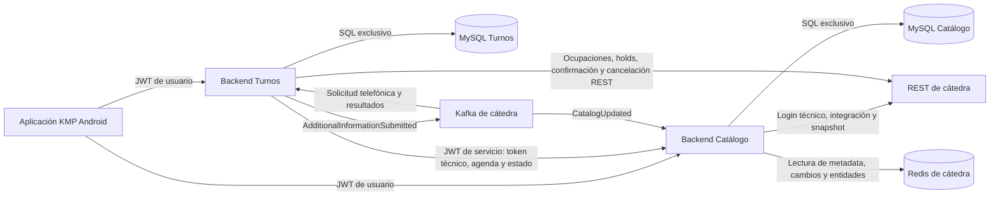
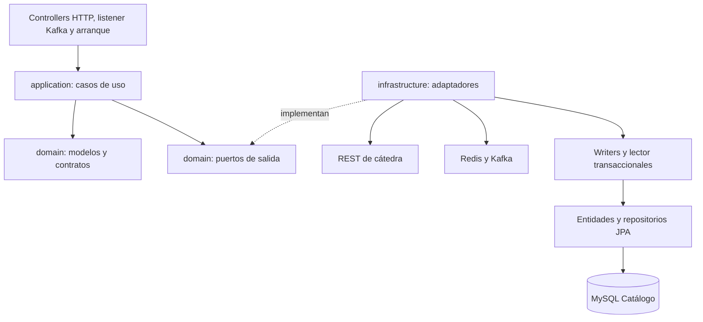
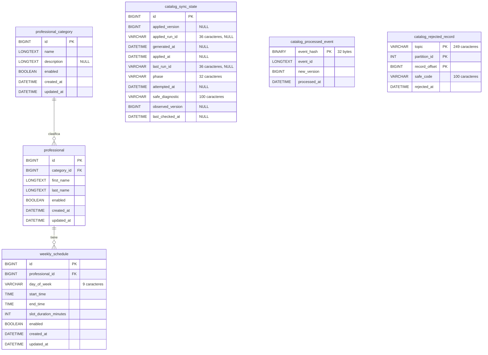

# Arquitectura y modelo de datos vigentes

Vista de la implementación actual. El enunciado (`PROJECT_STATEMENT-v1.md`, apartado
12) y el anexo oficial (`INTEGRATION_REFERENCE-v2.md`) son documentos externos de
cátedra, no archivos incluidos en este repositorio.

## Sistema y propiedad de datos

| Propietario | Datos y responsabilidades |
| --- | --- |
| Catálogo | Única réplica local de categorías, profesionales y agendas; versión, control de sincronización y recibos Kafka. Resuelve búsquedas locales y entrega agendas vigentes. |
| Turnos | Usuarios finales, autenticación, disponibilidad y progreso de reservas asociado al propietario. Consulta Catálogo; no mantiene otra réplica para nuevas reservas. Puede conservar descripciones históricas. |
| Cátedra | Catálogo original, historial incremental y autoridad de holds/reservas. Provee REST, Redis y Kafka externos. |
| KMP Android | Consumidor de ambos backends con JWT de usuario. Su implementación y despliegue se mantienen en un repositorio independiente. |

No hay acceso cruzado a tablas, usuarios SQL ni volúmenes. Cada Compose despliega
su backend y MySQL en una red privada propia. Solo los backends comparten la red
externa `prog2-services`; Turnos utiliza `http://catalog:8080`. Los puertos locales
predeterminados son 8080 para Catálogo y 8081 para Turnos. Cátedra no se despliega
en estos Compose. Preparación y secretos: [README](../README.md#configuración-local).

## Hexagonal de Catálogo

| Componentes bajo `com.prog2.catalog` | Responsabilidad |
| --- | --- |
| `integration` | Login técnico, evaluación del aprovisionamiento y sesión inmutable en memoria. Expone puertos para token, configuración e invalidación. No crea tablas. |
| `synchronization/application/usecases` | Snapshot, incremento, recuperación y consultas por puertos. `CatalogStatusPolicy` deriva el estado funcional. |
| `synchronization/infrastructure` | Clientes REST/Redis, listener Kafka, adaptación de los puertos públicos de integración, persistencia y API HTTP con DTO/mappers separados. |
| `infrastructure/config` y `infrastructure/security` | Configuración compartida, recursos y validación JWT. Component scanning resuelve colaboradores triviales; las fábricas conservadas construyen recursos o parámetros especiales. |
| `infrastructure/startup` | Runner técnico/snapshot y monitor periódico, sin bloquear los hilos HTTP. |

Dominio no depende de JPA, HTTP, Kafka o Spring; aplicación consume puertos.
`@Component` e inyección por constructor no cambian esa dirección de dependencias.
Los adaptadores invocan writers separados detrás del proxy `@Transactional`, de
modo que también traducen errores del commit. El lector usa `REPEATABLE_READ`
para entregar datos y metadata de una misma instantánea SQL. El guard compartido
coordina lectores y ciclos exclusivos; la red y las pausas no mantienen abierta
una transacción SQL.

## Modelo de datos

Fuente: [V2](../src/main/resources/db/migration/V2__catalog_snapshot.sql) y
[V3](../src/main/resources/db/migration/V3__catalog_updates.sql), sin modificaciones
históricas. Las seis tablas usan InnoDB. Los IDs de catálogo proceden de cátedra,
no se autogeneran. `DATETIME` tiene precisión 6; los instantes se manejan en UTC.
`TIME` representa la hora local de atención, sin convertirla en instante UTC.
En el diagrama solo las columnas marcadas `NULL` son anulables.

Las dos relaciones dibujadas son las únicas FK: `professional.category_id` y
`weekly_schedule.professional_id`. Las tablas de control no tienen FK al catálogo.
La PK de `catalog_rejected_record` es compuesta por topic, partición y offset;
`topic` utiliza `utf8mb4_bin`, sensible a mayúsculas.

`catalog_sync_state` se inicializa con la fila `id=1`. `applied_version=NULL`
significa que no existe copia confirmada, distinto de un catálogo vacío aplicado.
`applied_run_id` identifica la unidad confirmada; `last_run_id`, `attempted_at`,
`phase` y `safe_diagnostic` describen el intento. `generated_at` corresponde al
snapshot central y `applied_at` a la aplicación local. V3 añade `observed_version`
y `last_checked_at` para evaluar frescura. `BUSY` es un resultado transitorio de
exclusión, no una fase que se persista como último intento.

`catalog_processed_event` indexa SHA-256 de `eventId` y conserva el ID completo
para comprobar identidad exacta; no introduce un límite artificial al ID central.
`catalog_rejected_record` permite reconocer duraderamente mensajes incompatibles
sin presentarlos como actualizaciones aplicadas. No guarda su payload completo.

Flyway administra además su tabla técnica de historial, no incluida en este
modelo de negocio/control. `V1__setup_probe.sql` pertenece solo a tests. La sesión
técnica y sus secretos permanecen en memoria/configuración externa, no en estas tablas.

## Sincronización, idempotencia y recuperación

1. **Snapshot:** tras obtener acceso técnico se descarga y valida una copia en cada
   arranque. Categorías, profesionales, horarios y versión se reemplazan juntos;
   un rollback conserva la copia anterior. Ante commit incierto se relee el ID de
   aplicación antes de repetir. [Estrategia y límites](../README.md#carga-completa-del-catálogo),
   [PLAN histórico de snapshot](features/snapshot-catalogo/PLAN.md).
2. **Incremental:** Kafka notifica y Redis aporta un rango continuo de IDs y sus
   valores actuales. Se verifica la publicación antes/después y se aplica el lote
   hasta la versión objetivo en una sola transacción. No se acreditan versiones
   intermedias con valores actuales de una posterior. Datos, versión, runId y recibo
   de la notificación se confirman atómicamente.
3. **Duplicados y orden:** `eventId` tiene recibo durable; una notificación antigua
   puede reconocerse si ya está cubierta sin retroceder la copia. El offset solo
   se confirma después del reconocimiento durable. Un crash tras SQL y antes del
   ACK admite reentrega segura; los mensajes incompatibles se registran por su
   posición Kafka antes de avanzar.
4. **Notificaciones perdidas y discontinuidades:** con copia disponible, el monitor
   consulta Redis inmediatamente y, por defecto, cada 30 s desde el fin de la
   comprobación anterior. Una ventana insuficiente, cambio faltante, publicación
   inestable o referencias inválidas activan recuperación por snapshot. Los
   reintentos y esperas son acotados por ciclo; fallos permanentes requieren reinicio.

Detalles de incrementos/recovery y sus límites: [README](../README.md#incrementos-y-recuperación),
[PLAN histórico](features/sincronizacion-incremental/PLAN.md). Si el snapshot inicial
falla sin dejar copia, el monitor no inicia comprobaciones incrementales; se necesita
reiniciar para otro ciclo inicial. No se promete recuperación ilimitada ni actualidad
por el solo hecho de recibir un mensaje Kafka.

`CURRENT` es una evaluación temporal, no la fase de snapshot aplicada ni una promesa
indefinida. Requiere copia confirmada, versiones aplicada/observada iguales, acceso
técnico utilizable y verificación de esta ejecución de hasta 60 s inclusive, sin
sincronización o fallo invalidante. KMP puede consultar una copia anterior con aviso;
Turnos recibe 503 si no hay agenda vigente. Health `UP` no certifica esas condiciones.

Contratos y seguridad: [CONTRATOS](CONTRATOS.md). Ejecución y pruebas:
[README](../README.md#compilar-y-verificar). Los documentos de `features/` conservan
las decisiones y evidencias históricas; esta vista describe la composición vigente.
