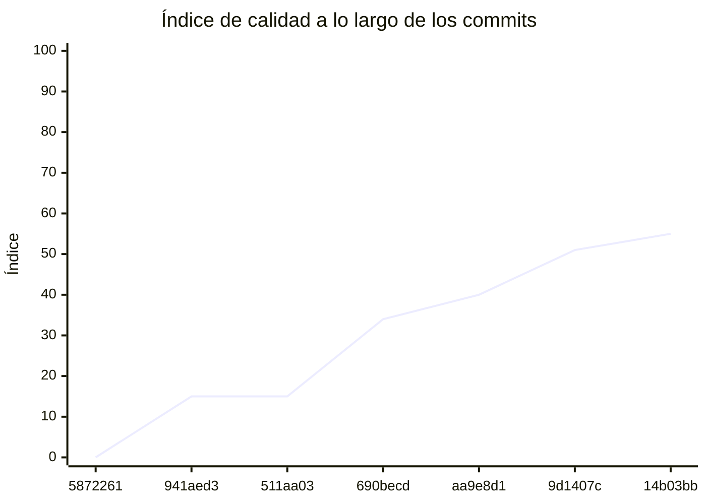

<!-- evaluacion:inicio -->
# Evaluación — prog2-perassiferrara/backend-catalogo

> Documento **generado automáticamente** por la cátedra de Programación II (UM): RepoSense + análisis de calidad de **7 dimensiones**. **No editar a mano**: se regenera en cada evaluación.
> Rama evaluada: `main`. Análisis **heurístico** (regex + métricas) + build: es una criba para orientar la revisión, **no una nota**. La **documentación** del repositorio no se evalúa.
> Generado: 2026-10-17.

## 1. Veredicto

| Aspecto | Resultado |
|---|---|
| Índice de calidad | **72/100** |
| Tipo de repositorio | `backend` |
| Build (`mvnw verify` / `gradlew check`) | OK |
| Código (LOC) | 2,427 |
| Archivos de código | 38 |
| Clases | 43 |
| Código dentro de clases (%POO) | 78% |
| Funciones fuera de clases | 0 |
| Duplicación | 3.2% |
| Cobertura | 96% |
| Tope duro aplicado a D1 | `POO_BAJO` → D1 ≤ 60 |

> Este informe **describe** lo que el análisis midió con los criterios ya establecidos de la materia. No es una nota.

## 2. Semáforo de aprobación

Criterios de la cátedra (`CRITERIOS-CALIDAD.md`): **Aprobar** se juega con el perfil `estandar`; **destacar**, con el `exigente` (meta de excelencia).

| Semáforo | Resultado |
|---|---|
| Aprobar (`estandar`) | **no cumple** — 7/11 |
| Destacar (`exigente`) | **no cumple** — 5/11 |

**Para aprobar, falta cumplir:** SOLID

**Para destacar, falta cumplir:** SOLID; POO; Duplicación

## 3. Autoría (RepoSense)

| Autor | Commits | Código (LOC) | Tests (LOC) | Docs (LOC) | Días activos | % del código |
|---|---:|---:|---:|---:|---:|---:|
| Valentino Perassi Ferrara | 12 | 1,291 | 1,414 | 3,135 | 9 | 100% |

> _El LOC de autoría lo calcula RepoSense sobre el historial y puede diferir del LOC de código del análisis (que mira el estado de `main`)._

## 4. Dimensiones evaluadas

Cada dimensión indica **qué mide**, **por qué importa** y **tu resultado**. Cuando el puntaje queda por debajo de la referencia, se agregan preguntas para **investigar la causa** (no hay recetas).

| Dimensión | Peso | Puntaje |
|:--|--:|--:|
| **D1** Diseño OO, SOLID y patrones (20%) | 20% | 6 |
| **D2** Arquitectura hexagonal — backend (15%) | 15% | 100 |
| **D3** Frontend KMP: MVVM y buenas prácticas (10%) | 10% | N/A |
| **D4** Integración y contrato (10%) | 10% | 40 |
| **D5** Seguridad y robustez (10%) | 10% | 100 |
| **D6** Pruebas y cobertura (20%) | 20% | 100 |
| **D7** Proceso y entrega (15%) | 15% | 100 |

### D1. Diseño OO, SOLID y patrones (20%)

- **Qué mide:** Métricas orientadas a objetos (clases, métodos, campos, cohesión, acoplamiento, herencia) y proxies de SOLID, más patrones de diseño.
- **Por qué importa:** El eje de la materia es el buen uso de la POO y su arquitectura: un diseño con clases claras y poco acopladas es más fácil de entender, probar y cambiar.
- **Tu resultado:** **6/100**
- **Para investigar la causa:**
    - ¿Se pensó el modelo de clases antes de codificar o se agrupó después?
    - ¿Qué clases concentran muchas responsabilidades a la vez?
    - ¿Los colaboradores llegan como parámetros o se crean por dentro?

### D2. Arquitectura hexagonal — backend (15%)

- **Qué mide:** Separación en capas (dominio, puertos de entrada/salida, adaptadores) y dirección de las dependencias del backend.
- **Por qué importa:** Aislar el dominio de la infraestructura permite cambiar la base de datos, el framework o el transporte sin tocar las reglas de negocio.
- **Tu resultado:** **100/100**

### D4. Integración y contrato (10%)

- **Qué mide:** Cumplimiento del contrato de integración de la cátedra (formato de errores, paginación, autenticación, endpoints esperados).
- **Por qué importa:** Los servicios deben poder integrarse entre sí y con la app sin sorpresas; el contrato es lo que hacen cumplir las pruebas de integración.
- **Tu resultado:** **40/100**
- **Para investigar la causa:**
    - ¿Qué endpoints difieren del contrato acordado?
    - ¿Los errores se devuelven con un formato uniforme?
    - ¿La autenticación es consistente entre servicios?

### D5. Seguridad y robustez (10%)

- **Qué mide:** Credenciales embebidas, consultas SQL por concatenación, y presencia de config de entorno; aislamiento de secretos.
- **Por qué importa:** Un secreto en el repositorio o una consulta construida por concatenación son riesgos concretos, no hipotéticos.
- **Tu resultado:** **100/100**

### D6. Pruebas y cobertura (20%)

- **Qué mide:** Cantidad y resultado de pruebas y cobertura de línea (JaCoCo/Kover, Surefire/Failsafe) cuando hay build.
- **Por qué importa:** Las pruebas son la red de seguridad para refactorizar e integrar; la cobertura acota las zonas sin verificar.
- **Tu resultado:** **100/100**

### D7. Proceso y entrega (15%)

- **Qué mide:** Artefactos verificables de proceso/entrega: `compose`, `.env.example`, CI (`.github/workflows/`), `CODEOWNERS` y wrapper de build (`mvnw`/`gradlew`). **No** puntúa documentación.
- **Por qué importa:** Un proyecto que compila, se levanta y se valida solo es más fácil de revisar y de integrar en equipo.
- **Tu resultado:** **100/100**

## 5. Señales detectadas

El análisis encontró las siguientes señales (archivo, sin número de línea a propósito):

**SRP/responsabilidad** (24)
- clase 'WebClientCentralIntegrationAdapter' grande (LOC=134, métodos=17, campos=4) — `src/main/java/com/prog2/catalog/integration/infrastructure/client/adapter/WebClientCentralIntegrationAdapter.java`
- clase 'WebClientCentralIntegrationAdapter' con baja cohesión (34%) — `src/main/java/com/prog2/catalog/integration/infrastructure/client/adapter/WebClientCentralIntegrationAdapter.java`
- método 'WebClientCentralIntegrationAdapter.IntegrationSession' de 50 líneas — `src/main/java/com/prog2/catalog/integration/infrastructure/client/adapter/WebClientCentralIntegrationAdapter.java`
- método 'WebClientCentralIntegrationAdapter.IntegrationSession' con complejidad 12 — `src/main/java/com/prog2/catalog/integration/infrastructure/client/adapter/WebClientCentralIntegrationAdapter.java`
- método 'WebClientCentralIntegrationAdapter.exchange' con complejidad 7 — `src/main/java/com/prog2/catalog/integration/infrastructure/client/adapter/WebClientCentralIntegrationAdapter.java`
- método 'WebClientCentralIntegrationAdapter.defaultIfEmpty' con complejidad 6 — `src/main/java/com/prog2/catalog/integration/infrastructure/client/adapter/WebClientCentralIntegrationAdapter.java`
- método 'WebClientCentralIntegrationAdapter.map' con complejidad 6 — `src/main/java/com/prog2/catalog/integration/infrastructure/client/adapter/WebClientCentralIntegrationAdapter.java`
- método 'IntegrationStartupRunner.runAttempts' con complejidad 7 — `src/main/java/com/prog2/catalog/integration/infrastructure/config/IntegrationStartupRunner.java`
- método 'IntegrationProperties.IntegrationProperties' de 55 líneas — `src/main/java/com/prog2/catalog/integration/infrastructure/config/IntegrationProperties.java`
- método 'IntegrationProperties.IntegrationProperties' con complejidad 7 — `src/main/java/com/prog2/catalog/integration/infrastructure/config/IntegrationProperties.java`
- método 'InitializeIntegrationUseCaseImpl.initialize' de 39 líneas — `src/main/java/com/prog2/catalog/integration/application/usecases/InitializeIntegrationUseCaseImpl.java`
- método 'InitializeIntegrationUseCaseImpl.initialize' con complejidad 9 — `src/main/java/com/prog2/catalog/integration/application/usecases/InitializeIntegrationUseCaseImpl.java`
- método 'JwtSecurityProperties.JwtSecurityProperties' de 58 líneas — `src/main/java/com/prog2/catalog/infrastructure/security/config/JwtSecurityProperties.java`
- método 'JwtSecurityProperties.JwtSecurityProperties' con complejidad 8 — `src/main/java/com/prog2/catalog/infrastructure/security/config/JwtSecurityProperties.java`
- clase 'CatalogApplicationTests' grande (LOC=217, métodos=23, campos=6) — `src/test/java/com/prog2/catalog/CatalogApplicationTests.java`
- clase 'CatalogApplicationTests' con baja cohesión (17%) — `src/test/java/com/prog2/catalog/CatalogApplicationTests.java`
- clase 'JwtTestTokens' con baja cohesión (4%) — `src/test/java/com/prog2/catalog/security/JwtTestTokens.java`
- clase 'SecurityHttpTests' grande (LOC=258, métodos=25, campos=5) — `src/test/java/com/prog2/catalog/security/SecurityHttpTests.java`
- clase 'SecurityHttpTests' con baja cohesión (28%) — `src/test/java/com/prog2/catalog/security/SecurityHttpTests.java`
- método 'SecurityHttpTests.returnsUnavailableWithoutRenewalForUnusableCentralSession' con complejidad 7 — `src/test/java/com/prog2/catalog/security/SecurityHttpTests.java`
- clase 'IntegrationBehaviorTests' grande (LOC=239, métodos=21, campos=5) — `src/test/java/com/prog2/catalog/integration/IntegrationBehaviorTests.java`
- clase 'TechnicalIntegrationTestServer' grande (LOC=104, métodos=18, campos=9) — `src/test/java/com/prog2/catalog/integration/TechnicalIntegrationTestServer.java`
- clase 'TechnicalIntegrationTestServer' con baja cohesión (8%) — `src/test/java/com/prog2/catalog/integration/TechnicalIntegrationTestServer.java`
- método 'TechnicalIntegrationTestServer.handle' con complejidad 7 — `src/test/java/com/prog2/catalog/integration/TechnicalIntegrationTestServer.java`

**DIP/concretos** (30)
- clase 'WebClientCentralIntegrationAdapter' muy acoplada (CBO=52) — `src/main/java/com/prog2/catalog/integration/infrastructure/client/adapter/WebClientCentralIntegrationAdapter.java`
- clase 'WebClientCentralIntegrationAdapter' instancia 9 concretos (CBO=52) — `src/main/java/com/prog2/catalog/integration/infrastructure/client/adapter/WebClientCentralIntegrationAdapter.java`
- clase 'IntegrationStartupRunner' muy acoplada (CBO=19) — `src/main/java/com/prog2/catalog/integration/infrastructure/config/IntegrationStartupRunner.java`
- clase 'IntegrationConfiguration' muy acoplada (CBO=14) — `src/main/java/com/prog2/catalog/integration/infrastructure/config/IntegrationConfiguration.java`
- clase 'IntegrationProperties' muy acoplada (CBO=15) — `src/main/java/com/prog2/catalog/integration/infrastructure/config/IntegrationProperties.java`
- clase 'IntegrationProperties' instancia 3 concretos (CBO=15) — `src/main/java/com/prog2/catalog/integration/infrastructure/config/IntegrationProperties.java`
- clase 'IntegrationTokenController' muy acoplada (CBO=19) — `src/main/java/com/prog2/catalog/integration/infrastructure/web/controller/IntegrationTokenController.java`
- clase 'InitializeIntegrationUseCaseImpl' muy acoplada (CBO=24) — `src/main/java/com/prog2/catalog/integration/application/usecases/InitializeIntegrationUseCaseImpl.java`
- clase 'InitializeIntegrationUseCaseImpl' instancia 7 concretos (CBO=24) — `src/main/java/com/prog2/catalog/integration/application/usecases/InitializeIntegrationUseCaseImpl.java`
- clase 'IntegrationSession' muy acoplada (CBO=11) — `src/main/java/com/prog2/catalog/integration/domain/model/IntegrationSession.java`
- clase 'JwtSecurityProperties' muy acoplada (CBO=19) — `src/main/java/com/prog2/catalog/infrastructure/security/config/JwtSecurityProperties.java`
- clase 'SecurityConfiguration' muy acoplada (CBO=50) — `src/main/java/com/prog2/catalog/infrastructure/security/config/SecurityConfiguration.java`
- clase 'SecurityConfiguration' instancia 11 concretos (CBO=50) — `src/main/java/com/prog2/catalog/infrastructure/security/config/SecurityConfiguration.java`
- clase 'JwtContractValidator' muy acoplada (CBO=14) — `src/main/java/com/prog2/catalog/infrastructure/security/jwt/JwtContractValidator.java`
- clase 'SecurityProblemHandler' muy acoplada (CBO=25) — `src/main/java/com/prog2/catalog/infrastructure/security/web/SecurityProblemHandler.java`
- clase 'DatabaseConfiguration' muy acoplada (CBO=9) — `src/main/java/com/prog2/catalog/infrastructure/config/DatabaseConfiguration.java`
- clase 'CatalogApplicationTests' muy acoplada (CBO=63) — `src/test/java/com/prog2/catalog/CatalogApplicationTests.java`
- clase 'CatalogApplicationTests' instancia 7 concretos (CBO=63) — `src/test/java/com/prog2/catalog/CatalogApplicationTests.java`
- clase 'JwtTestTokens' muy acoplada (CBO=28) — `src/test/java/com/prog2/catalog/security/JwtTestTokens.java`
- clase 'JwtTestTokens' instancia 6 concretos (CBO=28) — `src/test/java/com/prog2/catalog/security/JwtTestTokens.java`
- clase 'SecurityHttpTests' muy acoplada (CBO=70) — `src/test/java/com/prog2/catalog/security/SecurityHttpTests.java`
- clase 'SecurityHttpTests' instancia 13 concretos (CBO=70) — `src/test/java/com/prog2/catalog/security/SecurityHttpTests.java`
- clase 'JwtSecurityPropertiesTests' muy acoplada (CBO=15) — `src/test/java/com/prog2/catalog/security/JwtSecurityPropertiesTests.java`
- clase 'IntegrationBehaviorTests' muy acoplada (CBO=52) — `src/test/java/com/prog2/catalog/integration/IntegrationBehaviorTests.java`
- clase 'IntegrationBehaviorTests' instancia 13 concretos (CBO=52) — `src/test/java/com/prog2/catalog/integration/IntegrationBehaviorTests.java`
- clase 'IntegrationPropertiesTests' muy acoplada (CBO=11) — `src/test/java/com/prog2/catalog/integration/IntegrationPropertiesTests.java`
- clase 'TechnicalIntegrationTestServer' muy acoplada (CBO=28) — `src/test/java/com/prog2/catalog/integration/TechnicalIntegrationTestServer.java`
- clase 'TechnicalIntegrationTestServer' instancia 8 concretos (CBO=28) — `src/test/java/com/prog2/catalog/integration/TechnicalIntegrationTestServer.java`
- clase 'IntegrationStartupRunnerTests' muy acoplada (CBO=14) — `src/test/java/com/prog2/catalog/integration/IntegrationStartupRunnerTests.java`
- clase 'IntegrationStartupRunnerTests' instancia 3 concretos (CBO=14) — `src/test/java/com/prog2/catalog/integration/IntegrationStartupRunnerTests.java`

**OCP/type-switch** (2)
- clase 'SecurityConfiguration' con 2 type-checks — `src/main/java/com/prog2/catalog/infrastructure/security/config/SecurityConfiguration.java`
- clase 'JwtContractValidator' con 2 type-checks — `src/main/java/com/prog2/catalog/infrastructure/security/jwt/JwtContractValidator.java`

**duplicación** (1)
- duplicación de bloques: 3.2% del código

## 6. Evolución por commit

Métricas calculadas sobre el estado de `main` en **cada commit** (7 commits con trabajo), del primero al último. La calidad usa el perfil `exigente`; el aporte de código lo mide RepoSense. El índice puede **bajar** al crecer el proyecto: se acumulan señales.

| # | Fecha | Commit | Autor | LOC | Índice | %POO | Duplic. | Sueltas |
|---|---|---|---|---:|---:|---:|---:|---:|
| 1 | 2026-09-07 | `5872261` | Valentino Perassi Ferrara | 0 | 0 | 0% | 0.0% | 0 |
| 2 | 2026-09-10 | `941aed3` | Ing. Daniel Quinteros | 0 | 15 | 0% | 0.0% | 0 |
| 3 | 2026-10-06 | `511aa03` | Valentino Perassi Ferrara | 0 | 15 | 0% | 0.0% | 0 |
| 4 | 2026-10-06 | `690becd` | Valentino Perassi Ferrara | 172 | 34 | 73% | 4.8% | 0 |
| 5 | 2026-10-12 | `aa9e8d1` | Valentino Perassi Ferrara | 172 | 40 | 73% | 4.8% | 0 |
| 6 | 2026-10-12 | `9d1407c` | Valentino Perassi Ferrara | 1,492 | 51 | 80% | 2.4% | 0 |
| 7 | 2026-10-15 | `14b03bb` | Valentino Perassi Ferrara | 2,427 | 55 | 78% | 3.2% | 0 |

---
_Informe generado por la cátedra. Las dimensiones y umbrales corresponden a `calidad.py` (perfil `exigente`); el semáforo, a `CRITERIOS-CALIDAD.md`. La documentación del repositorio no se evalúa. Ante dudas, revisá el archivo señalado._
<!-- evaluacion:fin -->
