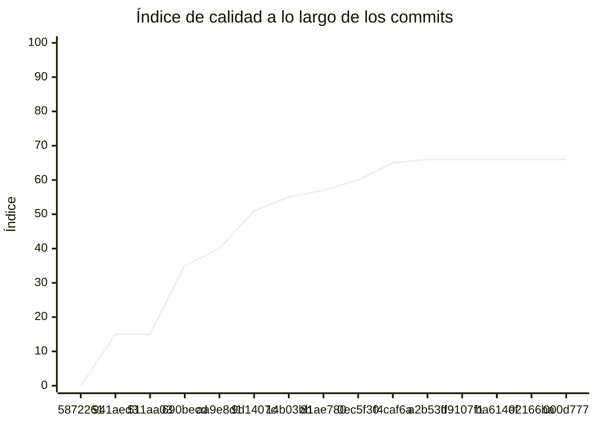

<!-- evaluacion:inicio -->
# Evaluación — prog2-perassiferrara/backend-catalogo

> Documento **generado automáticamente** por la cátedra de Programación II (UM): RepoSense + análisis de calidad de **7 dimensiones**. **No editar a mano**: se regenera en cada evaluación.
> Rama evaluada: `main`. Análisis **heurístico** (regex + métricas) + build: es una criba para orientar la revisión, **no una nota**. La **documentación** del repositorio no se evalúa.
> Generado: 2026-11-11.

## 1. Veredicto

| Aspecto | Resultado |
|---|---|
| Índice de calidad | **77/100** |
| Tipo de repositorio | `backend` |
| Build (`mvnw verify` / `gradlew check`) | OK |
| Código (LOC) | 10,329 |
| Archivos de código | 184 |
| Clases | 207 |
| Código dentro de clases (%POO) | 80% |
| Funciones fuera de clases | 0 |
| Duplicación (puerta) | 0.8% |
| Duplicación lógica | 0.9% |
| Duplicación de boilerplate | 6.9% |
| Cobertura | 96% |
| Tope duro aplicado a D1 | `POO_BAJO` → D1 ≤ 60 |

> Este informe **describe** lo que el análisis midió con los criterios ya establecidos de la materia. No es una nota.

## 2. Semáforo de aprobación

Criterios de la cátedra (`CRITERIOS-CALIDAD.md`): **Aprobar** se juega con el perfil `estandar`; **destacar**, con el `exigente` (meta de excelencia).

| Semáforo | Resultado |
|---|---|
| Aprobar (`estandar`) | **no cumple** — 7/11 |
| Destacar (`exigente`) | **no cumple** — 6/11 |

**Para aprobar, falta cumplir:** SOLID

**Para destacar, falta cumplir:** SOLID; POO

## 3. Autoría (RepoSense)

| Autor | Commits | Código (LOC) | Tests (LOC) | Docs (LOC) | Días activos | % del código |
|---|---:|---:|---:|---:|---:|---:|
| Valentino Perassi Ferrara | 35 | 5,255 | 6,191 | 7,645 | 20 | 100% |

> _El LOC de autoría lo calcula RepoSense sobre el historial y puede diferir del LOC de código del análisis (que mira el estado de `main`)._

## 4. Dimensiones evaluadas

Cada dimensión indica **qué mide**, **por qué importa** y **tu resultado**. Cuando el puntaje queda por debajo de la referencia, se agregan preguntas para **investigar la causa** (no hay recetas).

| Dimensión | Peso | Puntaje |
|:--|--:|--:|
| **D1** Diseño OO, SOLID y patrones (20%) | 20% | 1 |
| **D2** Arquitectura hexagonal — backend (15%) | 15% | 100 |
| **D3** Frontend KMP: MVVM y buenas prácticas (10%) | 10% | N/A |
| **D4** Integración y contrato (10%) | 10% | 90 |
| **D5** Seguridad y robustez (10%) | 10% | 100 |
| **D6** Pruebas y cobertura (20%) | 20% | 100 |
| **D7** Proceso y entrega (15%) | 15% | 100 |

### D1. Diseño OO, SOLID y patrones (20%)

- **Qué mide:** Métricas orientadas a objetos (clases, métodos, campos, cohesión, acoplamiento, herencia) y proxies de SOLID, más patrones de diseño.
- **Por qué importa:** El eje de la materia es el buen uso de la POO y su arquitectura: un diseño con clases claras y poco acopladas es más fácil de entender, probar y cambiar.
- **Tu resultado:** **1/100**
- **Para investigar la causa:**
    - ¿Se pensó el modelo de clases antes de codificar o se agrupó después?
    - ¿Qué clases concentran muchas responsabilidades a la vez?
    - ¿Los colaboradores llegan como parámetros o se crean por dentro?

### D2. Arquitectura hexagonal — backend (15%)

- **Qué mide:** Separación en capas (dominio, puertos de entrada/salida, adaptadores) y dirección de las dependencias del backend.
- **Por qué importa:** Aislar el dominio de la infraestructura permite cambiar la base de datos, el framework o el transporte sin tocar las reglas de negocio.
- **Tu resultado:** **100/100**

### D4. Integración y contrato (10%)

- **Qué mide:** Cumplimiento del contrato de integración de la cátedra (formato de errores, paginación, autenticación, endpoints esperados).
- **Por qué importa:** Los servicios deben poder integrarse entre sí y con la app sin sorpresas; el contrato es lo que hacen cumplir las pruebas de integración.
- **Tu resultado:** **90/100**

### D5. Seguridad y robustez (10%)

- **Qué mide:** Credenciales embebidas, consultas SQL por concatenación, y presencia de config de entorno; aislamiento de secretos.
- **Por qué importa:** Un secreto en el repositorio o una consulta construida por concatenación son riesgos concretos, no hipotéticos.
- **Tu resultado:** **100/100**

### D6. Pruebas y cobertura (20%)

- **Qué mide:** Cantidad y resultado de pruebas y cobertura de línea (JaCoCo/Kover, Surefire/Failsafe) cuando hay build.
- **Por qué importa:** Las pruebas son la red de seguridad para refactorizar e integrar; la cobertura acota las zonas sin verificar.
- **Tu resultado:** **100/100**

### D7. Proceso y entrega (15%)

- **Qué mide:** Artefactos verificables de proceso/entrega: `compose`, `.env.example`, CI (`.github/workflows/`), `CODEOWNERS` y wrapper de build (`mvnw`/`gradlew`). **No** puntúa documentación.
- **Por qué importa:** Un proyecto que compila, se levanta y se valida solo es más fácil de revisar y de integrar en equipo.
- **Tu resultado:** **100/100**

## 5. Señales detectadas

El análisis encontró las siguientes señales (archivo, sin número de línea a propósito):

**SRP/responsabilidad** (139)
- clase 'RedisCatalogChangesAdapter' grande (LOC=155, métodos=17, campos=8) — `src/main/java/com/prog2/catalog/synchronization/infrastructure/redis/adapter/RedisCatalogChangesAdapter.java`
- clase 'RedisCatalogChangesAdapter' con baja cohesión (1%) — `src/main/java/com/prog2/catalog/synchronization/infrastructure/redis/adapter/RedisCatalogChangesAdapter.java`
- método 'RedisCatalogChangesAdapter.readSince' con complejidad 6 — `src/main/java/com/prog2/catalog/synchronization/infrastructure/redis/adapter/RedisCatalogChangesAdapter.java`
- método 'RedisCatalogChangesAdapter.read' de 47 líneas — `src/main/java/com/prog2/catalog/synchronization/infrastructure/redis/adapter/RedisCatalogChangesAdapter.java`
- método 'RedisCatalogChangesAdapter.read' con complejidad 10 — `src/main/java/com/prog2/catalog/synchronization/infrastructure/redis/adapter/RedisCatalogChangesAdapter.java`
- clase 'TransactionalCatalogUpdateWriter' grande (LOC=115, métodos=17, campos=8) — `src/main/java/com/prog2/catalog/synchronization/infrastructure/persistence/service/TransactionalCatalogUpdateWriter.java`
- clase 'TransactionalCatalogUpdateWriter' con baja cohesión (15%) — `src/main/java/com/prog2/catalog/synchronization/infrastructure/persistence/service/TransactionalCatalogUpdateWriter.java`
- método 'TransactionalCatalogUpdateWriter.apply' con complejidad 8 — `src/main/java/com/prog2/catalog/synchronization/infrastructure/persistence/service/TransactionalCatalogUpdateWriter.java`
- clase 'TransactionalCatalogSnapshotWriter' con baja cohesión (33%) — `src/main/java/com/prog2/catalog/synchronization/infrastructure/persistence/service/TransactionalCatalogSnapshotWriter.java`
- clase 'CatalogSnapshotPersistenceMapper' grande (LOC=38, métodos=14, campos=0) — `src/main/java/com/prog2/catalog/synchronization/infrastructure/persistence/mapper/CatalogSnapshotPersistenceMapper.java`
- clase 'JpaCatalogUpdateAdapter' grande (LOC=27, métodos=11, campos=1) — `src/main/java/com/prog2/catalog/synchronization/infrastructure/persistence/adapter/JpaCatalogUpdateAdapter.java`
- clase 'CatalogSyncStateEntity' grande (LOC=77, métodos=17, campos=11) — `src/main/java/com/prog2/catalog/synchronization/infrastructure/persistence/entity/CatalogSyncStateEntity.java`
- clase 'CatalogSyncStateEntity' con baja cohesión (25%) — `src/main/java/com/prog2/catalog/synchronization/infrastructure/persistence/entity/CatalogSyncStateEntity.java`
- método 'ProfessionalCategoryEntity.ProfessionalCategoryEntity' con 6 parámetros — `src/main/java/com/prog2/catalog/synchronization/infrastructure/persistence/entity/ProfessionalCategoryEntity.java`
- clase 'WeeklyScheduleEntity' grande (LOC=46, métodos=3, campos=9) — `src/main/java/com/prog2/catalog/synchronization/infrastructure/persistence/entity/WeeklyScheduleEntity.java`
- método 'ProfessionalEntity.ProfessionalEntity' con 7 parámetros — `src/main/java/com/prog2/catalog/synchronization/infrastructure/persistence/entity/ProfessionalEntity.java`
- clase 'CatalogUpdatedListener' con baja cohesión (27%) — `src/main/java/com/prog2/catalog/synchronization/infrastructure/messaging/CatalogUpdatedListener.java`
- método 'CatalogUpdatedListener.onMessage' con complejidad 7 — `src/main/java/com/prog2/catalog/synchronization/infrastructure/messaging/CatalogUpdatedListener.java`
- clase 'WebClientCatalogSnapshotAdapter' grande (LOC=91, métodos=10, campos=5) — `src/main/java/com/prog2/catalog/synchronization/infrastructure/client/adapter/WebClientCatalogSnapshotAdapter.java`
- clase 'WebClientCatalogSnapshotAdapter' con baja cohesión (7%) — `src/main/java/com/prog2/catalog/synchronization/infrastructure/client/adapter/WebClientCatalogSnapshotAdapter.java`
- método 'WebClientCatalogSnapshotAdapter.fetch' de 34 líneas — `src/main/java/com/prog2/catalog/synchronization/infrastructure/client/adapter/WebClientCatalogSnapshotAdapter.java`
- método 'WebClientCatalogSnapshotAdapter.fetch' con complejidad 7 — `src/main/java/com/prog2/catalog/synchronization/infrastructure/client/adapter/WebClientCatalogSnapshotAdapter.java`
- método 'WebClientCatalogSnapshotAdapter.failure' de 30 líneas — `src/main/java/com/prog2/catalog/synchronization/infrastructure/client/adapter/WebClientCatalogSnapshotAdapter.java`
- método 'WebClientCatalogSnapshotAdapter.failure' con complejidad 9 — `src/main/java/com/prog2/catalog/synchronization/infrastructure/client/adapter/WebClientCatalogSnapshotAdapter.java`
- método 'WebClientCatalogSnapshotAdapter.httpFailure' con complejidad 6 — `src/main/java/com/prog2/catalog/synchronization/infrastructure/client/adapter/WebClientCatalogSnapshotAdapter.java`
- clase 'CatalogSearchDtoMapper' grande (LOC=29, métodos=10, campos=1) — `src/main/java/com/prog2/catalog/synchronization/infrastructure/web/mapper/CatalogSearchDtoMapper.java`
- método 'ProfessionalAgendaResponse.ProfessionalResponse' con 5 parámetros — `src/main/java/com/prog2/catalog/synchronization/infrastructure/web/dto/ProfessionalAgendaResponse.java`
- método 'ProfessionalResponse.ProfessionalResponse' con 5 parámetros — `src/main/java/com/prog2/catalog/synchronization/infrastructure/web/dto/ProfessionalAgendaResponse.java`
- clase 'UpdateCatalogUseCaseImpl' grande (LOC=183, métodos=21, campos=14) — `src/main/java/com/prog2/catalog/synchronization/application/usecases/UpdateCatalogUseCaseImpl.java`
- clase 'UpdateCatalogUseCaseImpl' con baja cohesión (46%) — `src/main/java/com/prog2/catalog/synchronization/application/usecases/UpdateCatalogUseCaseImpl.java`
- método 'UpdateCatalogUseCaseImpl.execute' con complejidad 9 — `src/main/java/com/prog2/catalog/synchronization/application/usecases/UpdateCatalogUseCaseImpl.java`
- método 'UpdateCatalogUseCaseImpl.run' con complejidad 6 — `src/main/java/com/prog2/catalog/synchronization/application/usecases/UpdateCatalogUseCaseImpl.java`
- método 'UpdateCatalogUseCaseImpl.applyAttempt' de 34 líneas — `src/main/java/com/prog2/catalog/synchronization/application/usecases/UpdateCatalogUseCaseImpl.java`
- método 'UpdateCatalogUseCaseImpl.applyAttempt' con complejidad 7 — `src/main/java/com/prog2/catalog/synchronization/application/usecases/UpdateCatalogUseCaseImpl.java`
- método 'UpdateCatalogUseCaseImpl.failed' con complejidad 6 — `src/main/java/com/prog2/catalog/synchronization/application/usecases/UpdateCatalogUseCaseImpl.java`
- clase 'GetProfessionalCategoriesUseCaseImpl' con baja cohesión (33%) — `src/main/java/com/prog2/catalog/synchronization/application/usecases/GetProfessionalCategoriesUseCaseImpl.java`
- clase 'RecoverCatalogUseCaseImpl' grande (LOC=77, métodos=6, campos=9) — `src/main/java/com/prog2/catalog/synchronization/application/usecases/RecoverCatalogUseCaseImpl.java`
- clase 'RecoverCatalogUseCaseImpl' con baja cohesión (40%) — `src/main/java/com/prog2/catalog/synchronization/application/usecases/RecoverCatalogUseCaseImpl.java`
- método 'RecoverCatalogUseCaseImpl.attempt' con complejidad 10 — `src/main/java/com/prog2/catalog/synchronization/application/usecases/RecoverCatalogUseCaseImpl.java`
- clase 'SearchProfessionalsUseCaseImpl' con baja cohesión (40%) — `src/main/java/com/prog2/catalog/synchronization/application/usecases/SearchProfessionalsUseCaseImpl.java`
- clase 'SynchronizeCatalogUseCaseImpl' grande (LOC=156, métodos=12, campos=15) — `src/main/java/com/prog2/catalog/synchronization/application/usecases/SynchronizeCatalogUseCaseImpl.java`
- clase 'SynchronizeCatalogUseCaseImpl' con baja cohesión (12%) — `src/main/java/com/prog2/catalog/synchronization/application/usecases/SynchronizeCatalogUseCaseImpl.java`
- clase 'SnapshotCycle' grande (LOC=13, métodos=1, campos=8) — `src/main/java/com/prog2/catalog/synchronization/application/usecases/SynchronizeCatalogUseCaseImpl.java`
- clase 'WebClientCentralIntegrationAdapter' grande (LOC=136, métodos=17, campos=4) — `src/main/java/com/prog2/catalog/integration/infrastructure/client/adapter/WebClientCentralIntegrationAdapter.java`
- clase 'WebClientCentralIntegrationAdapter' con baja cohesión (34%) — `src/main/java/com/prog2/catalog/integration/infrastructure/client/adapter/WebClientCentralIntegrationAdapter.java`
- método 'WebClientCentralIntegrationAdapter.IntegrationSession' de 50 líneas — `src/main/java/com/prog2/catalog/integration/infrastructure/client/adapter/WebClientCentralIntegrationAdapter.java`
- método 'WebClientCentralIntegrationAdapter.IntegrationSession' con complejidad 12 — `src/main/java/com/prog2/catalog/integration/infrastructure/client/adapter/WebClientCentralIntegrationAdapter.java`
- método 'WebClientCentralIntegrationAdapter.exchange' con complejidad 7 — `src/main/java/com/prog2/catalog/integration/infrastructure/client/adapter/WebClientCentralIntegrationAdapter.java`
- método 'WebClientCentralIntegrationAdapter.defaultIfEmpty' con complejidad 6 — `src/main/java/com/prog2/catalog/integration/infrastructure/client/adapter/WebClientCentralIntegrationAdapter.java`
- método 'WebClientCentralIntegrationAdapter.map' con complejidad 6 — `src/main/java/com/prog2/catalog/integration/infrastructure/client/adapter/WebClientCentralIntegrationAdapter.java`
- método 'InitializeIntegrationUseCaseImpl.initialize' de 39 líneas — `src/main/java/com/prog2/catalog/integration/application/usecases/InitializeIntegrationUseCaseImpl.java`
- método 'InitializeIntegrationUseCaseImpl.initialize' con complejidad 9 — `src/main/java/com/prog2/catalog/integration/application/usecases/InitializeIntegrationUseCaseImpl.java`
- clase 'CatalogSynchronizationMonitor' grande (LOC=57, métodos=5, campos=9) — `src/main/java/com/prog2/catalog/infrastructure/startup/CatalogSynchronizationMonitor.java`
- método 'CatalogSynchronizationMonitor.check' con complejidad 6 — `src/main/java/com/prog2/catalog/infrastructure/startup/CatalogSynchronizationMonitor.java`
- clase 'CatalogStartupRunner' grande (LOC=85, métodos=4, campos=9) — `src/main/java/com/prog2/catalog/infrastructure/startup/CatalogStartupRunner.java`
- clase 'CatalogStartupRunner' con baja cohesión (33%) — `src/main/java/com/prog2/catalog/infrastructure/startup/CatalogStartupRunner.java`
- método 'CatalogStartupRunner.initializeTechnicalAccess' con complejidad 7 — `src/main/java/com/prog2/catalog/infrastructure/startup/CatalogStartupRunner.java`
- método 'JwtSecurityProperties.JwtSecurityProperties' de 58 líneas — `src/main/java/com/prog2/catalog/infrastructure/security/config/JwtSecurityProperties.java`
- método 'JwtSecurityProperties.JwtSecurityProperties' con complejidad 8 — `src/main/java/com/prog2/catalog/infrastructure/security/config/JwtSecurityProperties.java`
- método 'IntegrationProperties.IntegrationProperties' de 55 líneas — `src/main/java/com/prog2/catalog/infrastructure/config/IntegrationProperties.java`
- método 'IntegrationProperties.IntegrationProperties' con complejidad 7 — `src/main/java/com/prog2/catalog/infrastructure/config/IntegrationProperties.java`
- clase 'CatalogRemoteClients' grande (LOC=122, métodos=9, campos=11) — `src/main/java/com/prog2/catalog/infrastructure/config/CatalogRemoteClients.java`
- clase 'CatalogRemoteClients' con baja cohesión (33%) — `src/main/java/com/prog2/catalog/infrastructure/config/CatalogRemoteClients.java`
- método 'CatalogRemoteClients.createConsumer' de 46 líneas — `src/main/java/com/prog2/catalog/infrastructure/config/CatalogRemoteClients.java`
- método 'CatalogRemoteClients.createConsumer' con complejidad 8 — `src/main/java/com/prog2/catalog/infrastructure/config/CatalogRemoteClients.java`
- método 'CatalogRemoteClients.setCommonErrorHandler' con complejidad 8 — `src/main/java/com/prog2/catalog/infrastructure/config/CatalogRemoteClients.java`
- clase 'CatalogApplicationTests' grande (LOC=287, métodos=27, campos=6) — `src/test/java/com/prog2/catalog/CatalogApplicationTests.java`
- clase 'CatalogApplicationTests' con baja cohesión (16%) — `src/test/java/com/prog2/catalog/CatalogApplicationTests.java`
- método 'CatalogApplicationTests.eachRestartDownloadsANewSnapshotEvenWhenAConsistentCopyAlreadyExists' de 31 líneas — `src/test/java/com/prog2/catalog/CatalogApplicationTests.java`
- clase 'CatalogRedisChangesTests' grande (LOC=87, métodos=13, campos=3) — `src/test/java/com/prog2/catalog/synchronization/CatalogRedisChangesTests.java`
- clase 'CatalogRedisChangesTests' con baja cohesión (44%) — `src/test/java/com/prog2/catalog/synchronization/CatalogRedisChangesTests.java`
- clase 'CatalogSearchPersistenceTests' grande (LOC=95, métodos=11, campos=3) — `src/test/java/com/prog2/catalog/synchronization/CatalogSearchPersistenceTests.java`
- clase 'CatalogSearchPersistenceTests' con baja cohesión (16%) — `src/test/java/com/prog2/catalog/synchronization/CatalogSearchPersistenceTests.java`
- método 'CatalogSearchPersistenceTests.row' con 5 parámetros — `src/test/java/com/prog2/catalog/synchronization/CatalogSearchPersistenceTests.java`
- clase 'SynchronizeCatalogUseCaseTests' grande (LOC=237, métodos=23, campos=5) — `src/test/java/com/prog2/catalog/synchronization/SynchronizeCatalogUseCaseTests.java`
- clase 'CatalogCommitRecoveryTests' grande (LOC=143, métodos=11, campos=4) — `src/test/java/com/prog2/catalog/synchronization/CatalogCommitRecoveryTests.java`
- clase 'CatalogCommitRecoveryTests' con baja cohesión (24%) — `src/test/java/com/prog2/catalog/synchronization/CatalogCommitRecoveryTests.java`
- método 'CatalogCommitRecoveryTests.metadataCommitTimeoutCanRecoverOnTheNextCheckWithoutRestart' de 35 líneas — `src/test/java/com/prog2/catalog/synchronization/CatalogCommitRecoveryTests.java`
- método 'CatalogCommitRecoveryTests.metadataCommitTimeoutCanRecoverOnTheNextCheckWithoutRestart' con complejidad 6 — `src/test/java/com/prog2/catalog/synchronization/CatalogCommitRecoveryTests.java`
- método 'CatalogSearchFixtures.schedule' con 5 parámetros — `src/test/java/com/prog2/catalog/synchronization/CatalogSearchFixtures.java`
- método 'CatalogSearchFixtures.professional' con 5 parámetros — `src/test/java/com/prog2/catalog/synchronization/CatalogSearchFixtures.java`
- método 'CatalogSearchFixtures.schedule' con 5 parámetros — `src/test/java/com/prog2/catalog/synchronization/CatalogSearchFixtures.java`
- método 'CatalogSearchFixtures.WeeklySchedule' con 5 parámetros — `src/test/java/com/prog2/catalog/synchronization/CatalogSearchFixtures.java`
- método 'CatalogSnapshotClientTests.interruptedOrStalledBodyAfterSuccessHeadersRemainsATemporaryDownloadFailure' de 31 líneas — `src/test/java/com/prog2/catalog/synchronization/CatalogSnapshotClientTests.java`
- método 'RecoverCatalogUseCaseTests.respectsThreeCyclesAndTheFiveMinutePauseEvenWhenMoreMessagesArrive' con complejidad 9 — `src/test/java/com/prog2/catalog/synchronization/RecoverCatalogUseCaseTests.java`
- método 'RecoverCatalogUseCaseTests.usesConfiguredCycleCountAndBothRecoveryDelays' con complejidad 7 — `src/test/java/com/prog2/catalog/synchronization/RecoverCatalogUseCaseTests.java`
- clase 'CatalogSearchUseCaseTests' grande (LOC=95, métodos=12, campos=7) — `src/test/java/com/prog2/catalog/synchronization/CatalogSearchUseCaseTests.java`
- clase 'CatalogSearchUseCaseTests' con baja cohesión (47%) — `src/test/java/com/prog2/catalog/synchronization/CatalogSearchUseCaseTests.java`
- método 'CatalogStorageFailureTests.storageFailures' de 33 líneas — `src/test/java/com/prog2/catalog/synchronization/CatalogStorageFailureTests.java`
- clase 'CatalogQueryTestData' con baja cohesión (20%) — `src/test/java/com/prog2/catalog/synchronization/CatalogQueryTestData.java`
- método 'CatalogQueryTestData.schedule' con 6 parámetros — `src/test/java/com/prog2/catalog/synchronization/CatalogQueryTestData.java`
- método 'CatalogQueryTestData.schedule' con 6 parámetros — `src/test/java/com/prog2/catalog/synchronization/CatalogQueryTestData.java`
- método 'CatalogQueryTestData.WeeklySchedule' con 5 parámetros — `src/test/java/com/prog2/catalog/synchronization/CatalogQueryTestData.java`
- clase 'CatalogUpdatePersistenceTests' grande (LOC=131, métodos=15, campos=3) — `src/test/java/com/prog2/catalog/synchronization/CatalogUpdatePersistenceTests.java`
- clase 'CatalogUpdatePersistenceTests' con baja cohesión (34%) — `src/test/java/com/prog2/catalog/synchronization/CatalogUpdatePersistenceTests.java`
- clase 'CatalogQueryHttpTests' grande (LOC=140, métodos=22, campos=5) — `src/test/java/com/prog2/catalog/synchronization/CatalogQueryHttpTests.java`
- clase 'CatalogQueryHttpTests' con baja cohesión (30%) — `src/test/java/com/prog2/catalog/synchronization/CatalogQueryHttpTests.java`
- clase 'CatalogIncrementalSynchronizationTests' grande (LOC=222, métodos=22, campos=6) — `src/test/java/com/prog2/catalog/synchronization/CatalogIncrementalSynchronizationTests.java`
- clase 'CatalogNotificationConsumerTests' grande (LOC=170, métodos=17, campos=11) — `src/test/java/com/prog2/catalog/synchronization/CatalogNotificationConsumerTests.java`
- clase 'CatalogNotificationConsumerTests' con baja cohesión (43%) — `src/test/java/com/prog2/catalog/synchronization/CatalogNotificationConsumerTests.java`
- método 'CatalogNotificationConsumerTests.of' con complejidad 6 — `src/test/java/com/prog2/catalog/synchronization/CatalogNotificationConsumerTests.java`
- método 'CatalogNotificationConsumerTests.close' con complejidad 6 — `src/test/java/com/prog2/catalog/synchronization/CatalogNotificationConsumerTests.java`
- clase 'CatalogSnapshotPersistenceTests' grande (LOC=247, métodos=23, campos=7) — `src/test/java/com/prog2/catalog/synchronization/CatalogSnapshotPersistenceTests.java`
- clase 'CatalogSnapshotPersistenceTests' con baja cohesión (28%) — `src/test/java/com/prog2/catalog/synchronization/CatalogSnapshotPersistenceTests.java`
- método 'CatalogSnapshotPersistenceTests.VALUES' de 41 líneas — `src/test/java/com/prog2/catalog/synchronization/CatalogSnapshotPersistenceTests.java`
- método 'CatalogSnapshotPersistenceTests.VALUES' con 5 parámetros — `src/test/java/com/prog2/catalog/synchronization/CatalogSnapshotPersistenceTests.java`
- método 'CatalogSnapshotPersistenceTests.readersSeeCompleteCopiesAndRepeatableReadKeepsTheVersionAcrossCommit' de 37 líneas — `src/test/java/com/prog2/catalog/synchronization/CatalogSnapshotPersistenceTests.java`
- clase 'CatalogRedisFailureTests' grande (LOC=49, métodos=11, campos=2) — `src/test/java/com/prog2/catalog/synchronization/CatalogRedisFailureTests.java`
- clase 'CatalogSearchHttpTests' grande (LOC=122, métodos=15, campos=4) — `src/test/java/com/prog2/catalog/synchronization/CatalogSearchHttpTests.java`
- clase 'CatalogSearchHttpTests' con baja cohesión (27%) — `src/test/java/com/prog2/catalog/synchronization/CatalogSearchHttpTests.java`
- clase 'CommitFaultDataSource' grande (LOC=60, métodos=15, campos=5) — `src/test/java/com/prog2/catalog/synchronization/CommitFaultDataSource.java`
- clase 'CommitFaultDataSource' con baja cohesión (38%) — `src/test/java/com/prog2/catalog/synchronization/CommitFaultDataSource.java`
- clase 'CatalogSearchConcurrencyTests' grande (LOC=176, métodos=21, campos=6) — `src/test/java/com/prog2/catalog/synchronization/CatalogSearchConcurrencyTests.java`
- clase 'CatalogSearchConcurrencyTests' con baja cohesión (38%) — `src/test/java/com/prog2/catalog/synchronization/CatalogSearchConcurrencyTests.java`
- método 'CatalogSearchConcurrencyTests.countDown' de 67 líneas — `src/test/java/com/prog2/catalog/synchronization/CatalogSearchConcurrencyTests.java`
- método 'CatalogSearchConcurrencyTests.countDown' de 46 líneas — `src/test/java/com/prog2/catalog/synchronization/CatalogSearchConcurrencyTests.java`
- método 'CatalogSearchConcurrencyTests.of' con 5 parámetros — `src/test/java/com/prog2/catalog/synchronization/CatalogSearchConcurrencyTests.java`
- método 'TechnicalSnapshotAccessTests.only401InvalidatesTheRealSessionAndNoFailureTriggersAnotherLogin' de 31 líneas — `src/test/java/com/prog2/catalog/synchronization/TechnicalSnapshotAccessTests.java`
- clase 'ProfessionalAgendaQueryTests' grande (LOC=86, métodos=13, campos=7) — `src/test/java/com/prog2/catalog/synchronization/ProfessionalAgendaQueryTests.java`
- clase 'ProfessionalAgendaQueryTests' con baja cohesión (46%) — `src/test/java/com/prog2/catalog/synchronization/ProfessionalAgendaQueryTests.java`
- clase 'CatalogQueryConcurrencyTests' grande (LOC=142, métodos=12, campos=6) — `src/test/java/com/prog2/catalog/synchronization/CatalogQueryConcurrencyTests.java`
- clase 'CatalogQueryConcurrencyTests' con baja cohesión (27%) — `src/test/java/com/prog2/catalog/synchronization/CatalogQueryConcurrencyTests.java`
- método 'CatalogQueryConcurrencyTests.queriesDuringARealWriteRemainNonBlockingAndNeverExposePartialData' de 32 líneas — `src/test/java/com/prog2/catalog/synchronization/CatalogQueryConcurrencyTests.java`
- clase 'JwtTestTokens' con baja cohesión (4%) — `src/test/java/com/prog2/catalog/security/JwtTestTokens.java`
- clase 'SecurityHttpTests' grande (LOC=258, métodos=25, campos=5) — `src/test/java/com/prog2/catalog/security/SecurityHttpTests.java`
- clase 'SecurityHttpTests' con baja cohesión (28%) — `src/test/java/com/prog2/catalog/security/SecurityHttpTests.java`
- método 'SecurityHttpTests.returnsUnavailableWithoutRenewalForUnusableCentralSession' con complejidad 7 — `src/test/java/com/prog2/catalog/security/SecurityHttpTests.java`
- clase 'OpenApiHttpTests' grande (LOC=153, métodos=12, campos=12) — `src/test/java/com/prog2/catalog/openapi/OpenApiHttpTests.java`
- clase 'OpenApiHttpTests' con baja cohesión (36%) — `src/test/java/com/prog2/catalog/openapi/OpenApiHttpTests.java`
- método 'OpenApiHttpTests.assertThat' de 34 líneas — `src/test/java/com/prog2/catalog/openapi/OpenApiHttpTests.java`
- método 'OpenApiHttpTests.assertThat' con complejidad 7 — `src/test/java/com/prog2/catalog/openapi/OpenApiHttpTests.java`
- método 'OpenApiHttpTests.flattensOptionalSearchParametersAndPreservesLimitsAndDefaults' de 31 líneas — `src/test/java/com/prog2/catalog/openapi/OpenApiHttpTests.java`
- método 'OpenApiHttpTests.flattensOptionalSearchParametersAndPreservesLimitsAndDefaults' con complejidad 7 — `src/test/java/com/prog2/catalog/openapi/OpenApiHttpTests.java`
- clase 'IntegrationBehaviorTests' grande (LOC=257, métodos=25, campos=5) — `src/test/java/com/prog2/catalog/integration/IntegrationBehaviorTests.java`
- clase 'TechnicalIntegrationTestServer' grande (LOC=108, métodos=18, campos=9) — `src/test/java/com/prog2/catalog/integration/TechnicalIntegrationTestServer.java`
- clase 'TechnicalIntegrationTestServer' con baja cohesión (8%) — `src/test/java/com/prog2/catalog/integration/TechnicalIntegrationTestServer.java`
- método 'TechnicalIntegrationTestServer.handle' de 30 líneas — `src/test/java/com/prog2/catalog/integration/TechnicalIntegrationTestServer.java`
- método 'TechnicalIntegrationTestServer.handle' con complejidad 8 — `src/test/java/com/prog2/catalog/integration/TechnicalIntegrationTestServer.java`
- clase 'CatalogOperationalPropertiesTests' grande (LOC=99, métodos=11, campos=1) — `src/test/java/com/prog2/catalog/infrastructure/config/CatalogOperationalPropertiesTests.java`

**DIP/concretos** (156)
- clase 'RedisCatalogChangesAdapter' muy acoplada (CBO=55) — `src/main/java/com/prog2/catalog/synchronization/infrastructure/redis/adapter/RedisCatalogChangesAdapter.java`
- clase 'RedisCatalogChangesAdapter' instancia 10 concretos (CBO=55) — `src/main/java/com/prog2/catalog/synchronization/infrastructure/redis/adapter/RedisCatalogChangesAdapter.java`
- clase 'ProfessionalSpecifications' muy acoplada (CBO=8) — `src/main/java/com/prog2/catalog/synchronization/infrastructure/persistence/specification/ProfessionalSpecifications.java`
- clase 'TransactionalCatalogQueryReader' muy acoplada (CBO=19) — `src/main/java/com/prog2/catalog/synchronization/infrastructure/persistence/service/TransactionalCatalogQueryReader.java`
- clase 'TransactionalCatalogQueryReader' instancia 5 concretos (CBO=19) — `src/main/java/com/prog2/catalog/synchronization/infrastructure/persistence/service/TransactionalCatalogQueryReader.java`
- clase 'TransactionalCatalogUpdateWriter' muy acoplada (CBO=42) — `src/main/java/com/prog2/catalog/synchronization/infrastructure/persistence/service/TransactionalCatalogUpdateWriter.java`
- clase 'TransactionalCatalogUpdateWriter' instancia 8 concretos (CBO=42) — `src/main/java/com/prog2/catalog/synchronization/infrastructure/persistence/service/TransactionalCatalogUpdateWriter.java`
- clase 'TransactionalCatalogSnapshotWriter' muy acoplada (CBO=26) — `src/main/java/com/prog2/catalog/synchronization/infrastructure/persistence/service/TransactionalCatalogSnapshotWriter.java`
- clase 'CatalogStorageFailureMapper' muy acoplada (CBO=24) — `src/main/java/com/prog2/catalog/synchronization/infrastructure/persistence/mapper/CatalogStorageFailureMapper.java`
- clase 'CatalogStorageFailureMapper' instancia 4 concretos (CBO=24) — `src/main/java/com/prog2/catalog/synchronization/infrastructure/persistence/mapper/CatalogStorageFailureMapper.java`
- clase 'CatalogSnapshotPersistenceMapper' muy acoplada (CBO=11) — `src/main/java/com/prog2/catalog/synchronization/infrastructure/persistence/mapper/CatalogSnapshotPersistenceMapper.java`
- clase 'CatalogSnapshotPersistenceMapper' instancia 7 concretos (CBO=11) — `src/main/java/com/prog2/catalog/synchronization/infrastructure/persistence/mapper/CatalogSnapshotPersistenceMapper.java`
- clase 'JpaCatalogUpdateAdapter' muy acoplada (CBO=14) — `src/main/java/com/prog2/catalog/synchronization/infrastructure/persistence/adapter/JpaCatalogUpdateAdapter.java`
- clase 'JpaCatalogSnapshotAdapter' muy acoplada (CBO=11) — `src/main/java/com/prog2/catalog/synchronization/infrastructure/persistence/adapter/JpaCatalogSnapshotAdapter.java`
- clase 'JpaCatalogQueryAdapter' muy acoplada (CBO=12) — `src/main/java/com/prog2/catalog/synchronization/infrastructure/persistence/adapter/JpaCatalogQueryAdapter.java`
- clase 'CatalogSyncStateEntity' muy acoplada (CBO=13) — `src/main/java/com/prog2/catalog/synchronization/infrastructure/persistence/entity/CatalogSyncStateEntity.java`
- clase 'CatalogUpdatedListener' muy acoplada (CBO=22) — `src/main/java/com/prog2/catalog/synchronization/infrastructure/messaging/CatalogUpdatedListener.java`
- clase 'CatalogSnapshotResponseMapper' muy acoplada (CBO=22) — `src/main/java/com/prog2/catalog/synchronization/infrastructure/client/mapper/CatalogSnapshotResponseMapper.java`
- clase 'CatalogSnapshotResponseMapper' instancia 6 concretos (CBO=22) — `src/main/java/com/prog2/catalog/synchronization/infrastructure/client/mapper/CatalogSnapshotResponseMapper.java`
- clase 'WebClientCatalogSnapshotAdapter' muy acoplada (CBO=37) — `src/main/java/com/prog2/catalog/synchronization/infrastructure/client/adapter/WebClientCatalogSnapshotAdapter.java`
- clase 'WebClientCatalogSnapshotAdapter' instancia 5 concretos (CBO=37) — `src/main/java/com/prog2/catalog/synchronization/infrastructure/client/adapter/WebClientCatalogSnapshotAdapter.java`
- clase 'SynchronizationConfiguration' muy acoplada (CBO=25) — `src/main/java/com/prog2/catalog/synchronization/infrastructure/config/SynchronizationConfiguration.java`
- clase 'SynchronizationConfiguration' instancia 8 concretos (CBO=25) — `src/main/java/com/prog2/catalog/synchronization/infrastructure/config/SynchronizationConfiguration.java`
- clase 'IntegrationTechnicalAccessAdapter' muy acoplada (CBO=11) — `src/main/java/com/prog2/catalog/synchronization/infrastructure/integration/adapter/IntegrationTechnicalAccessAdapter.java`
- clase 'IntegrationTechnicalAccessAdapter' instancia 3 concretos (CBO=11) — `src/main/java/com/prog2/catalog/synchronization/infrastructure/integration/adapter/IntegrationTechnicalAccessAdapter.java`
- clase 'CatalogQueryController' muy acoplada (CBO=28) — `src/main/java/com/prog2/catalog/synchronization/infrastructure/web/controller/CatalogQueryController.java`
- clase 'CatalogSearchController' muy acoplada (CBO=25) — `src/main/java/com/prog2/catalog/synchronization/infrastructure/web/controller/CatalogSearchController.java`
- clase 'CatalogSearchDtoMapper' muy acoplada (CBO=14) — `src/main/java/com/prog2/catalog/synchronization/infrastructure/web/mapper/CatalogSearchDtoMapper.java`
- clase 'CatalogSearchDtoMapper' instancia 4 concretos (CBO=14) — `src/main/java/com/prog2/catalog/synchronization/infrastructure/web/mapper/CatalogSearchDtoMapper.java`
- clase 'CatalogQueryDtoMapper' muy acoplada (CBO=11) — `src/main/java/com/prog2/catalog/synchronization/infrastructure/web/mapper/CatalogQueryDtoMapper.java`
- clase 'CatalogQueryDtoMapper' instancia 5 concretos (CBO=11) — `src/main/java/com/prog2/catalog/synchronization/infrastructure/web/mapper/CatalogQueryDtoMapper.java`
- clase 'ProfessionalSearchRequest' muy acoplada (CBO=12) — `src/main/java/com/prog2/catalog/synchronization/infrastructure/web/dto/ProfessionalSearchRequest.java`
- clase 'CatalogQueryExceptionHandler' muy acoplada (CBO=26) — `src/main/java/com/prog2/catalog/synchronization/infrastructure/web/exception/CatalogQueryExceptionHandler.java`
- clase 'CatalogStatusPolicy' muy acoplada (CBO=17) — `src/main/java/com/prog2/catalog/synchronization/application/service/CatalogStatusPolicy.java`
- clase 'UpdateCatalogUseCaseImpl' muy acoplada (CBO=47) — `src/main/java/com/prog2/catalog/synchronization/application/usecases/UpdateCatalogUseCaseImpl.java`
- clase 'UpdateCatalogUseCaseImpl' instancia 14 concretos (CBO=47) — `src/main/java/com/prog2/catalog/synchronization/application/usecases/UpdateCatalogUseCaseImpl.java`
- clase 'GetProfessionalCategoriesUseCaseImpl' muy acoplada (CBO=15) — `src/main/java/com/prog2/catalog/synchronization/application/usecases/GetProfessionalCategoriesUseCaseImpl.java`
- clase 'GetProfessionalCategoriesUseCaseImpl' instancia 3 concretos (CBO=15) — `src/main/java/com/prog2/catalog/synchronization/application/usecases/GetProfessionalCategoriesUseCaseImpl.java`
- clase 'RecoverCatalogUseCaseImpl' muy acoplada (CBO=22) — `src/main/java/com/prog2/catalog/synchronization/application/usecases/RecoverCatalogUseCaseImpl.java`
- clase 'RecoverCatalogUseCaseImpl' instancia 3 concretos (CBO=22) — `src/main/java/com/prog2/catalog/synchronization/application/usecases/RecoverCatalogUseCaseImpl.java`
- clase 'SearchProfessionalsUseCaseImpl' muy acoplada (CBO=17) — `src/main/java/com/prog2/catalog/synchronization/application/usecases/SearchProfessionalsUseCaseImpl.java`
- clase 'SearchProfessionalsUseCaseImpl' instancia 4 concretos (CBO=17) — `src/main/java/com/prog2/catalog/synchronization/application/usecases/SearchProfessionalsUseCaseImpl.java`
- clase 'GetCatalogStatusUseCaseImpl' muy acoplada (CBO=13) — `src/main/java/com/prog2/catalog/synchronization/application/usecases/GetCatalogStatusUseCaseImpl.java`
- clase 'GetProfessionalAgendaUseCaseImpl' muy acoplada (CBO=20) — `src/main/java/com/prog2/catalog/synchronization/application/usecases/GetProfessionalAgendaUseCaseImpl.java`
- clase 'GetProfessionalAgendaUseCaseImpl' instancia 6 concretos (CBO=20) — `src/main/java/com/prog2/catalog/synchronization/application/usecases/GetProfessionalAgendaUseCaseImpl.java`
- clase 'SynchronizeCatalogUseCaseImpl' muy acoplada (CBO=29) — `src/main/java/com/prog2/catalog/synchronization/application/usecases/SynchronizeCatalogUseCaseImpl.java`
- clase 'SynchronizeCatalogUseCaseImpl' instancia 5 concretos (CBO=29) — `src/main/java/com/prog2/catalog/synchronization/application/usecases/SynchronizeCatalogUseCaseImpl.java`
- clase 'SnapshotFailureKind' muy acoplada (CBO=9) — `src/main/java/com/prog2/catalog/synchronization/domain/enums/SnapshotFailureKind.java`
- clase 'SynchronizationPhase' muy acoplada (CBO=13) — `src/main/java/com/prog2/catalog/synchronization/domain/enums/SynchronizationPhase.java`
- clase 'CatalogUpdateRepository' muy acoplada (CBO=14) — `src/main/java/com/prog2/catalog/synchronization/domain/ports/out/CatalogUpdateRepository.java`
- clase 'CatalogSnapshotRepository' muy acoplada (CBO=10) — `src/main/java/com/prog2/catalog/synchronization/domain/ports/out/CatalogSnapshotRepository.java`
- clase 'CatalogSnapshot' muy acoplada (CBO=11) — `src/main/java/com/prog2/catalog/synchronization/domain/model/CatalogSnapshot.java`
- clase 'CatalogChangesBatch' muy acoplada (CBO=9) — `src/main/java/com/prog2/catalog/synchronization/domain/model/CatalogChangesBatch.java`
- clase 'WebClientCentralIntegrationAdapter' muy acoplada (CBO=52) — `src/main/java/com/prog2/catalog/integration/infrastructure/client/adapter/WebClientCentralIntegrationAdapter.java`
- clase 'WebClientCentralIntegrationAdapter' instancia 9 concretos (CBO=52) — `src/main/java/com/prog2/catalog/integration/infrastructure/client/adapter/WebClientCentralIntegrationAdapter.java`
- clase 'IntegrationTokenController' muy acoplada (CBO=27) — `src/main/java/com/prog2/catalog/integration/infrastructure/web/controller/IntegrationTokenController.java`
- clase 'InitializeIntegrationUseCaseImpl' muy acoplada (CBO=24) — `src/main/java/com/prog2/catalog/integration/application/usecases/InitializeIntegrationUseCaseImpl.java`
- clase 'InitializeIntegrationUseCaseImpl' instancia 7 concretos (CBO=24) — `src/main/java/com/prog2/catalog/integration/application/usecases/InitializeIntegrationUseCaseImpl.java`
- clase 'IntegrationSession' muy acoplada (CBO=11) — `src/main/java/com/prog2/catalog/integration/domain/model/IntegrationSession.java`
- clase 'CatalogSynchronizationMonitor' muy acoplada (CBO=25) — `src/main/java/com/prog2/catalog/infrastructure/startup/CatalogSynchronizationMonitor.java`
- clase 'CatalogStartupRunner' muy acoplada (CBO=22) — `src/main/java/com/prog2/catalog/infrastructure/startup/CatalogStartupRunner.java`
- clase 'JwtSecurityProperties' muy acoplada (CBO=19) — `src/main/java/com/prog2/catalog/infrastructure/security/config/JwtSecurityProperties.java`
- clase 'SecurityConfiguration' muy acoplada (CBO=50) — `src/main/java/com/prog2/catalog/infrastructure/security/config/SecurityConfiguration.java`
- clase 'SecurityConfiguration' instancia 11 concretos (CBO=50) — `src/main/java/com/prog2/catalog/infrastructure/security/config/SecurityConfiguration.java`
- clase 'JwtContractValidator' muy acoplada (CBO=14) — `src/main/java/com/prog2/catalog/infrastructure/security/jwt/JwtContractValidator.java`
- clase 'SecurityProblemHandler' muy acoplada (CBO=25) — `src/main/java/com/prog2/catalog/infrastructure/security/web/SecurityProblemHandler.java`
- clase 'DatabaseConfiguration' muy acoplada (CBO=9) — `src/main/java/com/prog2/catalog/infrastructure/config/DatabaseConfiguration.java`
- clase 'CatalogConfiguration' muy acoplada (CBO=13) — `src/main/java/com/prog2/catalog/infrastructure/config/CatalogConfiguration.java`
- clase 'CatalogOperationalProperties' muy acoplada (CBO=11) — `src/main/java/com/prog2/catalog/infrastructure/config/CatalogOperationalProperties.java`
- clase 'CatalogOperationalProperties' instancia 6 concretos (CBO=11) — `src/main/java/com/prog2/catalog/infrastructure/config/CatalogOperationalProperties.java`
- clase 'IntegrationProperties' muy acoplada (CBO=15) — `src/main/java/com/prog2/catalog/infrastructure/config/IntegrationProperties.java`
- clase 'IntegrationProperties' instancia 3 concretos (CBO=15) — `src/main/java/com/prog2/catalog/infrastructure/config/IntegrationProperties.java`
- clase 'CatalogRemoteClients' muy acoplada (CBO=53) — `src/main/java/com/prog2/catalog/infrastructure/config/CatalogRemoteClients.java`
- clase 'CatalogRemoteClients' instancia 7 concretos (CBO=53) — `src/main/java/com/prog2/catalog/infrastructure/config/CatalogRemoteClients.java`
- clase 'OpenApiConfiguration' muy acoplada (CBO=36) — `src/main/java/com/prog2/catalog/infrastructure/config/OpenApiConfiguration.java`
- clase 'OpenApiConfiguration' instancia 16 concretos (CBO=36) — `src/main/java/com/prog2/catalog/infrastructure/config/OpenApiConfiguration.java`
- clase 'CatalogJsonMapperFactory' muy acoplada (CBO=11) — `src/main/java/com/prog2/catalog/infrastructure/config/CatalogJsonMapperFactory.java`
- clase 'CatalogApplicationTests' muy acoplada (CBO=79) — `src/test/java/com/prog2/catalog/CatalogApplicationTests.java`
- clase 'CatalogApplicationTests' instancia 9 concretos (CBO=79) — `src/test/java/com/prog2/catalog/CatalogApplicationTests.java`
- clase 'CatalogRedisChangesTests' muy acoplada (CBO=26) — `src/test/java/com/prog2/catalog/synchronization/CatalogRedisChangesTests.java`
- clase 'CatalogRedisChangesTests' instancia 7 concretos (CBO=26) — `src/test/java/com/prog2/catalog/synchronization/CatalogRedisChangesTests.java`
- clase 'CatalogSearchPersistenceTests' muy acoplada (CBO=35) — `src/test/java/com/prog2/catalog/synchronization/CatalogSearchPersistenceTests.java`
- clase 'CatalogSearchPersistenceTests' instancia 4 concretos (CBO=35) — `src/test/java/com/prog2/catalog/synchronization/CatalogSearchPersistenceTests.java`
- clase 'SynchronizeCatalogUseCaseTests' muy acoplada (CBO=38) — `src/test/java/com/prog2/catalog/synchronization/SynchronizeCatalogUseCaseTests.java`
- clase 'SynchronizeCatalogUseCaseTests' instancia 8 concretos (CBO=38) — `src/test/java/com/prog2/catalog/synchronization/SynchronizeCatalogUseCaseTests.java`
- clase 'CatalogCommitRecoveryTests' muy acoplada (CBO=72) — `src/test/java/com/prog2/catalog/synchronization/CatalogCommitRecoveryTests.java`
- clase 'CatalogCommitRecoveryTests' instancia 10 concretos (CBO=72) — `src/test/java/com/prog2/catalog/synchronization/CatalogCommitRecoveryTests.java`
- clase 'CatalogStatusPolicyTests' muy acoplada (CBO=24) — `src/test/java/com/prog2/catalog/synchronization/CatalogStatusPolicyTests.java`
- clase 'CatalogSearchFixtures' muy acoplada (CBO=24) — `src/test/java/com/prog2/catalog/synchronization/CatalogSearchFixtures.java`
- clase 'CatalogSearchFixtures' instancia 8 concretos (CBO=24) — `src/test/java/com/prog2/catalog/synchronization/CatalogSearchFixtures.java`
- clase 'CatalogSnapshotClientTests' muy acoplada (CBO=23) — `src/test/java/com/prog2/catalog/synchronization/CatalogSnapshotClientTests.java`
- clase 'CatalogSnapshotClientTests' instancia 13 concretos (CBO=23) — `src/test/java/com/prog2/catalog/synchronization/CatalogSnapshotClientTests.java`
- clase 'RecoverCatalogUseCaseTests' muy acoplada (CBO=24) — `src/test/java/com/prog2/catalog/synchronization/RecoverCatalogUseCaseTests.java`
- clase 'RecoverCatalogUseCaseTests' instancia 11 concretos (CBO=24) — `src/test/java/com/prog2/catalog/synchronization/RecoverCatalogUseCaseTests.java`
- clase 'IncrementalFixtures' muy acoplada (CBO=16) — `src/test/java/com/prog2/catalog/synchronization/IncrementalFixtures.java`
- clase 'CatalogSnapshotValidationTests' muy acoplada (CBO=12) — `src/test/java/com/prog2/catalog/synchronization/CatalogSnapshotValidationTests.java`
- clase 'CatalogSnapshotValidationTests' instancia 5 concretos (CBO=12) — `src/test/java/com/prog2/catalog/synchronization/CatalogSnapshotValidationTests.java`
- clase 'SnapshotFixtures' muy acoplada (CBO=9) — `src/test/java/com/prog2/catalog/synchronization/SnapshotFixtures.java`
- clase 'SnapshotFixtures' instancia 4 concretos (CBO=9) — `src/test/java/com/prog2/catalog/synchronization/SnapshotFixtures.java`
- clase 'CatalogSearchUseCaseTests' muy acoplada (CBO=41) — `src/test/java/com/prog2/catalog/synchronization/CatalogSearchUseCaseTests.java`
- clase 'CatalogSearchUseCaseTests' instancia 16 concretos (CBO=41) — `src/test/java/com/prog2/catalog/synchronization/CatalogSearchUseCaseTests.java`
- clase 'CatalogStorageFailureTests' muy acoplada (CBO=31) — `src/test/java/com/prog2/catalog/synchronization/CatalogStorageFailureTests.java`
- clase 'CatalogStorageFailureTests' instancia 37 concretos (CBO=31) — `src/test/java/com/prog2/catalog/synchronization/CatalogStorageFailureTests.java`
- clase 'CatalogQueryTestData' muy acoplada (CBO=40) — `src/test/java/com/prog2/catalog/synchronization/CatalogQueryTestData.java`
- clase 'CatalogQueryTestData' instancia 8 concretos (CBO=40) — `src/test/java/com/prog2/catalog/synchronization/CatalogQueryTestData.java`
- clase 'CatalogUpdatePersistenceTests' muy acoplada (CBO=74) — `src/test/java/com/prog2/catalog/synchronization/CatalogUpdatePersistenceTests.java`
- clase 'CatalogUpdatePersistenceTests' instancia 18 concretos (CBO=74) — `src/test/java/com/prog2/catalog/synchronization/CatalogUpdatePersistenceTests.java`
- clase 'CatalogQueryHttpTests' muy acoplada (CBO=51) — `src/test/java/com/prog2/catalog/synchronization/CatalogQueryHttpTests.java`
- clase 'CatalogIncrementalSynchronizationTests' muy acoplada (CBO=57) — `src/test/java/com/prog2/catalog/synchronization/CatalogIncrementalSynchronizationTests.java`
- clase 'CatalogIncrementalSynchronizationTests' instancia 31 concretos (CBO=57) — `src/test/java/com/prog2/catalog/synchronization/CatalogIncrementalSynchronizationTests.java`
- clase 'CatalogNotificationConsumerTests' muy acoplada (CBO=67) — `src/test/java/com/prog2/catalog/synchronization/CatalogNotificationConsumerTests.java`
- clase 'CatalogNotificationConsumerTests' instancia 21 concretos (CBO=67) — `src/test/java/com/prog2/catalog/synchronization/CatalogNotificationConsumerTests.java`
- clase 'TechnicalCatalogSettingsTests' muy acoplada (CBO=21) — `src/test/java/com/prog2/catalog/synchronization/TechnicalCatalogSettingsTests.java`
- clase 'TechnicalCatalogSettingsTests' instancia 9 concretos (CBO=21) — `src/test/java/com/prog2/catalog/synchronization/TechnicalCatalogSettingsTests.java`
- clase 'CatalogSnapshotPersistenceTests' muy acoplada (CBO=87) — `src/test/java/com/prog2/catalog/synchronization/CatalogSnapshotPersistenceTests.java`
- clase 'CatalogSnapshotPersistenceTests' instancia 10 concretos (CBO=87) — `src/test/java/com/prog2/catalog/synchronization/CatalogSnapshotPersistenceTests.java`
- clase 'CatalogQueryTestConfiguration' muy acoplada (CBO=23) — `src/test/java/com/prog2/catalog/synchronization/CatalogQueryTestConfiguration.java`
- clase 'CatalogQueryTestConfiguration' instancia 7 concretos (CBO=23) — `src/test/java/com/prog2/catalog/synchronization/CatalogQueryTestConfiguration.java`
- clase 'QueryClock' muy acoplada (CBO=8) — `src/test/java/com/prog2/catalog/synchronization/CatalogQueryTestConfiguration.java`
- clase 'CatalogRedisFailureTests' muy acoplada (CBO=23) — `src/test/java/com/prog2/catalog/synchronization/CatalogRedisFailureTests.java`
- clase 'CatalogRedisFailureTests' instancia 11 concretos (CBO=23) — `src/test/java/com/prog2/catalog/synchronization/CatalogRedisFailureTests.java`
- clase 'CatalogSearchHttpTests' muy acoplada (CBO=41) — `src/test/java/com/prog2/catalog/synchronization/CatalogSearchHttpTests.java`
- clase 'CommitFaultDataSource' muy acoplada (CBO=23) — `src/test/java/com/prog2/catalog/synchronization/CommitFaultDataSource.java`
- clase 'CommitFaultDataSource' instancia 6 concretos (CBO=23) — `src/test/java/com/prog2/catalog/synchronization/CommitFaultDataSource.java`
- clase 'CommitConnection' muy acoplada (CBO=17) — `src/test/java/com/prog2/catalog/synchronization/CommitFaultDataSource.java`
- clase 'CatalogSearchConcurrencyTests' muy acoplada (CBO=62) — `src/test/java/com/prog2/catalog/synchronization/CatalogSearchConcurrencyTests.java`
- clase 'CatalogSearchConcurrencyTests' instancia 28 concretos (CBO=62) — `src/test/java/com/prog2/catalog/synchronization/CatalogSearchConcurrencyTests.java`
- clase 'TechnicalSnapshotAccessTests' muy acoplada (CBO=36) — `src/test/java/com/prog2/catalog/synchronization/TechnicalSnapshotAccessTests.java`
- clase 'TechnicalSnapshotAccessTests' instancia 17 concretos (CBO=36) — `src/test/java/com/prog2/catalog/synchronization/TechnicalSnapshotAccessTests.java`
- clase 'ProfessionalAgendaQueryTests' muy acoplada (CBO=33) — `src/test/java/com/prog2/catalog/synchronization/ProfessionalAgendaQueryTests.java`
- clase 'ProfessionalAgendaQueryTests' instancia 11 concretos (CBO=33) — `src/test/java/com/prog2/catalog/synchronization/ProfessionalAgendaQueryTests.java`
- clase 'CatalogQueryConcurrencyTests' muy acoplada (CBO=48) — `src/test/java/com/prog2/catalog/synchronization/CatalogQueryConcurrencyTests.java`
- clase 'CatalogQueryConcurrencyTests' instancia 22 concretos (CBO=48) — `src/test/java/com/prog2/catalog/synchronization/CatalogQueryConcurrencyTests.java`
- clase 'CatalogUpdatedListenerTests' muy acoplada (CBO=36) — `src/test/java/com/prog2/catalog/synchronization/CatalogUpdatedListenerTests.java`
- clase 'CatalogUpdatedListenerTests' instancia 9 concretos (CBO=36) — `src/test/java/com/prog2/catalog/synchronization/CatalogUpdatedListenerTests.java`
- clase 'CatalogTrackingLifecycleTests' muy acoplada (CBO=29) — `src/test/java/com/prog2/catalog/synchronization/CatalogTrackingLifecycleTests.java`
- clase 'CatalogTrackingLifecycleTests' instancia 8 concretos (CBO=29) — `src/test/java/com/prog2/catalog/synchronization/CatalogTrackingLifecycleTests.java`
- clase 'JwtTestTokens' muy acoplada (CBO=28) — `src/test/java/com/prog2/catalog/security/JwtTestTokens.java`
- clase 'JwtTestTokens' instancia 6 concretos (CBO=28) — `src/test/java/com/prog2/catalog/security/JwtTestTokens.java`
- clase 'SecurityHttpTests' muy acoplada (CBO=70) — `src/test/java/com/prog2/catalog/security/SecurityHttpTests.java`
- clase 'SecurityHttpTests' instancia 13 concretos (CBO=70) — `src/test/java/com/prog2/catalog/security/SecurityHttpTests.java`
- clase 'JwtSecurityPropertiesTests' muy acoplada (CBO=15) — `src/test/java/com/prog2/catalog/security/JwtSecurityPropertiesTests.java`
- clase 'OpenApiDisabledHttpTests' muy acoplada (CBO=12) — `src/test/java/com/prog2/catalog/openapi/OpenApiDisabledHttpTests.java`
- clase 'OpenApiDisabledHttpTests' instancia 3 concretos (CBO=12) — `src/test/java/com/prog2/catalog/openapi/OpenApiDisabledHttpTests.java`
- clase 'OpenApiTestConfiguration' muy acoplada (CBO=10) — `src/test/java/com/prog2/catalog/openapi/OpenApiTestConfiguration.java`
- clase 'OpenApiHttpTests' muy acoplada (CBO=33) — `src/test/java/com/prog2/catalog/openapi/OpenApiHttpTests.java`
- clase 'IntegrationBehaviorTests' muy acoplada (CBO=58) — `src/test/java/com/prog2/catalog/integration/IntegrationBehaviorTests.java`
- clase 'IntegrationBehaviorTests' instancia 18 concretos (CBO=58) — `src/test/java/com/prog2/catalog/integration/IntegrationBehaviorTests.java`
- clase 'IntegrationPropertiesTests' muy acoplada (CBO=11) — `src/test/java/com/prog2/catalog/integration/IntegrationPropertiesTests.java`
- clase 'TechnicalIntegrationTestServer' muy acoplada (CBO=29) — `src/test/java/com/prog2/catalog/integration/TechnicalIntegrationTestServer.java`
- clase 'TechnicalIntegrationTestServer' instancia 8 concretos (CBO=29) — `src/test/java/com/prog2/catalog/integration/TechnicalIntegrationTestServer.java`
- clase 'CatalogSynchronizationMonitorTests' muy acoplada (CBO=9) — `src/test/java/com/prog2/catalog/infrastructure/startup/CatalogSynchronizationMonitorTests.java`
- clase 'CatalogStartupRunnerTests' muy acoplada (CBO=30) — `src/test/java/com/prog2/catalog/infrastructure/startup/CatalogStartupRunnerTests.java`
- clase 'CatalogStartupRunnerTests' instancia 15 concretos (CBO=30) — `src/test/java/com/prog2/catalog/infrastructure/startup/CatalogStartupRunnerTests.java`
- clase 'CatalogOperationalPropertiesTests' muy acoplada (CBO=20) — `src/test/java/com/prog2/catalog/infrastructure/config/CatalogOperationalPropertiesTests.java`
- clase 'CatalogOperationalPropertiesTests' instancia 7 concretos (CBO=20) — `src/test/java/com/prog2/catalog/infrastructure/config/CatalogOperationalPropertiesTests.java`

**OCP/type-switch** (8)
- clase 'RedisCatalogChangesAdapter' con 2 type-checks — `src/main/java/com/prog2/catalog/synchronization/infrastructure/redis/adapter/RedisCatalogChangesAdapter.java`
- clase 'CatalogStorageFailureMapper' con 8 type-checks — `src/main/java/com/prog2/catalog/synchronization/infrastructure/persistence/mapper/CatalogStorageFailureMapper.java`
- clase 'CatalogRejectedRecordKey' con 1 type-checks — `src/main/java/com/prog2/catalog/synchronization/infrastructure/persistence/entity/CatalogRejectedRecordKey.java`
- clase 'SecurityConfiguration' con 2 type-checks — `src/main/java/com/prog2/catalog/infrastructure/security/config/SecurityConfiguration.java`
- clase 'JwtContractValidator' con 2 type-checks — `src/main/java/com/prog2/catalog/infrastructure/security/jwt/JwtContractValidator.java`
- clase 'CatalogRemoteClients' con 2 type-checks — `src/main/java/com/prog2/catalog/infrastructure/config/CatalogRemoteClients.java`
- clase 'CommitFaultDataSource' con 1 type-checks — `src/test/java/com/prog2/catalog/synchronization/CommitFaultDataSource.java`
- clase 'CommitConnection' con 1 type-checks — `src/test/java/com/prog2/catalog/synchronization/CommitFaultDataSource.java`

**POO** (1)
- clase 'ProfessionalSearchCriteria' con 4 campos públicos (encapsulación) — `src/main/java/com/prog2/catalog/synchronization/domain/model/ProfessionalSearchCriteria.java`

## 6. Evolución por commit

Métricas calculadas sobre el estado de `main` en **cada commit** (15 commits con trabajo), del primero al último. La calidad usa el perfil `exigente`; el aporte de código lo mide RepoSense. El índice puede **bajar** al crecer el proyecto: se acumulan señales.

| # | Fecha | Commit | Autor | LOC | Índice | %POO | Duplic. | Sueltas |
|---|---|---|---|---:|---:|---:|---:|---:|
| 1 | 2026-09-07 | `5872261` | Valentino Perassi Ferrara | 0 | 0 | 0% | 0.0% | 0 |
| 2 | 2026-09-10 | `941aed3` | Ing. Daniel Quinteros | 0 | 15 | 0% | 0.0% | 0 |
| 3 | 2026-10-06 | `511aa03` | Valentino Perassi Ferrara | 0 | 15 | 0% | 0.0% | 0 |
| 4 | 2026-10-06 | `690becd` | Valentino Perassi Ferrara | 172 | 35 | 73% | 0.0% | 0 |
| 5 | 2026-10-12 | `aa9e8d1` | Valentino Perassi Ferrara | 172 | 40 | 73% | 0.0% | 0 |
| 6 | 2026-10-12 | `9d1407c` | Valentino Perassi Ferrara | 1,492 | 51 | 80% | 0.0% | 0 |
| 7 | 2026-10-15 | `14b03bb` | Valentino Perassi Ferrara | 2,427 | 55 | 78% | 0.0% | 0 |
| 8 | 2026-10-18 | `81ae780` | Valentino Perassi Ferrara | 4,569 | 57 | 80% | 1.5% | 0 |
| 9 | 2026-10-26 | `0ec5f30` | Valentino Perassi Ferrara | 6,993 | 60 | 81% | 1.2% | 0 |
| 10 | 2026-10-28 | `f4caf6a` | Valentino Perassi Ferrara | 8,619 | 65 | 81% | 0.8% | 0 |
| 11 | 2026-10-28 | `a2b53ff` | Valentino Perassi Ferrara | 9,663 | 66 | 81% | 1.1% | 0 |
| 12 | 2026-10-30 | `d9107f1` | Valentino Perassi Ferrara | 9,979 | 66 | 81% | 1.1% | 0 |
| 13 | 2026-10-31 | `ba614ef` | Valentino Perassi Ferrara | 10,413 | 66 | 80% | 1.0% | 0 |
| 14 | 2026-11-04 | `02166ba` | Valentino Perassi Ferrara | 10,324 | 66 | 80% | 0.8% | 0 |
| 15 | 2026-11-04 | `000d777` | Valentino Perassi Ferrara | 10,329 | 66 | 80% | 0.8% | 0 |

---
_Informe generado por la cátedra. Las dimensiones y umbrales corresponden a `calidad.py` (perfil `exigente`); el semáforo, a `CRITERIOS-CALIDAD.md`. La documentación del repositorio no se evalúa. Ante dudas, revisá el archivo señalado._
<!-- evaluacion:fin -->
