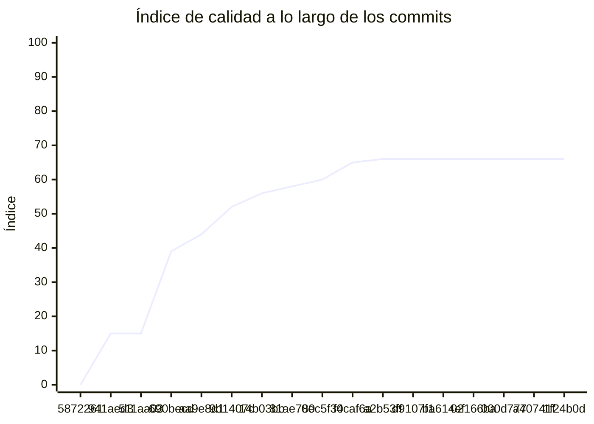

<!-- evaluacion:inicio -->
# Evaluación — prog2-perassiferrara/backend-catalogo

> Documento **generado automáticamente** por la cátedra de Programación II (UM): RepoSense + análisis de calidad de **7 dimensiones**. **No editar a mano**: se regenera en cada evaluación.
> Rama evaluada: `main`. Análisis **heurístico** (regex + métricas) + build: es una criba para orientar la revisión, **no una nota**. La **documentación** del repositorio no se evalúa.
> Generado: 2026-11-20.

## 1. Veredicto

| Aspecto | Resultado |
|---|---|
| Índice de calidad | **77/100** |
| Tipo de repositorio | `backend` |
| Build (`mvnw verify` / `gradlew check`) | OK |
| Código (LOC) | 10,443 |
| Archivos de código | 184 |
| Clases | 207 |
| Código dentro de clases (%POO) | 75% |
| Funciones fuera de clases | 0 |
| Duplicación (puerta) | 0.4% |
| Duplicación lógica | 0.4% |
| Duplicación de boilerplate | 7.1% |
| Cobertura | 96% |
| Tope duro aplicado a D1 | `POO_BAJO` → D1 ≤ 60 |

> Este informe **describe** lo que el análisis midió con los criterios ya establecidos de la materia. No es una nota.

## 2. Semáforo de aprobación

Criterios de la cátedra (`CRITERIOS-CALIDAD.md`): **Aprobar** se juega con el perfil `estandar`; **destacar**, con el `exigente` (meta de excelencia).

| Semáforo | Resultado |
|---|---|
| Aprobar (`estandar`) | **no cumple** — 7/11 |
| Destacar (`exigente`) | **no cumple** — 6/11 |

**Para aprobar, falta cumplir:** SOLID

**Para destacar, falta cumplir:** SOLID; POO

## 3. Autoría (RepoSense)

| Autor | Commits | Código (LOC) | Tests (LOC) | Docs (LOC) | Días activos | % del código |
|---|---:|---:|---:|---:|---:|---:|
| Valentino Perassi Ferrara | 38 | 5,372 | 6,191 | 7,636 | 23 | 100% |

> _El LOC de autoría lo calcula RepoSense sobre el historial y puede diferir del LOC de código del análisis (que mira el estado de `main`)._

## 4. Dimensiones evaluadas

Cada dimensión indica **qué mide**, **por qué importa** y **tu resultado**. Cuando el puntaje queda por debajo de la referencia, se agregan preguntas para **investigar la causa** (no hay recetas).

| Dimensión | Peso | Puntaje |
|:--|--:|--:|
| **D1** Diseño OO, SOLID y patrones (20%) | 20% | 2 |
| **D2** Arquitectura hexagonal — backend (15%) | 15% | 100 |
| **D3** Frontend KMP: MVVM y buenas prácticas (10%) | 10% | N/A |
| **D4** Integración y contrato (10%) | 10% | 90 |
| **D5** Seguridad y robustez (10%) | 10% | 100 |
| **D6** Pruebas y cobertura (20%) | 20% | 100 |
| **D7** Proceso y entrega (15%) | 15% | 100 |

### D1. Diseño OO, SOLID y patrones (20%)

- **Qué mide:** Métricas orientadas a objetos (clases, métodos, campos, cohesión, acoplamiento, herencia) y proxies de SOLID, más patrones de diseño.
- **Por qué importa:** El eje de la materia es el buen uso de la POO y su arquitectura: un diseño con clases claras y poco acopladas es más fácil de entender, probar y cambiar.
- **Tu resultado:** **2/100**
- **Para investigar la causa:**
    - ¿Se pensó el modelo de clases antes de codificar o se agrupó después?
    - ¿Qué clases concentran muchas responsabilidades a la vez?
    - ¿Los colaboradores llegan como parámetros o se crean por dentro?

### D2. Arquitectura hexagonal — backend (15%)

- **Qué mide:** Separación en capas (dominio, puertos de entrada/salida, adaptadores) y dirección de las dependencias del backend.
- **Por qué importa:** Aislar el dominio de la infraestructura permite cambiar la base de datos, el framework o el transporte sin tocar las reglas de negocio.
- **Tu resultado:** **100/100**

### D4. Integración y contrato (10%)

- **Qué mide:** Cumplimiento del contrato de integración de la cátedra (formato de errores, paginación, autenticación, endpoints esperados).
- **Por qué importa:** Los servicios deben poder integrarse entre sí y con la app sin sorpresas; el contrato es lo que hacen cumplir las pruebas de integración.
- **Tu resultado:** **90/100**

### D5. Seguridad y robustez (10%)

- **Qué mide:** Credenciales embebidas, consultas SQL por concatenación, y presencia de config de entorno; aislamiento de secretos.
- **Por qué importa:** Un secreto en el repositorio o una consulta construida por concatenación son riesgos concretos, no hipotéticos.
- **Tu resultado:** **100/100**

### D6. Pruebas y cobertura (20%)

- **Qué mide:** Cantidad y resultado de pruebas y cobertura de línea (JaCoCo/Kover, Surefire/Failsafe) cuando hay build.
- **Por qué importa:** Las pruebas son la red de seguridad para refactorizar e integrar; la cobertura acota las zonas sin verificar.
- **Tu resultado:** **100/100**

### D7. Proceso y entrega (15%)

- **Qué mide:** Artefactos verificables de proceso/entrega: `compose`, `.env.example`, CI (`.github/workflows/`), `CODEOWNERS` y wrapper de build (`mvnw`/`gradlew`). **No** puntúa documentación.
- **Por qué importa:** Un proyecto que compila, se levanta y se valida solo es más fácil de revisar y de integrar en equipo.
- **Tu resultado:** **100/100**

## 5. Señales detectadas

El análisis encontró las siguientes señales, con el archivo y la línea donde se originan cuando están disponibles:

**Archivos con más señales**

| Archivo | Señales |
|---|---:|
| `src/main/java/com/prog2/catalog/infrastructure/security/config/SecurityConfiguration.java` | 14 |
| `src/main/java/com/prog2/catalog/synchronization/application/usecases/UpdateCatalogUseCaseImpl.java` | 11 |
| `src/main/java/com/prog2/catalog/synchronization/infrastructure/redis/adapter/RedisCatalogChangesAdapter.java` | 10 |
| `src/main/java/com/prog2/catalog/infrastructure/config/CatalogRemoteClients.java` | 9 |
| `src/main/java/com/prog2/catalog/synchronization/infrastructure/client/adapter/WebClientCatalogSnapshotAdapter.java` | 8 |
| `src/main/java/com/prog2/catalog/synchronization/application/usecases/SynchronizeCatalogUseCaseImpl.java` | 7 |
| `src/main/java/com/prog2/catalog/synchronization/infrastructure/persistence/service/TransactionalCatalogUpdateWriter.java` | 6 |
| `src/main/java/com/prog2/catalog/synchronization/infrastructure/config/SynchronizationConfiguration.java` | 6 |
| `src/main/java/com/prog2/catalog/integration/infrastructure/client/adapter/WebClientCentralIntegrationAdapter.java` | 6 |
| `src/main/java/com/prog2/catalog/infrastructure/config/CatalogOperationalProperties.java` | 6 |

**SRP/responsabilidad** (111)
- método 'CatalogConfiguration.catalogStartupRunner' con 5 parámetros — `src/main/java/com/prog2/catalog/infrastructure/config/CatalogConfiguration.java:52`
- método 'CatalogOperationalProperties.CatalogOperationalProperties' de 49 líneas — `src/main/java/com/prog2/catalog/infrastructure/config/CatalogOperationalProperties.java:16`
- método 'CatalogOperationalProperties.CatalogOperationalProperties' con 7 parámetros — `src/main/java/com/prog2/catalog/infrastructure/config/CatalogOperationalProperties.java:16`
- método 'CatalogOperationalProperties.HttpCycle' con 5 parámetros — `src/main/java/com/prog2/catalog/infrastructure/config/CatalogOperationalProperties.java:21`
- método 'HttpCycle.HttpCycle' con 5 parámetros — `src/main/java/com/prog2/catalog/infrastructure/config/CatalogOperationalProperties.java:21`
- clase 'CatalogRemoteClients' grande (LOC=114, métodos=9, campos=11) — `src/main/java/com/prog2/catalog/infrastructure/config/CatalogRemoteClients.java:26`
- clase 'CatalogRemoteClients' con baja cohesión (28%) — `src/main/java/com/prog2/catalog/infrastructure/config/CatalogRemoteClients.java:26`
- método 'CatalogRemoteClients.createConsumer' de 46 líneas — `src/main/java/com/prog2/catalog/infrastructure/config/CatalogRemoteClients.java:84`
- método 'CatalogRemoteClients.createConsumer' con complejidad 8 — `src/main/java/com/prog2/catalog/infrastructure/config/CatalogRemoteClients.java:84`
- método 'CatalogRemoteClients.handleOne' con 6 parámetros — `src/main/java/com/prog2/catalog/infrastructure/config/CatalogRemoteClients.java:110`
- método 'CatalogRemoteClients.handleOtherException' con 5 parámetros — `src/main/java/com/prog2/catalog/infrastructure/config/CatalogRemoteClients.java:116`
- método 'IntegrationProperties.IntegrationProperties' de 55 líneas — `src/main/java/com/prog2/catalog/infrastructure/config/IntegrationProperties.java:19`
- método 'IntegrationProperties.IntegrationProperties' con complejidad 7 — `src/main/java/com/prog2/catalog/infrastructure/config/IntegrationProperties.java:19`
- método 'JwtSecurityProperties.JwtSecurityProperties' de 58 líneas — `src/main/java/com/prog2/catalog/infrastructure/security/config/JwtSecurityProperties.java:23`
- método 'JwtSecurityProperties.JwtSecurityProperties' con complejidad 8 — `src/main/java/com/prog2/catalog/infrastructure/security/config/JwtSecurityProperties.java:23`
- clase 'SecurityConfiguration' grande (LOC=99, métodos=16, campos=0) — `src/main/java/com/prog2/catalog/infrastructure/security/config/SecurityConfiguration.java:41`
- método 'SecurityConfiguration.securityFilterChain' de 50 líneas — `src/main/java/com/prog2/catalog/infrastructure/security/config/SecurityConfiguration.java:82`
- método 'SecurityConfiguration.sessionManagement' de 38 líneas — `src/main/java/com/prog2/catalog/infrastructure/security/config/SecurityConfiguration.java:94`
- método 'SecurityConfiguration.csrf' de 37 líneas — `src/main/java/com/prog2/catalog/infrastructure/security/config/SecurityConfiguration.java:95`
- método 'SecurityConfiguration.formLogin' de 36 líneas — `src/main/java/com/prog2/catalog/infrastructure/security/config/SecurityConfiguration.java:96`
- método 'SecurityConfiguration.httpBasic' de 35 líneas — `src/main/java/com/prog2/catalog/infrastructure/security/config/SecurityConfiguration.java:97`
- método 'SecurityConfiguration.logout' de 34 líneas — `src/main/java/com/prog2/catalog/infrastructure/security/config/SecurityConfiguration.java:98`
- método 'SecurityConfiguration.requestCache' de 33 líneas — `src/main/java/com/prog2/catalog/infrastructure/security/config/SecurityConfiguration.java:99`
- método 'SecurityConfiguration.cors' de 32 líneas — `src/main/java/com/prog2/catalog/infrastructure/security/config/SecurityConfiguration.java:100`
- método 'SecurityConfiguration.exceptionHandling' de 31 líneas — `src/main/java/com/prog2/catalog/infrastructure/security/config/SecurityConfiguration.java:101`
- método 'SecurityConfiguration.oauth2ResourceServer' de 30 líneas — `src/main/java/com/prog2/catalog/infrastructure/security/config/SecurityConfiguration.java:102`
- clase 'CatalogStartupRunner' grande (LOC=72, métodos=4, campos=9) — `src/main/java/com/prog2/catalog/infrastructure/startup/CatalogStartupRunner.java:26`
- clase 'CatalogStartupRunner' con baja cohesión (33%) — `src/main/java/com/prog2/catalog/infrastructure/startup/CatalogStartupRunner.java:26`
- método 'CatalogStartupRunner.initializeTechnicalAccess' con complejidad 7 — `src/main/java/com/prog2/catalog/infrastructure/startup/CatalogStartupRunner.java:70`
- clase 'CatalogSynchronizationMonitor' grande (LOC=48, métodos=5, campos=9) — `src/main/java/com/prog2/catalog/infrastructure/startup/CatalogSynchronizationMonitor.java:17`
- método 'CatalogSynchronizationMonitor.check' con complejidad 6 — `src/main/java/com/prog2/catalog/infrastructure/startup/CatalogSynchronizationMonitor.java:33`
- método 'InitializeIntegrationUseCaseImpl.initialize' de 39 líneas — `src/main/java/com/prog2/catalog/integration/application/usecases/InitializeIntegrationUseCaseImpl.java:34`
- método 'InitializeIntegrationUseCaseImpl.initialize' con complejidad 9 — `src/main/java/com/prog2/catalog/integration/application/usecases/InitializeIntegrationUseCaseImpl.java:34`
- método 'IntegrationConfiguration.IntegrationConfiguration' con 10 parámetros — `src/main/java/com/prog2/catalog/integration/domain/model/IntegrationConfiguration.java:20`
- método 'IntegrationSession.IntegrationSession' de 35 líneas — `src/main/java/com/prog2/catalog/integration/domain/model/IntegrationSession.java:16`
- clase 'WebClientCentralIntegrationAdapter' grande (LOC=136, métodos=10, campos=4) — `src/main/java/com/prog2/catalog/integration/infrastructure/client/adapter/WebClientCentralIntegrationAdapter.java:33`
- clase 'WebClientCentralIntegrationAdapter' con baja cohesión (29%) — `src/main/java/com/prog2/catalog/integration/infrastructure/client/adapter/WebClientCentralIntegrationAdapter.java:33`
- método 'WebClientCentralIntegrationAdapter.WebClientCentralIntegrationAdapter' con 5 parámetros — `src/main/java/com/prog2/catalog/integration/infrastructure/client/adapter/WebClientCentralIntegrationAdapter.java:49`
- método 'WebClientCentralIntegrationAdapter.exchange' con complejidad 7 — `src/main/java/com/prog2/catalog/integration/infrastructure/client/adapter/WebClientCentralIntegrationAdapter.java:105`
- método 'IntegrationResponse.IntegrationResponse' con 10 parámetros — `src/main/java/com/prog2/catalog/integration/infrastructure/client/dto/IntegrationResponse.java:15`
- clase 'GetProfessionalCategoriesUseCaseImpl' con baja cohesión (33%) — `src/main/java/com/prog2/catalog/synchronization/application/usecases/GetProfessionalCategoriesUseCaseImpl.java:19`
- clase 'RecoverCatalogUseCaseImpl' grande (LOC=67, métodos=6, campos=9) — `src/main/java/com/prog2/catalog/synchronization/application/usecases/RecoverCatalogUseCaseImpl.java:18`
- clase 'RecoverCatalogUseCaseImpl' con baja cohesión (40%) — `src/main/java/com/prog2/catalog/synchronization/application/usecases/RecoverCatalogUseCaseImpl.java:18`
- método 'RecoverCatalogUseCaseImpl.attempt' con complejidad 10 — `src/main/java/com/prog2/catalog/synchronization/application/usecases/RecoverCatalogUseCaseImpl.java:56`
- clase 'SynchronizeCatalogUseCaseImpl' grande (LOC=144, métodos=11, campos=15) — `src/main/java/com/prog2/catalog/synchronization/application/usecases/SynchronizeCatalogUseCaseImpl.java:21`
- clase 'SynchronizeCatalogUseCaseImpl' con baja cohesión (18%) — `src/main/java/com/prog2/catalog/synchronization/application/usecases/SynchronizeCatalogUseCaseImpl.java:21`
- método 'SynchronizeCatalogUseCaseImpl.finish' con 5 parámetros — `src/main/java/com/prog2/catalog/synchronization/application/usecases/SynchronizeCatalogUseCaseImpl.java:146`
- clase 'SnapshotCycle' grande (LOC=10, métodos=0, campos=8) — `src/main/java/com/prog2/catalog/synchronization/application/usecases/SynchronizeCatalogUseCaseImpl.java:166`
- clase 'SnapshotCycle' sin métodos (8 campos): solo datos — `src/main/java/com/prog2/catalog/synchronization/application/usecases/SynchronizeCatalogUseCaseImpl.java:166`
- clase 'UpdateCatalogUseCaseImpl' grande (LOC=231, métodos=20, campos=14) — `src/main/java/com/prog2/catalog/synchronization/application/usecases/UpdateCatalogUseCaseImpl.java:23`
- clase 'UpdateCatalogUseCaseImpl' con baja cohesión (35%) — `src/main/java/com/prog2/catalog/synchronization/application/usecases/UpdateCatalogUseCaseImpl.java:23`
- método 'UpdateCatalogUseCaseImpl.execute' de 35 líneas — `src/main/java/com/prog2/catalog/synchronization/application/usecases/UpdateCatalogUseCaseImpl.java:80`
- método 'UpdateCatalogUseCaseImpl.execute' con complejidad 9 — `src/main/java/com/prog2/catalog/synchronization/application/usecases/UpdateCatalogUseCaseImpl.java:80`
- método 'UpdateCatalogUseCaseImpl.run' con complejidad 6 — `src/main/java/com/prog2/catalog/synchronization/application/usecases/UpdateCatalogUseCaseImpl.java:116`
- método 'UpdateCatalogUseCaseImpl.applyAttempt' de 36 líneas — `src/main/java/com/prog2/catalog/synchronization/application/usecases/UpdateCatalogUseCaseImpl.java:149`
- método 'UpdateCatalogUseCaseImpl.applyAttempt' con complejidad 7 — `src/main/java/com/prog2/catalog/synchronization/application/usecases/UpdateCatalogUseCaseImpl.java:149`
- método 'UpdateCatalogUseCaseImpl.failed' con complejidad 6 — `src/main/java/com/prog2/catalog/synchronization/application/usecases/UpdateCatalogUseCaseImpl.java:221`
- clase 'UpdateCycle' sin métodos (6 campos): solo datos — `src/main/java/com/prog2/catalog/synchronization/application/usecases/UpdateCatalogUseCaseImpl.java:269`
- método 'CatalogChangesBatch.CatalogChangesBatch' con 5 parámetros — `src/main/java/com/prog2/catalog/synchronization/domain/model/CatalogChangesBatch.java:8`
- método 'CatalogConnectionSettings.CatalogConnectionSettings' con 8 parámetros — `src/main/java/com/prog2/catalog/synchronization/domain/model/CatalogConnectionSettings.java:4`
- método 'CatalogSnapshot.CatalogSnapshot' de 47 líneas — `src/main/java/com/prog2/catalog/synchronization/domain/model/CatalogSnapshot.java:12`
- método 'CatalogSnapshot.CatalogSnapshot' con 5 parámetros — `src/main/java/com/prog2/catalog/synchronization/domain/model/CatalogSnapshot.java:12`
- método 'CatalogSnapshot.CatalogSnapshot' con complejidad 6 — `src/main/java/com/prog2/catalog/synchronization/domain/model/CatalogSnapshot.java:12`
- método 'CatalogState.CatalogState' con 10 parámetros — `src/main/java/com/prog2/catalog/synchronization/domain/model/CatalogState.java:11`
- método 'CatalogState.CatalogState' con 8 parámetros — `src/main/java/com/prog2/catalog/synchronization/domain/model/CatalogState.java:16`
- método 'CatalogStatus.CatalogStatus' con 6 parámetros — `src/main/java/com/prog2/catalog/synchronization/domain/model/CatalogStatus.java:7`
- método 'CatalogUpdateResult.CatalogUpdateResult' con 5 parámetros — `src/main/java/com/prog2/catalog/synchronization/domain/model/CatalogUpdateResult.java:7`
- método 'Professional.Professional' con 7 parámetros — `src/main/java/com/prog2/catalog/synchronization/domain/model/Professional.java:6`
- método 'ProfessionalCategory.ProfessionalCategory' con 6 parámetros — `src/main/java/com/prog2/catalog/synchronization/domain/model/ProfessionalCategory.java:6`
- método 'ProfessionalSearchCriteria.ProfessionalSearchCriteria' con 6 parámetros — `src/main/java/com/prog2/catalog/synchronization/domain/model/ProfessionalSearchCriteria.java:6`
- método 'ProfessionalSearchResult.ProfessionalSearchResult' con 5 parámetros — `src/main/java/com/prog2/catalog/synchronization/domain/model/ProfessionalSearchResult.java:8`
- método 'SynchronizationResult.SynchronizationResult' con 5 parámetros — `src/main/java/com/prog2/catalog/synchronization/domain/model/SynchronizationResult.java:8`
- método 'WeeklySchedule.WeeklySchedule' con 9 parámetros — `src/main/java/com/prog2/catalog/synchronization/domain/model/WeeklySchedule.java:8`
- clase 'WebClientCatalogSnapshotAdapter' grande (LOC=97, métodos=11, campos=5) — `src/main/java/com/prog2/catalog/synchronization/infrastructure/client/adapter/WebClientCatalogSnapshotAdapter.java:27`
- clase 'WebClientCatalogSnapshotAdapter' con baja cohesión (7%) — `src/main/java/com/prog2/catalog/synchronization/infrastructure/client/adapter/WebClientCatalogSnapshotAdapter.java:27`
- método 'WebClientCatalogSnapshotAdapter.WebClientCatalogSnapshotAdapter' con 7 parámetros — `src/main/java/com/prog2/catalog/synchronization/infrastructure/client/adapter/WebClientCatalogSnapshotAdapter.java:38`
- método 'WebClientCatalogSnapshotAdapter.fetch' de 35 líneas — `src/main/java/com/prog2/catalog/synchronization/infrastructure/client/adapter/WebClientCatalogSnapshotAdapter.java:53`
- método 'WebClientCatalogSnapshotAdapter.fetch' con complejidad 7 — `src/main/java/com/prog2/catalog/synchronization/infrastructure/client/adapter/WebClientCatalogSnapshotAdapter.java:53`
- método 'WebClientCatalogSnapshotAdapter.httpFailure' con complejidad 6 — `src/main/java/com/prog2/catalog/synchronization/infrastructure/client/adapter/WebClientCatalogSnapshotAdapter.java:89`
- método 'CatalogSnapshotResponse.CatalogSnapshotResponse' con 5 parámetros — `src/main/java/com/prog2/catalog/synchronization/infrastructure/client/dto/CatalogSnapshotResponse.java:6`
- método 'ProfessionalCategoryResponse.ProfessionalCategoryResponse' con 6 parámetros — `src/main/java/com/prog2/catalog/synchronization/infrastructure/client/dto/ProfessionalCategoryResponse.java:4`
- método 'ProfessionalResponse.ProfessionalResponse' con 7 parámetros — `src/main/java/com/prog2/catalog/synchronization/infrastructure/client/dto/ProfessionalResponse.java:4`
- método 'WeeklyScheduleResponse.WeeklyScheduleResponse' con 9 parámetros — `src/main/java/com/prog2/catalog/synchronization/infrastructure/client/dto/WeeklyScheduleResponse.java:4`
- método 'SynchronizationConfiguration.recoverCatalogUseCase' con 6 parámetros — `src/main/java/com/prog2/catalog/synchronization/infrastructure/config/SynchronizationConfiguration.java:44`
- método 'SynchronizationConfiguration.updateCatalogUseCase' con 7 parámetros — `src/main/java/com/prog2/catalog/synchronization/infrastructure/config/SynchronizationConfiguration.java:52`
- método 'SynchronizationConfiguration.catalogSynchronizationMonitor' con 6 parámetros — `src/main/java/com/prog2/catalog/synchronization/infrastructure/config/SynchronizationConfiguration.java:60`
- método 'SynchronizationConfiguration.synchronizeCatalogUseCase' con 6 parámetros — `src/main/java/com/prog2/catalog/synchronization/infrastructure/config/SynchronizationConfiguration.java:86`
- clase 'CatalogUpdatedListener' con baja cohesión (20%) — `src/main/java/com/prog2/catalog/synchronization/infrastructure/messaging/CatalogUpdatedListener.java:16`
- método 'CatalogUpdatedListener.onMessage' con complejidad 7 — `src/main/java/com/prog2/catalog/synchronization/infrastructure/messaging/CatalogUpdatedListener.java:31`
- método 'CatalogUpdatedResponse.CatalogUpdatedResponse' con 6 parámetros — `src/main/java/com/prog2/catalog/synchronization/infrastructure/messaging/dto/CatalogUpdatedResponse.java:4`
- clase 'CatalogSyncStateEntity' grande (LOC=76, métodos=16, campos=11) — `src/main/java/com/prog2/catalog/synchronization/infrastructure/persistence/entity/CatalogSyncStateEntity.java:15`
- clase 'CatalogSyncStateEntity' con baja cohesión (28%) — `src/main/java/com/prog2/catalog/synchronization/infrastructure/persistence/entity/CatalogSyncStateEntity.java:15`
- clase 'TransactionalCatalogSnapshotWriter' con baja cohesión (33%) — `src/main/java/com/prog2/catalog/synchronization/infrastructure/persistence/service/TransactionalCatalogSnapshotWriter.java:26`
- clase 'TransactionalCatalogUpdateWriter' grande (LOC=121, métodos=16, campos=8) — `src/main/java/com/prog2/catalog/synchronization/infrastructure/persistence/service/TransactionalCatalogUpdateWriter.java:26`
- clase 'TransactionalCatalogUpdateWriter' con baja cohesión (16%) — `src/main/java/com/prog2/catalog/synchronization/infrastructure/persistence/service/TransactionalCatalogUpdateWriter.java:26`
- método 'TransactionalCatalogUpdateWriter.apply' de 30 líneas — `src/main/java/com/prog2/catalog/synchronization/infrastructure/persistence/service/TransactionalCatalogUpdateWriter.java:72`
- método 'TransactionalCatalogUpdateWriter.apply' con complejidad 8 — `src/main/java/com/prog2/catalog/synchronization/infrastructure/persistence/service/TransactionalCatalogUpdateWriter.java:72`
- clase 'RedisCatalogChangesAdapter' grande (LOC=155, métodos=16, campos=8) — `src/main/java/com/prog2/catalog/synchronization/infrastructure/redis/adapter/RedisCatalogChangesAdapter.java:27`
- clase 'RedisCatalogChangesAdapter' con baja cohesión (4%) — `src/main/java/com/prog2/catalog/synchronization/infrastructure/redis/adapter/RedisCatalogChangesAdapter.java:27`
- método 'RedisCatalogChangesAdapter.RedisCatalogChangesAdapter' con 7 parámetros — `src/main/java/com/prog2/catalog/synchronization/infrastructure/redis/adapter/RedisCatalogChangesAdapter.java:36`
- método 'RedisCatalogChangesAdapter.readSince' con complejidad 6 — `src/main/java/com/prog2/catalog/synchronization/infrastructure/redis/adapter/RedisCatalogChangesAdapter.java:49`
- método 'RedisCatalogChangesAdapter.read' de 47 líneas — `src/main/java/com/prog2/catalog/synchronization/infrastructure/redis/adapter/RedisCatalogChangesAdapter.java:68`
- método 'RedisCatalogChangesAdapter.read' con complejidad 10 — `src/main/java/com/prog2/catalog/synchronization/infrastructure/redis/adapter/RedisCatalogChangesAdapter.java:68`
- método 'RedisCatalogChangesAdapter.load' con 7 parámetros — `src/main/java/com/prog2/catalog/synchronization/infrastructure/redis/adapter/RedisCatalogChangesAdapter.java:145`
- método 'ProfessionalAgendaResponse.ProfessionalResponse' con 5 parámetros — `src/main/java/com/prog2/catalog/synchronization/infrastructure/web/dto/ProfessionalAgendaResponse.java:11`
- método 'ProfessionalResponse.ProfessionalResponse' con 5 parámetros — `src/main/java/com/prog2/catalog/synchronization/infrastructure/web/dto/ProfessionalAgendaResponse.java:11`
- método 'ProfessionalAgendaResponse.WeeklyScheduleResponse' con 5 parámetros — `src/main/java/com/prog2/catalog/synchronization/infrastructure/web/dto/ProfessionalAgendaResponse.java:14`
- método 'WeeklyScheduleResponse.WeeklyScheduleResponse' con 5 parámetros — `src/main/java/com/prog2/catalog/synchronization/infrastructure/web/dto/ProfessionalAgendaResponse.java:14`
- método 'ProfessionalSearchResponse.ProfessionalSearchResponse' con 6 parámetros — `src/main/java/com/prog2/catalog/synchronization/infrastructure/web/dto/ProfessionalSearchResponse.java:7`
- método 'ProfessionalSearchResponse.ProfessionalResponse' con 5 parámetros — `src/main/java/com/prog2/catalog/synchronization/infrastructure/web/dto/ProfessionalSearchResponse.java:11`
- método 'ProfessionalResponse.ProfessionalResponse' con 5 parámetros — `src/main/java/com/prog2/catalog/synchronization/infrastructure/web/dto/ProfessionalSearchResponse.java:11`

**DIP/concretos** (77)
- clase 'CatalogConfiguration' muy acoplada (CBO=13) — `src/main/java/com/prog2/catalog/infrastructure/config/CatalogConfiguration.java:22`
- clase 'CatalogJsonMapperFactory' muy acoplada (CBO=11) — `src/main/java/com/prog2/catalog/infrastructure/config/CatalogJsonMapperFactory.java:9`
- clase 'CatalogOperationalProperties' muy acoplada (CBO=11) — `src/main/java/com/prog2/catalog/infrastructure/config/CatalogOperationalProperties.java:16`
- clase 'CatalogOperationalProperties' instancia 6 concretos (CBO=11) — `src/main/java/com/prog2/catalog/infrastructure/config/CatalogOperationalProperties.java:16`
- clase 'CatalogRemoteClients' muy acoplada (CBO=53) — `src/main/java/com/prog2/catalog/infrastructure/config/CatalogRemoteClients.java:26`
- clase 'CatalogRemoteClients' instancia 7 concretos (CBO=53) — `src/main/java/com/prog2/catalog/infrastructure/config/CatalogRemoteClients.java:26`
- clase 'DatabaseConfiguration' muy acoplada (CBO=9) — `src/main/java/com/prog2/catalog/infrastructure/config/DatabaseConfiguration.java:17`
- clase 'IntegrationProperties' muy acoplada (CBO=15) — `src/main/java/com/prog2/catalog/infrastructure/config/IntegrationProperties.java:19`
- clase 'IntegrationProperties' instancia 3 concretos (CBO=15) — `src/main/java/com/prog2/catalog/infrastructure/config/IntegrationProperties.java:19`
- clase 'OpenApiConfiguration' muy acoplada (CBO=36) — `src/main/java/com/prog2/catalog/infrastructure/config/OpenApiConfiguration.java:28`
- clase 'OpenApiConfiguration' instancia 16 concretos (CBO=36) — `src/main/java/com/prog2/catalog/infrastructure/config/OpenApiConfiguration.java:28`
- clase 'JwtSecurityProperties' muy acoplada (CBO=19) — `src/main/java/com/prog2/catalog/infrastructure/security/config/JwtSecurityProperties.java:23`
- clase 'SecurityConfiguration' muy acoplada (CBO=50) — `src/main/java/com/prog2/catalog/infrastructure/security/config/SecurityConfiguration.java:41`
- clase 'SecurityConfiguration' instancia 11 concretos (CBO=50) — `src/main/java/com/prog2/catalog/infrastructure/security/config/SecurityConfiguration.java:41`
- clase 'JwtContractValidator' muy acoplada (CBO=15) — `src/main/java/com/prog2/catalog/infrastructure/security/jwt/JwtContractValidator.java:20`
- clase 'SecurityProblemHandler' muy acoplada (CBO=25) — `src/main/java/com/prog2/catalog/infrastructure/security/web/SecurityProblemHandler.java:24`
- clase 'CatalogStartupRunner' muy acoplada (CBO=28) — `src/main/java/com/prog2/catalog/infrastructure/startup/CatalogStartupRunner.java:26`
- clase 'CatalogSynchronizationMonitor' muy acoplada (CBO=25) — `src/main/java/com/prog2/catalog/infrastructure/startup/CatalogSynchronizationMonitor.java:17`
- clase 'InitializeIntegrationUseCaseImpl' muy acoplada (CBO=24) — `src/main/java/com/prog2/catalog/integration/application/usecases/InitializeIntegrationUseCaseImpl.java:26`
- clase 'InitializeIntegrationUseCaseImpl' instancia 7 concretos (CBO=24) — `src/main/java/com/prog2/catalog/integration/application/usecases/InitializeIntegrationUseCaseImpl.java:26`
- clase 'IntegrationSession' muy acoplada (CBO=11) — `src/main/java/com/prog2/catalog/integration/domain/model/IntegrationSession.java:16`
- clase 'WebClientCentralIntegrationAdapter' muy acoplada (CBO=52) — `src/main/java/com/prog2/catalog/integration/infrastructure/client/adapter/WebClientCentralIntegrationAdapter.java:33`
- clase 'WebClientCentralIntegrationAdapter' instancia 9 concretos (CBO=52) — `src/main/java/com/prog2/catalog/integration/infrastructure/client/adapter/WebClientCentralIntegrationAdapter.java:33`
- clase 'IntegrationTokenController' muy acoplada (CBO=27) — `src/main/java/com/prog2/catalog/integration/infrastructure/web/controller/IntegrationTokenController.java:36`
- clase 'CatalogStatusPolicy' muy acoplada (CBO=17) — `src/main/java/com/prog2/catalog/synchronization/application/service/CatalogStatusPolicy.java:19`
- clase 'GetCatalogStatusUseCaseImpl' muy acoplada (CBO=13) — `src/main/java/com/prog2/catalog/synchronization/application/usecases/GetCatalogStatusUseCaseImpl.java:16`
- clase 'GetProfessionalAgendaUseCaseImpl' muy acoplada (CBO=20) — `src/main/java/com/prog2/catalog/synchronization/application/usecases/GetProfessionalAgendaUseCaseImpl.java:16`
- clase 'GetProfessionalAgendaUseCaseImpl' instancia 6 concretos (CBO=20) — `src/main/java/com/prog2/catalog/synchronization/application/usecases/GetProfessionalAgendaUseCaseImpl.java:16`
- clase 'GetProfessionalCategoriesUseCaseImpl' muy acoplada (CBO=15) — `src/main/java/com/prog2/catalog/synchronization/application/usecases/GetProfessionalCategoriesUseCaseImpl.java:19`
- clase 'GetProfessionalCategoriesUseCaseImpl' instancia 3 concretos (CBO=15) — `src/main/java/com/prog2/catalog/synchronization/application/usecases/GetProfessionalCategoriesUseCaseImpl.java:19`
- clase 'RecoverCatalogUseCaseImpl' muy acoplada (CBO=22) — `src/main/java/com/prog2/catalog/synchronization/application/usecases/RecoverCatalogUseCaseImpl.java:18`
- clase 'RecoverCatalogUseCaseImpl' instancia 3 concretos (CBO=22) — `src/main/java/com/prog2/catalog/synchronization/application/usecases/RecoverCatalogUseCaseImpl.java:18`
- clase 'SearchProfessionalsUseCaseImpl' muy acoplada (CBO=17) — `src/main/java/com/prog2/catalog/synchronization/application/usecases/SearchProfessionalsUseCaseImpl.java:22`
- clase 'SearchProfessionalsUseCaseImpl' instancia 4 concretos (CBO=17) — `src/main/java/com/prog2/catalog/synchronization/application/usecases/SearchProfessionalsUseCaseImpl.java:22`
- clase 'SynchronizeCatalogUseCaseImpl' muy acoplada (CBO=31) — `src/main/java/com/prog2/catalog/synchronization/application/usecases/SynchronizeCatalogUseCaseImpl.java:21`
- clase 'SynchronizeCatalogUseCaseImpl' instancia 5 concretos (CBO=31) — `src/main/java/com/prog2/catalog/synchronization/application/usecases/SynchronizeCatalogUseCaseImpl.java:21`
- clase 'UpdateCatalogUseCaseImpl' muy acoplada (CBO=49) — `src/main/java/com/prog2/catalog/synchronization/application/usecases/UpdateCatalogUseCaseImpl.java:23`
- clase 'UpdateCatalogUseCaseImpl' instancia 14 concretos (CBO=49) — `src/main/java/com/prog2/catalog/synchronization/application/usecases/UpdateCatalogUseCaseImpl.java:23`
- clase 'SnapshotFailureKind' muy acoplada (CBO=9) — `src/main/java/com/prog2/catalog/synchronization/domain/enums/SnapshotFailureKind.java:4`
- clase 'SynchronizationPhase' muy acoplada (CBO=13) — `src/main/java/com/prog2/catalog/synchronization/domain/enums/SynchronizationPhase.java:4`
- clase 'CatalogChangesBatch' muy acoplada (CBO=9) — `src/main/java/com/prog2/catalog/synchronization/domain/model/CatalogChangesBatch.java:8`
- clase 'CatalogSnapshot' muy acoplada (CBO=11) — `src/main/java/com/prog2/catalog/synchronization/domain/model/CatalogSnapshot.java:12`
- clase 'CatalogSnapshotRepository' muy acoplada (CBO=10) — `src/main/java/com/prog2/catalog/synchronization/domain/ports/out/CatalogSnapshotRepository.java:10`
- clase 'CatalogUpdateRepository' muy acoplada (CBO=14) — `src/main/java/com/prog2/catalog/synchronization/domain/ports/out/CatalogUpdateRepository.java:8`
- clase 'WebClientCatalogSnapshotAdapter' muy acoplada (CBO=37) — `src/main/java/com/prog2/catalog/synchronization/infrastructure/client/adapter/WebClientCatalogSnapshotAdapter.java:27`
- clase 'WebClientCatalogSnapshotAdapter' instancia 5 concretos (CBO=37) — `src/main/java/com/prog2/catalog/synchronization/infrastructure/client/adapter/WebClientCatalogSnapshotAdapter.java:27`
- clase 'CatalogSnapshotResponseMapper' muy acoplada (CBO=22) — `src/main/java/com/prog2/catalog/synchronization/infrastructure/client/mapper/CatalogSnapshotResponseMapper.java:17`
- clase 'CatalogSnapshotResponseMapper' instancia 6 concretos (CBO=22) — `src/main/java/com/prog2/catalog/synchronization/infrastructure/client/mapper/CatalogSnapshotResponseMapper.java:17`
- clase 'SynchronizationConfiguration' muy acoplada (CBO=25) — `src/main/java/com/prog2/catalog/synchronization/infrastructure/config/SynchronizationConfiguration.java:28`
- clase 'SynchronizationConfiguration' instancia 8 concretos (CBO=25) — `src/main/java/com/prog2/catalog/synchronization/infrastructure/config/SynchronizationConfiguration.java:28`
- clase 'IntegrationTechnicalAccessAdapter' muy acoplada (CBO=11) — `src/main/java/com/prog2/catalog/synchronization/infrastructure/integration/adapter/IntegrationTechnicalAccessAdapter.java:21`
- clase 'IntegrationTechnicalAccessAdapter' instancia 3 concretos (CBO=11) — `src/main/java/com/prog2/catalog/synchronization/infrastructure/integration/adapter/IntegrationTechnicalAccessAdapter.java:21`
- clase 'CatalogUpdatedListener' muy acoplada (CBO=22) — `src/main/java/com/prog2/catalog/synchronization/infrastructure/messaging/CatalogUpdatedListener.java:16`
- clase 'JpaCatalogQueryAdapter' muy acoplada (CBO=12) — `src/main/java/com/prog2/catalog/synchronization/infrastructure/persistence/adapter/JpaCatalogQueryAdapter.java:19`
- clase 'JpaCatalogSnapshotAdapter' muy acoplada (CBO=11) — `src/main/java/com/prog2/catalog/synchronization/infrastructure/persistence/adapter/JpaCatalogSnapshotAdapter.java:20`
- clase 'JpaCatalogUpdateAdapter' muy acoplada (CBO=14) — `src/main/java/com/prog2/catalog/synchronization/infrastructure/persistence/adapter/JpaCatalogUpdateAdapter.java:20`
- clase 'CatalogSyncStateEntity' muy acoplada (CBO=13) — `src/main/java/com/prog2/catalog/synchronization/infrastructure/persistence/entity/CatalogSyncStateEntity.java:15`
- clase 'CatalogSnapshotPersistenceMapper' muy acoplada (CBO=11) — `src/main/java/com/prog2/catalog/synchronization/infrastructure/persistence/mapper/CatalogSnapshotPersistenceMapper.java:10`
- clase 'CatalogSnapshotPersistenceMapper' instancia 7 concretos (CBO=11) — `src/main/java/com/prog2/catalog/synchronization/infrastructure/persistence/mapper/CatalogSnapshotPersistenceMapper.java:10`
- clase 'CatalogStorageFailureMapper' muy acoplada (CBO=24) — `src/main/java/com/prog2/catalog/synchronization/infrastructure/persistence/mapper/CatalogStorageFailureMapper.java:19`
- clase 'CatalogStorageFailureMapper' instancia 4 concretos (CBO=24) — `src/main/java/com/prog2/catalog/synchronization/infrastructure/persistence/mapper/CatalogStorageFailureMapper.java:19`
- clase 'TransactionalCatalogQueryReader' muy acoplada (CBO=19) — `src/main/java/com/prog2/catalog/synchronization/infrastructure/persistence/service/TransactionalCatalogQueryReader.java:26`
- clase 'TransactionalCatalogQueryReader' instancia 5 concretos (CBO=19) — `src/main/java/com/prog2/catalog/synchronization/infrastructure/persistence/service/TransactionalCatalogQueryReader.java:26`
- clase 'TransactionalCatalogSnapshotWriter' muy acoplada (CBO=26) — `src/main/java/com/prog2/catalog/synchronization/infrastructure/persistence/service/TransactionalCatalogSnapshotWriter.java:26`
- clase 'TransactionalCatalogUpdateWriter' muy acoplada (CBO=42) — `src/main/java/com/prog2/catalog/synchronization/infrastructure/persistence/service/TransactionalCatalogUpdateWriter.java:26`
- clase 'TransactionalCatalogUpdateWriter' instancia 8 concretos (CBO=42) — `src/main/java/com/prog2/catalog/synchronization/infrastructure/persistence/service/TransactionalCatalogUpdateWriter.java:26`
- clase 'ProfessionalSpecifications' muy acoplada (CBO=8) — `src/main/java/com/prog2/catalog/synchronization/infrastructure/persistence/specification/ProfessionalSpecifications.java:11`
- clase 'RedisCatalogChangesAdapter' muy acoplada (CBO=55) — `src/main/java/com/prog2/catalog/synchronization/infrastructure/redis/adapter/RedisCatalogChangesAdapter.java:27`
- clase 'RedisCatalogChangesAdapter' instancia 10 concretos (CBO=55) — `src/main/java/com/prog2/catalog/synchronization/infrastructure/redis/adapter/RedisCatalogChangesAdapter.java:27`
- clase 'CatalogQueryController' muy acoplada (CBO=28) — `src/main/java/com/prog2/catalog/synchronization/infrastructure/web/controller/CatalogQueryController.java:22`
- clase 'CatalogSearchController' muy acoplada (CBO=25) — `src/main/java/com/prog2/catalog/synchronization/infrastructure/web/controller/CatalogSearchController.java:27`
- clase 'ProfessionalSearchRequest' muy acoplada (CBO=12) — `src/main/java/com/prog2/catalog/synchronization/infrastructure/web/dto/ProfessionalSearchRequest.java:10`
- clase 'CatalogQueryExceptionHandler' muy acoplada (CBO=26) — `src/main/java/com/prog2/catalog/synchronization/infrastructure/web/exception/CatalogQueryExceptionHandler.java:17`
- clase 'CatalogQueryDtoMapper' muy acoplada (CBO=11) — `src/main/java/com/prog2/catalog/synchronization/infrastructure/web/mapper/CatalogQueryDtoMapper.java:11`
- clase 'CatalogQueryDtoMapper' instancia 5 concretos (CBO=11) — `src/main/java/com/prog2/catalog/synchronization/infrastructure/web/mapper/CatalogQueryDtoMapper.java:11`
- clase 'CatalogSearchDtoMapper' muy acoplada (CBO=14) — `src/main/java/com/prog2/catalog/synchronization/infrastructure/web/mapper/CatalogSearchDtoMapper.java:11`
- clase 'CatalogSearchDtoMapper' instancia 4 concretos (CBO=14) — `src/main/java/com/prog2/catalog/synchronization/infrastructure/web/mapper/CatalogSearchDtoMapper.java:11`

**OCP/type-switch** (6)
- clase 'CatalogRemoteClients' con 2 type-checks — `src/main/java/com/prog2/catalog/infrastructure/config/CatalogRemoteClients.java:26`
- clase 'SecurityConfiguration' con 2 type-checks — `src/main/java/com/prog2/catalog/infrastructure/security/config/SecurityConfiguration.java:41`
- clase 'JwtContractValidator' con 2 type-checks — `src/main/java/com/prog2/catalog/infrastructure/security/jwt/JwtContractValidator.java:20`
- clase 'CatalogRejectedRecordKey' con 1 type-checks — `src/main/java/com/prog2/catalog/synchronization/infrastructure/persistence/entity/CatalogRejectedRecordKey.java:14`
- clase 'CatalogStorageFailureMapper' con 8 type-checks — `src/main/java/com/prog2/catalog/synchronization/infrastructure/persistence/mapper/CatalogStorageFailureMapper.java:19`
- clase 'RedisCatalogChangesAdapter' con 2 type-checks — `src/main/java/com/prog2/catalog/synchronization/infrastructure/redis/adapter/RedisCatalogChangesAdapter.java:27`

## 6. Evolución por commit

Métricas calculadas sobre el estado de `main` en **cada commit** (17 commits con trabajo), del primero al último. La calidad usa el perfil `exigente`; el aporte de código lo mide RepoSense. El índice puede **bajar** al crecer el proyecto: se acumulan señales.

| # | Fecha | Commit | Autor | LOC | Índice | %POO | Duplic. | Sueltas |
|---|---|---|---|---:|---:|---:|---:|---:|
| 1 | 2026-09-07 | `5872261` | Valentino Perassi Ferrara | 0 | 0 | 0% | 0.0% | 0 |
| 2 | 2026-09-10 | `941aed3` | Ing. Daniel Quinteros | 0 | 15 | 0% | 0.0% | 0 |
| 3 | 2026-10-06 | `511aa03` | Valentino Perassi Ferrara | 0 | 15 | 0% | 0.0% | 0 |
| 4 | 2026-10-06 | `690becd` | Valentino Perassi Ferrara | 172 | 39 | 59% | 0.0% | 0 |
| 5 | 2026-10-12 | `aa9e8d1` | Valentino Perassi Ferrara | 172 | 44 | 59% | 0.0% | 0 |
| 6 | 2026-10-12 | `9d1407c` | Valentino Perassi Ferrara | 1,492 | 52 | 72% | 0.0% | 0 |
| 7 | 2026-10-15 | `14b03bb` | Valentino Perassi Ferrara | 2,427 | 56 | 71% | 0.0% | 0 |
| 8 | 2026-10-18 | `81ae780` | Valentino Perassi Ferrara | 4,569 | 58 | 74% | 1.5% | 0 |
| 9 | 2026-10-26 | `0ec5f30` | Valentino Perassi Ferrara | 6,993 | 60 | 78% | 1.2% | 0 |
| 10 | 2026-10-28 | `f4caf6a` | Valentino Perassi Ferrara | 8,619 | 65 | 77% | 0.8% | 0 |
| 11 | 2026-10-28 | `a2b53ff` | Valentino Perassi Ferrara | 9,663 | 66 | 77% | 1.1% | 0 |
| 12 | 2026-10-30 | `d9107f1` | Valentino Perassi Ferrara | 9,979 | 66 | 78% | 1.1% | 0 |
| 13 | 2026-10-31 | `ba614ef` | Valentino Perassi Ferrara | 10,413 | 66 | 77% | 1.0% | 0 |
| 14 | 2026-11-04 | `02166ba` | Valentino Perassi Ferrara | 10,324 | 66 | 76% | 0.8% | 0 |
| 15 | 2026-11-04 | `000d777` | Valentino Perassi Ferrara | 10,329 | 66 | 76% | 0.8% | 0 |
| 16 | 2026-11-17 | `a40741f` | Valentino Perassi Ferrara | 10,329 | 66 | 76% | 0.8% | 0 |
| 17 | 2026-11-19 | `1f24b0d` | Ing. Daniel Quinteros | 10,443 | 66 | 75% | 0.4% | 0 |

---
_Informe generado por la cátedra. Las dimensiones y umbrales corresponden a `calidad.py` (perfil `exigente`); el semáforo, a `CRITERIOS-CALIDAD.md`. La documentación del repositorio no se evalúa. Ante dudas, revisá el archivo señalado._
<!-- evaluacion:fin -->
