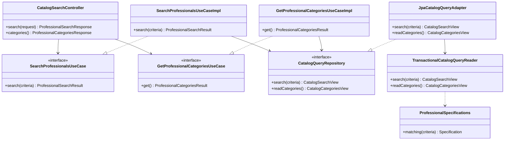

# PLAN: Buscar profesionales con filtros locales

**SPEC de referencia:** [SPEC.md](SPEC.md)
**Versión de la spec revisada:** aprobada por el usuario el 2026-10-28; base de código `f4caf6a`.
**Estado:** Aprobado <!-- Borrador | En revisión | Aprobado -->
**Aprobación del usuario:** 2026-10-28. La implementación requiere autorización explícita.

<!-- PARA LA PERSONA
Copia esta plantilla como PLAN.md junto a la SPEC.md aprobada.
Este documento define la solución técnica. Una vez revisado, el agente puede
derivar TASKS.md con tareas, dependencias y comprobaciones.
-->

<!-- PARA EL AGENTE
- Lee la SPEC.md aprobada, las instrucciones del proyecto y los contratos pertinentes.
  Si falta un documento necesario o la spec no está aprobada, indícalo antes de avanzar.
- Inspecciona el repositorio. Referencia rutas verificadas y distingue las nuevas propuestas.
- Propón una solución proporcional al alcance y coherente con el proyecto.
  Reutiliza lo existente y justifica nuevas dependencias o cambios de arquitectura.
- Distingue hechos, decisiones confirmadas y propuestas. Consulta las decisiones
  no resueltas; haz pocas preguntas por vez y actualiza el plan con las respuestas.
- Referencia los requisitos y criterios por su ID, sin copiar toda la spec.
- Si una decisión cambia el comportamiento o alcance, vuelve a la spec y solicita
  confirmación. No resuelvas una duda de producto mediante una suposición técnica.
- Conserva estos comentarios. No implementes durante la planificación.
- Solicita aprobación antes de marcar el plan como Aprobado. La autorización
  para implementar debe ser explícita; no se deduce del estado de los documentos.
- Para cambios de significado posteriores a la aprobación, registra una nota
  breve de cambio, motivo e impacto según AGENTS.md, sin historial separado.
-->

## Contexto técnico verificado

<!-- Qué existe hoy y cómo participa en la funcionalidad. -->

Rutas desde `src/main/java/com/prog2/catalog/`; `sync/` abrevia aquí `synchronization/`.
Base `f4caf6a`, Java 25, Boot 4.1.1, Spring Data JPA 4.1.1, Hibernate 7.4.5 y MySQL 8.4.8.

| Componente o archivo existente | Ruta verificada | Responsabilidad y uso previsto |
| --- | --- | --- |
| Consultas locales | `sync/domain/ports/out/CatalogQueryRepository.java`, `sync/infrastructure/persistence/adapter/JpaCatalogQueryAdapter.java` | Ampliar puerto y adaptador, conservando errores seguros. |
| Lectura consistente | `sync/infrastructure/persistence/service/TransactionalCatalogQueryReader.java` | Reutilizar la transacción para datos, categorías y total. |
| Estado y coordinación | `sync/application/service/{CatalogStatusPolicy,CatalogSynchronizationGuard}.java` | Reutilizar vigencia de 60 s y verificación de esta ejecución. |
| Réplica JPA | `sync/infrastructure/persistence/{entity,repository,mapper}/` | Reutilizar tablas, repositorios y mapeo manual. |
| HTTP y seguridad | `sync/infrastructure/web/`, `infrastructure/security/config/SecurityConfiguration.java` | Resumen de estado, errores y regla existente de usuario para `/api/**`. |

**Convenciones y patrón de referencia:** extender `synchronization`, propietario
de la réplica y sus consultas, sin reorganizarlo ni abrir dependencias entre slices.
Dominio puro; JPA, `Page`, `Pageable`, `Sort` y `Specification` solo en infraestructura.
Constructor DI, DTO separados y Javadoc en español.

## Solución propuesta

<!-- Explica el enfoque y sus motivos. Describe las responsabilidades y el
recorrido desde la solicitud, evento o arranque hasta el resultado del servicio.
Usa un diagrama si aporta claridad. -->

1. `CatalogSearchController` recibe el GET y valida sus parámetros; el mapper crea criterios de dominio.
2. Cada caso de uso intenta acceso compartido solo si no falta verificación inicial, sin esperar. No rechaza por no conseguirlo: las búsquedas admiten copia anterior.
3. El adaptador llama al lector transaccional separado. El SELECT de metadata establece la vista consistente; después obtiene página, categorías y total. Sin copia confirmada devuelve esa condición, sin interpretar tablas vacías como catálogo válido.
4. La búsqueda compone filtros `Specification` y pagina en MySQL. Resuelve juntas las categorías de los profesionales de la página, sin una consulta por cada fila.
5. El caso de uso evalúa el estado de la metadata leída. Con sincronizador activo informa `SYNCHRONIZING`; sin acceso compartido no acredita `CURRENT`, aunque el escritor termine antes de responder.
6. El mapper entrega el JSON acordado; un `finally` libera acceso solo si se adquirió. Las categorías siguen el mismo recorrido, sin paginar la lista de opciones.

Se reutilizan Repository y Adapter. `ProfessionalSpecifications` aplica el patrón
Specification con Spring Data, sin un motor de reglas adicional. El proxy transaccional
y el bloqueo son mecanismos de Spring y Java. No agregar una fachada que solo delegue
ni otro ejecutor SQL.

Vista de clases del recorrido y sus operaciones principales; los valores intercambiados se detallan en «Datos y contratos»:

## Módulos y componentes afectados

<!-- Si el proyecto está modularizado, identifica los módulos afectados, sus
responsabilidades y la dirección de sus dependencias. Respeta los límites
existentes y justifica cualquier módulo o dependencia nueva. Si no está
modularizado, describe las carpetas o componentes afectados sin introducir
modularización fuera del alcance; marca la tabla de módulos como No aplica. -->

| Módulo | Existe / nuevo | Responsabilidad y cambios | Dependencias afectadas |
| --- | --- | --- | --- |
| No aplica, un módulo Maven | Existente | Extender consultas en `synchronization`. | Infraestructura depende de aplicación/dominio, sin invertir esa dirección. |

<!-- Distingue lo que se reutiliza, modifica o crea. Las rutas nuevas son propuestas.
Señala impacto sobre modelos, contratos o componentes compartidos. -->

Las rutas nuevas son propuestas; crear solo los paquetes necesarios.

| Componente o ruta | Acción | Cambio y responsabilidad | Requisito relacionado |
| --- | --- | --- | --- |
| `sync/domain/ports/in/{SearchProfessionals,GetProfessionalCategories}UseCase.java` | Crear | Una entrada por operación, con valores de dominio. | RF-01/02 |
| `sync/domain/model/` | Crear los valores de la tabla siguiente | Criterios, vistas leídas y resultados con estado, sin tipos Spring/HTTP. | RF-01/02/03/07 |
| `sync/application/usecases/{SearchProfessionals,GetProfessionalCategories}UseCaseImpl.java` | Crear | Validar precondiciones, coordinar lectura y evaluar estado sin exigir vigencia. | RF-01 a RF-07 |
| Puerto/adaptador/lector de consultas existentes | Ampliar | Dos lecturas nuevas, categorías en lote y frontera transaccional existente. | RF-01/02/03/04/06/07 |
| `sync/infrastructure/persistence/specification/ProfessionalSpecifications.java` | Crear | Cuatro filtros combinables, con existencia de horario del día. | RF-01/07 |
| `JpaProfessionalRepository`, `CatalogSnapshotPersistenceMapper` | Ampliar | `JpaSpecificationExecutor` y conversión de categoría a dominio. | RF-01/02 |
| `sync/infrastructure/web/controller/CatalogSearchController.java`, `web/dto/`, `web/mapper/CatalogSearchDtoMapper.java` | Crear | Dos GET, petición validada y respuestas; reutilizar el mapper de estado. | RF-01/02/04/05/07 |
| `CatalogQueryFailure`, `CatalogQueryExceptionHandler` | Ampliar | Entrada de búsqueda y falta de copia; preservar errores de CU-05. | RF-03/04/05 |
| `SynchronizationConfiguration`, pruebas y `README.md` | Ampliar | Composición, verificaciones y contrato reproducible. | RF-01 a RF-07 |

## Datos y contratos

<!-- Completa solo lo aplicable. Si un punto no aplica, indica el motivo. -->

- **Modelos y contratos de entrada y salida:** valores inmutables de la tabla siguiente, con listas copiadas defensivamente; los puertos no exponen entidades, `Page` o DTO.
- **Identificadores, relaciones y restricciones:** IDs centrales positivos; categoría por `categoryId`, horarios por `professionalId`. `enabled` filtra al profesional, sin excluir implícitamente categorías deshabilitadas. La fecha se convierte a `DayOfWeek`, sin zona horaria ni requisito de fecha futura.
- **Origen de los datos consultados y transformaciones:** MySQL, sesión técnica ya disponible en memoria y reloj inyectado. Materializar el dominio antes de cerrar la transacción; publicar solo datos y resumen autorizados.
- **Persistencia, consultas y actualizaciones:** reutilizar el lector con `REQUIRES_NEW`, `readOnly=true`, `REPEATABLE_READ` y timeout de 5 s. SELECT normales, sin `FOR UPDATE`. Metadata primero, página/total/categorías en esa misma transacción. No cargar todos los profesionales para filtrar en memoria.
- **Convivencia entre datos locales y remotos:** ninguna petición central por consulta. El acceso técnico se comprueba solo en memoria para describir estado; su indisponibilidad no impide devolver copia anterior.
- **Compatibilidad y migraciones de datos existentes:** no se prevén tablas, columnas o migraciones nuevas. Conservar entidades, escrituras y contratos HTTP existentes.

| Valor nuevo en `domain/model/` | Contenido y función |
| --- | --- |
| `ProfessionalSearchCriteria` | Filtros opcionales, página y tamaño normalizados. |
| `ProfessionalSearchEntry` | Profesional y categoría, reutilizando modelos existentes. |
| `CatalogSearchView` | Metadata confirmada, entradas y total leídos juntos. |
| `ProfessionalSearchResult` | Entradas, página/tamaño/total y estado evaluado. |
| `CatalogCategoriesView` | Metadata y categorías de una misma vista. |
| `ProfessionalCategoriesResult` | Categorías y estado evaluado. |

### Filtros y orden

`JpaProfessionalRepository` añade `JpaSpecificationExecutor<ProfessionalEntity>`.
`ProfessionalSpecifications` compone los cuatro predicados con AND. Disponibilidad
usa `EXISTS` sobre profesional, día y horario habilitado, evitando duplicados en
página y total. Resolver categorías de la página con `findAllById`; no inventar
una categoría si no se puede resolver la relación.

Nombre compara `firstName + " " + lastName` mediante LIKE literal. Escapar
`!`, `%` y `_` con `!` como escape y aplicar explícitamente
`utf8mb4_0900_ai_ci`, sin depender de que la collation de las columnas ignore
mayúsculas/acentos. Utilizar `collate` del `HibernateCriteriaBuilder` existente:
API comprobada en el artefacto local 7.4.5, ejecución SQL pendiente de las pruebas
MySQL. El acoplamiento al proveedor queda en infraestructura. No concatenar entradas en SQL.

Orden fijo ascendente `lastName`, `firstName`, `id`; crear `PageRequest` solo
en infraestructura. Categorías completas ordenadas por nombre e ID, incluidas
deshabilitadas. Sin `sort` configurable ni filtros adicionales.
Fundamentos: [Specification](https://docs.spring.io/spring-data/jpa/reference/jpa/specifications.html),
[collations MySQL](https://dev.mysql.com/doc/refman/8.4/en/charset-collation-names.html) y
[lectura consistente InnoDB](https://dev.mysql.com/doc/refman/8.4/en/innodb-consistent-read.html).

### HTTP

**Confirmado el 2026-10-28:** página inicial 0, tamaño por defecto 20, máximo 100
por página y nombre de hasta **100** caracteres. Vacío equivale a filtro omitido.
JSON con resultados, paginación y estado, elegido tras comparar cabeceras.

| Método y ruta nueva | Entrada | Respuesta 200 |
| --- | --- | --- |
| `GET /api/catalog/professionals` | Filtros y paginación siguientes. | `content`, `page`, `size`, `totalElements`, `totalPages`, `catalog`. |
| `GET /api/catalog/categories` | Sin filtros ni paginación. | `content` con categorías completas y `catalog`. |

| Parámetro | Regla |
| --- | --- |
| `categoryId` | Opcional, entero positivo `long`; inexistente válido produce cero coincidencias. |
| `name` | Opcional, recortar extremos; vacío no filtra y longitud normalizada máxima 100. |
| `enabled` | Booleano opcional; omitido incluye ambos estados. Valor incompatible produce 400. |
| `availableOn` | Fecha opcional ISO `yyyy-MM-dd`, validada estrictamente. |
| `page` | Entero no negativo, defecto 0. Rechazar `page * size` fuera del rango JPA, calculándolo sin desbordar. |
| `size` | Entero de 1 a 100, defecto 20; exceso produce 400, sin truncamiento silencioso. |

`ProfessionalSearchRequest` es DTO MVC validado; el mapper lo convierte a criterios.
La aplicación defiende también las precondiciones del puerto.
`ProfessionalSearchResponse` contiene entradas con `id`, `firstName`,
`lastName`, `enabled` y `category: {id, name, enabled}`.
`CatalogCategoryResponse` se reutiliza en `ProfessionalCategoriesResponse`.
`catalog` reutiliza `CatalogStatusSummaryResponse`: solo `state` y `copyAvailable`.
Totales enteros largos; total cero implica `totalPages=0`. Página posterior al final
conserva el total real y devuelve `content=[]`. Ambos GET y sus errores llevan `Cache-Control: no-store`.

## Estado, operaciones y errores

<!-- Cómo se implementan los comportamientos aprobados en la spec.
Referencia RF/CA y completa solo los puntos pertinentes al backend. -->

- **Estado del servicio y de las operaciones:** reutilizar `CatalogStatusPolicy`. Con copia, 200 incluso con estado no vigente; solo `CURRENT` acredita vigencia en esa lectura. No consultar CU-06 por separado para construir la respuesta (RF-03).
- **Conservación y restauración del estado:** seguir la coordinación de `GetCatalogStatusUseCaseImpl`: no tomar acceso compartido cuando falta verificación inicial. Tras reinicio, permitir copia persistida con aviso sin bloquear CU-01 ni simular comprobación nueva.
- **Ejecución, concurrencia y cancelación de operaciones:** intentar lectura compartida sin esperar; si falla, leer mediante MVCC sin acreditar vigencia. Con acceso compartido, el escritor espera a la consulta acotada; durante una escritura activa, los SELECT leen la copia confirmada anterior. Liberar siempre, sin pausas de red ni recursos que escapen. El timeout transaccional no es un plazo HTTP global.
- **Errores, reintentos y prevención de duplicados:** reutilizar `CatalogQueryException`/`CatalogReadException`. Añadir `INVALID_SEARCH_CRITERIA` (400) y `CATALOG_COPY_UNAVAILABLE` (503); mantener `CATALOG_UNAVAILABLE` (503) para lectura fallida. Cero coincidencias es 200, nunca 404. Extender el advice al nuevo controlador y manejar binding/validación de su DTO, conservando `INVALID_PROFESSIONAL_ID` de CU-05. Sin reintentos o recuperación por GET.
- **Observabilidad y diagnósticos seguros:** `application/problem+json` con campos/código existentes e `instance` sin query. Logs seguros sin nombres buscados, SQL, tokens o mensajes del proveedor; sin nuevas métricas ni endpoints de diagnóstico.

## Dependencias y configuración

<!-- Librerías, servicios, permisos o configuración afectados. Verifica compatibilidad
con el proyecto y justifica las incorporaciones. No agregues dependencias por defecto. -->

- Sin dependencias o versiones nuevas: JPA/Criteria/Specification, Hibernate, Bean Validation, MVC y Testcontainers ya existen.
- JWT de usuario `token_use=user` con `ROLE_USER`: la regla `/api/**` cubre ambos GET. No ampliar permisos de servicio o CORS; comprobar separación en HTTP.
- Componer los dos casos en `SynchronizationConfiguration` con repositorio, guard, policy y acceso técnico existentes. Constructor DI; mapper HTTP reutiliza `CatalogQueryDtoMapper` para el resumen.
- Sin cambios a `.env`, Compose o parámetros de sincronización. La externalización general se trabajará después de CU-04, según el orden acordado.

## Estrategia de validación

<!-- Una fila por criterio de la spec. Selecciona el método capaz de demostrarlo:
test unitario, integración, contrato o prueba manual. No todos requieren todos los métodos.
Identifica tests existentes y separa los nuevos propuestos. Incluye regresiones relevantes.
Una captura aislada no demuestra persistencia ni ausencia de peticiones de red. -->

Pruebas nuevas propuestas: `CatalogSearchUseCaseTests`, `CatalogSearchPersistenceTests`,
`CatalogSearchHttpTests` y `CatalogSearchConcurrencyTests`. Reutilizar
`CatalogQueryTestConfiguration`, reloj controlado y JWT ficticios firmados.
SQL y HTTP con MySQL 8.4.8 real; los mocks aíslan fallos/reloj, no sustituyen los filtros.

| Criterio | Método y test existente o propuesto | Entorno y datos necesarios | Evidencia prevista |
| --- | --- | --- | --- |
| CA-01 | Persistencia y HTTP nuevos. | Categorías, flags, nombres con acentos/case y `%_!`; filtros separados/combinados. | Filas esperadas y texto literal. |
| CA-02 | Persistencia nueva. | Fechas de varios días, sin horarios, deshabilitados y múltiples coincidentes. | Agenda habilitada del día; sin duplicados de página/total. |
| CA-03 | Persistencia/HTTP nuevos. | Categorías habilitadas/deshabilitadas, nombres repetidos y copia vacía. | Lista completa ordenada con flags y resumen. |
| CA-04 | Casos de uso/HTTP nuevos. | Cero coincidencias, categoría inexistente, sin copia y SQL ilegible. | 200 vacío frente a 503 apropiado en ambas consultas. |
| CA-05 | Casos de uso/HTTP nuevos; política existente. | Fases no vigentes, edad vencida, guard nuevo sobre DB existente y acceso técnico inutilizable. | Copia consultable con estado conservador. |
| CA-06 | Concurrencia SQL nueva. | Pausar tras SELECT de metadata y confirmar snapshot con otras filas/totales; repetir mientras escritores reales de snapshot/incremento retienen commit. | Una generación por respuesta; GET termina antes de liberar al escritor y no informa `CURRENT`. |
| CA-07 | Persistencia/HTTP nuevos. | Varias páginas, apellidos/nombres iguales, IDs diferentes, tamaños 1/20/100, final vacío y rangos inválidos. | Orden/totales y límites correctos; sin omisiones o duplicados sobre copia estable. |
| CA-08 | HTTP nuevo y `SecurityHttpTests` existente. | JWT ausente/inválido/vencido, servicio, usuario sin rol; nombre 100/101, tipos, fecha imposible y paginación. | Rechazos 400/401/403 seguros y errores CU-05 preservados. |
| CA-09 | Casos de uso/SQL nuevos y ensayo operativo. | Datos/estado/recibos antes/después y contadores de llamadas, con consultas repetidas y fallidas. | Ninguna escritura o petición central por GET. |

**Comprobaciones de regresión:** política, agenda/estado HTTP, concurrencia,
seguridad y CU-01/02/03 existentes. Probar nombre sobre columnas con collation
sensible en MySQL aislado. Forzar en concurrencia una página completa que ejecute
COUNT, con totales diferentes antes/después; una página corta puede omitirlo.

**Comandos verificados para compilar y ejecutar tests:** wrapper y Surefire existentes:
`./mvnw -B -ntp -Dtest=CatalogSearchUseCaseTests,CatalogSearchPersistenceTests,CatalogSearchHttpTests,CatalogSearchConcurrencyTests test`
(nombres propuestos); después `./mvnw -B -ntp clean verify` y `git diff --check`.
Revisar JaCoCo, Sonar CLI/IDE según disponibilidad y Javadoc. No son ejecuciones ya realizadas.

**Pruebas operativas del backend:** JAR o Compose aislado con MySQL y cátedra
ficticia, tras construir: ambos GET, filtros/paginación, permisos y copia anterior,
sin solicitudes REST adicionales por consultar. Registrar resultados en TASKS.

**Limitaciones del entorno:** no modificar el Compose personal ni simular fallos
en infraestructura central. Esto no prueba recepción de un incremento Kafka real
ni KMP ejecutando su parte. Actions/SonarCloud posteriores son feedback del usuario,
no tareas o condiciones de espera.

<!-- Esta sección planifica la validación. Durante la implementación, registra
en TASKS.md o en el informe de validación acordado los resultados y evidencias
reales. Usar el cierre de TASKS.md definido en AGENTS.md: CA/evidencia,
regresión y desviaciones del PLAN. Distingue pruebas ejecutadas, fallidas,
no ejecutadas y bloqueadas.
Compilar o tener tests en verde no sustituye revisar los criterios de la spec. -->

## Orden de implementación

<!-- Etapas y dependencias principales. El desglose ejecutable se escribe en TASKS.md.
Incluye puntos de comprobación para avanzar con cambios pequeños. -->

1. Contratos de dominio y filtros JPA, con pruebas reales de coincidencias, acentos, horarios, orden y totales; sin tipos de infraestructura en puertos.
2. Extender lector y casos de uso; comprobar falta de copia, estados no vigentes y concurrencia con escritores reales.
3. DTO/GET/errores y composición; verificar JSON, validación y autorización sin alterar CU-05/06.
4. Regresión, ensayo operativo pertinente, README y cierre de TASKS con CA/evidencia, límites y desviaciones. Sin operaciones Git del agente.

## Riesgos y decisiones pendientes

<!-- Riesgos concretos de esta solución y cómo se resolverán, sin listas genéricas.
Escribe Ninguna en las decisiones pendientes cuando estén resueltas. -->

- **Riesgos y medidas acordadas:** no copiar el rechazo por falta de `CURRENT` de CU-05 ni separar total/estado/datos en transacciones distintas. La comparación de nombres usa una extensión del Hibernate fijado: API verificada, SQL pendiente de prueba real y acoplamiento limitado a infraestructura. LIKE con fragmento puede recorrer filas; paginar limita la respuesta, no elimina ese costo. No agregar índices o buscadores especulativos. Páginas sucesivas pueden cambiar si cambia el catálogo, según SPEC.
- **Decisiones pendientes:** Ninguna. Usuario confirmó límites con nombre máximo 100 y eligió JSON tras comparar cabeceras. PLAN completo aprobado el 2026-10-28; ejecución y comprobaciones se derivan en TASKS, sin autorización implícita para implementar.

<!-- ANTES DE SOLICITAR APROBACIÓN
Comprueba que el plan cubre los requisitos, respeta las exclusiones, reutiliza
componentes verificados y permite demostrar todos los criterios de aceptación.
Resuelve dudas y marcadores pendientes. Si la spec cambió, revisa su impacto.
Tras aprobar el plan, deriva TASKS.md con IDs, dependencias, referencias a RF/CA
y comprobaciones. Antes de implementar, realizar el chequeo de coherencia de
AGENTS.md con esos documentos, sin otro informe ni aprobación adicional.
No marques una tarea terminada sin realizar su validación;
si está bloqueada, registra el motivo.
-->

