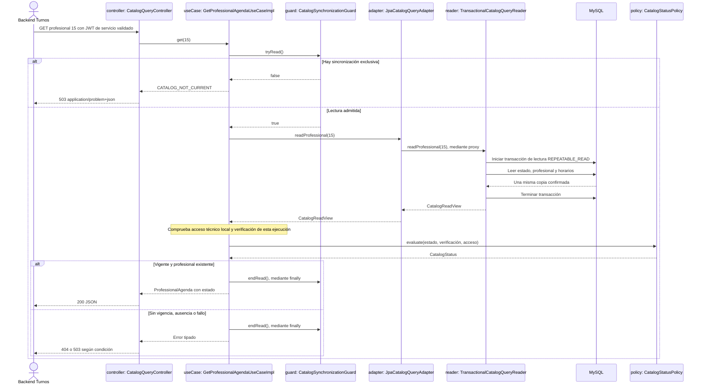

# PLAN: Consultar profesional, agenda y estado del catálogo

**SPEC de referencia:** [SPEC.md](SPEC.md)
**Versión de la spec revisada:** aprobada por el usuario el 2026-10-26, incluida D-01.
**Estado:** Aprobado <!-- Borrador | En revisión | Aprobado -->

**Aprobación del usuario:** 2026-10-27. TASKS aprobadas e implementación autorizada el 2026-10-27; evidencia en [TASKS.md](TASKS.md).

<!-- PARA LA PERSONA
Copia esta plantilla como PLAN.md junto a la SPEC.md aprobada.
Este documento define la solución técnica. Una vez revisado, el agente puede
derivar TASKS.md con tareas, dependencias y comprobaciones.
-->

<!-- PARA EL AGENTE
- Lee la SPEC.md aprobada, las instrucciones del proyecto y los contratos pertinentes.
  Si falta un documento necesario o la spec no está aprobada, indícalo antes de avanzar.
- Inspecciona el repositorio. Referencia rutas verificadas y distingue las nuevas propuestas.
- Propón una solución proporcional al alcance y coherente con el proyecto.
  Reutiliza lo existente y justifica nuevas dependencias o cambios de arquitectura.
- Distingue hechos, decisiones confirmadas y propuestas. Consulta las decisiones
  no resueltas; haz pocas preguntas por vez y actualiza el plan con las respuestas.
- Referencia los requisitos y criterios por su ID, sin copiar toda la spec.
- Si una decisión cambia el comportamiento o alcance, vuelve a la spec y solicita
  confirmación. No resuelvas una duda de producto mediante una suposición técnica.
- Conserva estos comentarios. No implementes durante la planificación.
- Solicita aprobación antes de marcar el plan como Aprobado. La autorización
  para implementar debe ser explícita; no se deduce del estado de los documentos.
- Para cambios de significado posteriores a la aprobación, registra una nota
  breve de cambio, motivo e impacto según AGENTS.md, sin historial separado.
-->

## Contexto técnico verificado

<!-- Qué existe hoy y cómo participa en la funcionalidad. -->

Rutas Java relativas a `src/main/java/com/prog2/catalog/`. Base observada:
`0ec5f30`, PR #19 integrado; rama `11-cu-05-proveer-profesional-y-agenda-vigente-a-turnos`.

| Componente o archivo existente | Ruta verificada | Responsabilidad y uso previsto |
| --- | --- | --- |
| Copia y estado | `synchronization/domain/model/{Professional,WeeklySchedule,CatalogState}.java` | Modelos propios; versión aplicada y comprobación fechada, sin HTTP/JPA. |
| Coordinación | `synchronization/application/usecases/{Synchronize,Update,Recover}CatalogUseCaseImpl.java` | Comparten actualmente un `ReentrantLock` durante el ciclo, sin transacción SQL abierta en la red. |
| Composición | `synchronization/infrastructure/config/SynchronizationConfiguration.java` | Construye el bloqueo y casos de uso. Permite incorporar el cableado de consultas. |
| Persistencia | `synchronization/infrastructure/persistence/repository/Jpa{Professional,WeeklySchedule,CatalogSyncState}Repository.java` | Tablas existentes; falta la consulta de horarios por profesional. |
| Mapeo | `synchronization/infrastructure/persistence/mapper/CatalogSnapshotPersistenceMapper.java` | Ya convierte metadata a dominio; se amplía para leer profesional y horario. |
| Acceso técnico local | `synchronization/infrastructure/integration/adapter/IntegrationTechnicalAccessAdapter.java` | Consume puertos públicos de integración. `getToken()` comprueba la sesión en memoria, sin red. |
| Seguridad | `infrastructure/security/config/SecurityConfiguration.java` | JWT RS256; usuarios en `/api/**`; rutas internas denegadas salvo entrega técnica expresamente autorizada. |
| Errores de filtros | `infrastructure/security/web/SecurityProblemHandler.java` | 401/403 con `application/problem+json`, códigos estables y `no-store`. |
| Esquema y build | `src/main/resources/db/migration/V2__catalog_snapshot.sql`, `V3__catalog_updates.sql`, `pom.xml` | Tablas disponibles; Java 25, Boot 4.1.1, JPA y pruebas MySQL/Kafka/Redis. No hay starter de validación declarado. |

**Convenciones y patrón de referencia:** `hexagonal-arch`, estructura del profesor,
constructor DI y DTO separados. Se conserva el slice `synchronization`, que ya
posee los datos; no se crea otro propietario del catálogo ni otro acceso entre
slices. Se reutiliza la colaboración pública con `integration` ya aprobada.
El material de JPA recomienda transacciones de lectura y DTO; la coordinación
de concurrencia se justifica por RF-02/RF-05, sin atribuir a clase una solución concreta.

## Solución propuesta

<!-- Explica el enfoque y sus motivos. Describe las responsabilidades y el
recorrido desde la solicitud, evento o arranque hasta el resultado del servicio.
Usa un diagrama si aporta claridad. -->

**Recorrido de CU-05:** Turnos solicita el profesional 15. Seguridad valida su JWT
de servicio; el controlador delega al caso de uso. Este obtiene acceso de lectura,
lee estado/profesional/horarios en una transacción local y evalúa D-01. Con vigencia
acreditada devuelve datos y estado juntos; sin vigencia devuelve 503 y sin profesional
en copia vigente devuelve 404. Una deshabilitación se comunica en los datos, sin
ocultarla como ausencia. No se consulta Redis, REST ni Kafka por solicitud.

**CU-06:** dos rutas entregan el mismo estado evaluado con proyecciones distintas:
resumen para KMP y detalle de versión/comprobación para Turnos. Se distingue
indisponibilidad funcional de imposibilidad de leer MySQL. El estado incluido en
CU-05 evita que Turnos necesite consultar primero otra ruta para habilitar su operación.

**Decisiones confirmadas por el usuario el 2026-10-26:** D-01, 60 segundos inclusive;
D-02, coordinación compartida de lectura/escritura; D-03, reutilizar el JWT de
servicio y `ROLE_CATALOG_INTEGRATION`. Los diagramas y el diseño siguiente reflejan
esas decisiones; el usuario aprobó el PLAN completo el 2026-10-27.

### Responsabilidades principales

Un solo diagrama de clases, centrado en CU-05. CU-06 reutiliza el repositorio,
el coordinador y la política; DTO, excepciones y repositorios Spring Data quedan
en la tabla de componentes para mantener legible el recorrido.

```mermaid
classDiagram
    direction TB
    class CatalogQueryController {
        +getProfessionalAgenda(long professionalId) ProfessionalAgendaResponse
        +getUserStatus() CatalogStatusSummaryResponse
        +getServiceStatus() CatalogStatusResponse
    }
    class GetProfessionalAgendaUseCase {
        <<interface>>
        +get(long professionalId) ProfessionalAgenda
    }
    class GetProfessionalAgendaUseCaseImpl {
        +get(long professionalId) ProfessionalAgenda
    }
    class CatalogQueryRepository {
        <<interface>>
        +readProfessional(long professionalId) CatalogReadView
        +readState() CatalogState
    }
    class JpaCatalogQueryAdapter {
        +readProfessional(long professionalId) CatalogReadView
        +readState() CatalogState
    }
    class TransactionalCatalogQueryReader {
        +readProfessional(long professionalId) CatalogReadView
        +readState() CatalogState
    }
    class CatalogStatusPolicy {
        +evaluate(CatalogState state, boolean verified, boolean accessAvailable) CatalogStatus
    }
    class CatalogSynchronizationGuard {
        -boolean verificationRequired
        +tryRead() boolean
        +endRead()
        +trySynchronize() boolean
        +endSynchronization()
        +requireVerification()
        +confirmVerification()
    }
    class TechnicalAccessGateway {
        <<interface>>
        +getToken() String
    }
    CatalogQueryController ..> GetProfessionalAgendaUseCase : delega
    GetProfessionalAgendaUseCaseImpl ..|> GetProfessionalAgendaUseCase
    GetProfessionalAgendaUseCaseImpl --> CatalogQueryRepository
    GetProfessionalAgendaUseCaseImpl --> CatalogStatusPolicy
    GetProfessionalAgendaUseCaseImpl --> CatalogSynchronizationGuard
    GetProfessionalAgendaUseCaseImpl --> TechnicalAccessGateway
    JpaCatalogQueryAdapter ..|> CatalogQueryRepository
    JpaCatalogQueryAdapter --> TransactionalCatalogQueryReader
    note for CatalogSynchronizationGuard "Compartido con CU-01, CU-02 y CU-03; D-02 confirmada"
```

### Secuencia de una consulta a Turnos

Las instancias corresponden a las clases anteriores. El lector es un bean
transaccional invocado desde otro bean; no se depende de autoinvocaciones.

**Patrones y mecanismos:** los adaptadores HTTP/JPA traducen contratos; el puerto
de repositorio aísla persistencia; Spring aplica Proxy a la lectura transaccional.
La inyección por constructor y dependencia de interfaces aplican DIP. La política
de vigencia y el coordinador son responsabilidades concretas, no se presentan como
Strategy, Mediator o State por sus nombres. El bloqueo es un mecanismo del JDK.

## Módulos y componentes afectados

<!-- Si el proyecto está modularizado, identifica los módulos afectados, sus
responsabilidades y la dirección de sus dependencias. Respeta los límites
existentes y justifica cualquier módulo o dependencia nueva. Si no está
modularizado, describe las carpetas o componentes afectados sin introducir
modularización fuera del alcance; marca la tabla de módulos como No aplica. -->

No se incorporan módulos Maven. Se amplía el slice existente y la autorización transversal.

| Módulo | Existe / nuevo | Responsabilidad y cambios | Dependencias afectadas |
| --- | --- | --- | --- |
| `synchronization/` | Existente | Consultas y coordinación de acceso a su propia copia. | Aplicación usa dominio y colaboradores propios; JPA/MVC permanecen en infraestructura. |
| `infrastructure/security/` | Existente | Permitir exactamente los tres GET propuestos para su identidad correspondiente. | Sin cambios al decoder, emisor, claves ni contrato de claims. |
| `integration/` | Existente, reutilizado | Evaluación local del acceso técnico existente. | Solo los puertos públicos ya consumidos; sin repositorios ajenos ni nuevas llamadas remotas. |

<!-- Distingue lo que se reutiliza, modifica o crea. Las rutas nuevas son propuestas.
Señala impacto sobre modelos, contratos o componentes compartidos. -->

Las rutas nuevas siguientes son propuestas. `sync/` abrevia aquí únicamente
`src/main/java/com/prog2/catalog/synchronization/`.

| Componente o ruta | Acción | Cambio y responsabilidad | Requisito relacionado |
| --- | --- | --- | --- |
| `sync/domain/ports/in/{GetProfessionalAgenda,GetCatalogStatus}UseCase.java` | Crear | Entradas de consulta con modelos de dominio. | RF-01/04 |
| `sync/domain/ports/out/CatalogQueryRepository.java` | Crear | Lectura de estado y vista coherente de profesional/agendas. | RF-01/05/06 |
| `sync/domain/model/{CatalogReadView,ProfessionalAgenda,CatalogStatus}.java` | Crear | Vista leída, resultado validado y estado evaluado, sin entidades ni detalles HTTP. | RF-01/04/05 |
| `sync/domain/enums/{CatalogAvailability,CatalogQueryFailure}.java` | Crear | Estados funcionales públicos y motivos tipados de rechazo. | RF-02/03/04/07 |
| `sync/domain/exception/CatalogReadException.java`, `sync/application/exception/CatalogQueryException.java` | Crear | Fallo del puerto de lectura y rechazo de aplicación, sin errores externos libres. | RF-03/07 |
| `sync/application/usecases/{GetProfessionalAgenda,GetCatalogStatus}UseCaseImpl.java` | Crear | Coordinación local, autorización resuelta previamente por HTTP y evaluación del resultado. | RF-01 a RF-07 |
| `sync/application/service/{CatalogStatusPolicy,CatalogSynchronizationGuard}.java` | Crear | Una política compartida para 60 s y un coordinador para lectura/sincronización y verificación de la ejecución. | RF-02/04/05 |
| CU-01/02/03 y `sync/infrastructure/config/SynchronizationConfiguration.java` | Modificar conforme a D-02 | Usar el coordinador común, registrar pérdida/confirmación de verificación y cablear consultas. | RF-02/05/06 |
| `sync/infrastructure/persistence/adapter/JpaCatalogQueryAdapter.java`, `service/TransactionalCatalogQueryReader.java` | Crear | Implementación JPA y frontera de lectura transaccional separada. | RF-01/05/07 |
| `JpaWeeklyScheduleRepository.java`, `CatalogSnapshotPersistenceMapper.java` existentes | Ampliar | Consulta por `professionalId` y conversiones de entidad a dominio. | RF-01/03/05 |
| `sync/infrastructure/web/controller/CatalogQueryController.java` | Crear | Los tres GET, validación de ID y respuestas DTO. | RF-01/04/07 |
| `sync/infrastructure/web/dto/{ProfessionalAgendaResponse,CatalogStatusResponse,CatalogStatusSummaryResponse}.java` | Crear | Formato público; profesional/horario pueden ser records anidados en la respuesta. | RF-01/03/04 |
| `sync/infrastructure/web/mapper/CatalogQueryDtoMapper.java`, `web/exception/CatalogQueryExceptionHandler.java` | Crear | Mapeo manual y errores MVC seguros, sin lógica de vigencia en el controlador. | RF-04/07 |
| `infrastructure/security/config/SecurityConfiguration.java` | Modificar | Reglas de servicio específicas antes de denegación interna; conservar reglas de usuario. | RF-07 |
| `pom.xml`, `README.md` y pruebas propuestas abajo | Ampliar | Bean Validation, contratos y ejecución reproducible. | RF-01/07 |

## Datos y contratos

<!-- Completa solo lo aplicable. Si un punto no aplica, indica el motivo. -->

- **Modelos y contratos de entrada y salida:** `GetProfessionalAgendaUseCase.get(long)` devuelve `ProfessionalAgenda` (profesional, lista de horarios y `CatalogStatus`). El repositorio devuelve `CatalogReadView` con estado, profesional opcional y horarios, permitiendo decidir 503 antes que 404. `GetCatalogStatusUseCase.get()` entrega el mismo modelo de estado para ambas proyecciones HTTP.
- **Identificadores, relaciones y restricciones:** ID positivo `long`, conservado de cátedra. Validación `@Positive` en MVC y defensa de la precondición en el caso de uso. Horarios exclusivamente del profesional solicitado, incluidos deshabilitados. Orden estable lunes a domingo, hora inicial e ID, aplicado sin convertir horas a UTC. Se consulta por ID, no `findAll()` global ni slots.
- **Origen de los datos consultados y transformaciones:** MySQL para estado/datos, acceso técnico ya disponible en memoria y reloj UTC inyectado. Mapper JPA crea valores inmutables antes de terminar la transacción; mapper HTTP crea DTO específicos. El JWT técnico comprobado localmente se descarta y nunca forma parte de esos resultados.
- **Persistencia, consultas y actualizaciones:** lector separado con `@Transactional(readOnly=true, propagation=REQUIRES_NEW, isolation=REPEATABLE_READ, timeout=5)`. Estado, profesional y horarios se leen mediante SELECT normales en esa transacción; no `FOR UPDATE`, sin sesiones JPA que escapen. `readOnly` no sustituye el aislamiento ni se trata como una prohibición absoluta de escritura impuesta por la base. El adaptador traduce fallos posteriores al proxy a `CatalogReadException`.
- **Convivencia entre datos locales y remotos:** ninguna dependencia central por solicitud. La sesión local puede pasar a no utilizable por vencimiento o invalidación; se conserva la conducta de su puerto existente. El estado para Turnos se evalúa junto con los datos, no se reutiliza un permiso obtenido de otra consulta anterior.
- **Compatibilidad y migraciones de datos existentes:** no se requieren tablas, columnas ni migraciones nuevas. Se conservan V2/V3, datos y recibos. La adaptación del coordinador requiere actualizar los constructores y fixtures afectados; no cambia los presupuestos ni transacciones de sincronización.

La transacción mantiene una misma vista para sus SELECT en MySQL; el proxy Spring
se activa por la llamada desde el adaptador al lector. Se verificó este fundamento
en [MySQL 8.4](https://dev.mysql.com/doc/refman/8.4/en/innodb-consistent-read.html) y
[Spring Transactions](https://docs.spring.io/spring-framework/reference/data-access/transaction/declarative/annotations.html).
El timeout de 5 s es de la transacción, no un plazo HTTP total: siguen aplicando los
límites de adquisición de conexión y socket existentes. No se añade otro executor para leer SQL.

### HTTP propuesto

| Método y ruta | Identidad requerida | Respuesta correcta |
| --- | --- | --- |
| `GET /api/internal/catalog/professionals/{professionalId}` | Servicio Turnos autorizado | 200 con `professional`, `weeklySchedules`, `catalog`. |
| `GET /api/internal/catalog/synchronization` | Servicio Turnos autorizado | 200 con estado detallado, incluso sin copia o con fallo funcional. |
| `GET /api/catalog/synchronization` | Usuario con `ROLE_USER` | 200 con resumen del estado, incluso sin copia o con fallo funcional. |

Detalle de las respuestas, con nombres de campos propuestos:

- `professional`: `id`, `categoryId`, `firstName`, `lastName`, `enabled`.
- Cada `weeklySchedules`: `id`, `professionalId`, `dayOfWeek`, `startTime`, `endTime`, `slotDurationMinutes`, `enabled`. Lista completa de sus horarios, sin filtrar por fecha ni habilitación en este contrato. Horas de salida `HH:mm:ss`; no se alteran los valores locales.
- `catalog` y estado detallado: `state`, `copyAvailable`, `appliedVersion`, `observedVersion`, `lastCheckedAt`, `evaluatedAt`. Versiones/comprobación pueden ser nulas cuando se desconocen; instantes UTC ISO-8601. No se entregan runId, diagnósticos internos ni configuración central.
- Resumen KMP: solo `state` y `copyAvailable`. `copyAvailable=true` con estado distinto de `CURRENT` permite el aviso de posible desactualización; CU-04 implementará la búsqueda correspondiente.
- `state`: `NO_COPY`, `CURRENT`, `SYNCHRONIZING`, `RECOVERING`, `STALE`, `FAILED`, `UNVERIFIABLE`. No se serializa directamente el enum persistido: es un estado funcional derivado.

Datos y estado funcional legibles producen 200; que el estado sea fallido no
convierte CU-06 en error HTTP. CU-05 solo entrega datos como resultado correcto
cuando su estado es `CURRENT`. Profesional/agendas deshabilitados producen 200 con
sus flags; Turnos decide si son aplicables. Sin agendas se entrega `[]`.
Todas estas respuestas llevan `Cache-Control: no-store`; los 60 s son una regla
del servidor, no un permiso para reutilizar indefinidamente respuestas en Turnos.

### Errores

| HTTP y código | Condición | Alcance |
| --- | --- | --- |
| 400 `INVALID_PROFESSIONAL_ID` | ID no positivo, no numérico o fuera de `long`. | CU-05, tras los filtros de seguridad. |
| 404 `PROFESSIONAL_NOT_FOUND` | ID válido ausente, con vigencia acreditada. | CU-05; no representa falta de copia ni deshabilitación. |
| 503 `CATALOG_NOT_CURRENT` | Sin copia, vigencia vencida/no verificable, trabajo exclusivo o integración inutilizable. | CU-05, sin datos habilitantes. |
| 503 `CATALOG_UNAVAILABLE` | No puede leerse/verificarse el propio estado o la copia por fallo local. | Ambas consultas; nunca una lista vacía de éxito. |
| 401 `AUTHENTICATION_REQUIRED` | JWT ausente o no admitido. | Filtros existentes, con `WWW-Authenticate: Bearer`. |
| 403 `ACCESS_DENIED` | Identidad admitida sin permiso para la ruta. | Filtros existentes; no consulta datos ni estado funcional. |

Errores MVC con `ProblemDetail`, `application/problem+json`, `type`, `title`,
`status`, `code` e `instance` de ruta sin query/claims. No usar `getMessage()`
de una dependencia como `detail`. Se conserva el contrato de errores de filtros,
sin reescribir seguridad o gestión global de excepciones por esta funcionalidad.

## Estado, operaciones y errores

<!-- Cómo se implementan los comportamientos aprobados en la spec.
Referencia RF/CA y completa solo los puntos pertinentes al backend. -->

- **Estado del servicio y de las operaciones:** `CatalogStatusPolicy` concentra D-01 usando el reloj y límite fijo de 60 s. `CURRENT` requiere copia, fase persistida `CURRENT`, versiones aplicada/observada iguales, comprobación no futura de hasta 60 s, acceso técnico utilizable y verificación válida de esta ejecución. No basta mirar el enum almacenado. Se evalúa al finalizar la lectura para no aprobar un límite vencido mientras se consultaba MySQL.
- **Conservación y restauración del estado:** el coordinador comienza con verificación requerida, sin escribir ni borrar datos. Solo una comprobación Redis correcta o incremento validado y confirmado de la ejecución actual la satisface. Un snapshot por sí solo no la satisface. Ante un fallo conocido, queda requerida incluso si no fue posible persistir su diagnóstico; así no reaparece un `CURRENT` antiguo tras recuperarse MySQL. Duplicados, rechazos o recibos ya cubiertos no simulan una nueva comprobación.
- **Ejecución, concurrencia y cancelación de operaciones:** D-02 confirmada: `CatalogSynchronizationGuard` usa `ReentrantReadWriteLock` del JDK. CU-01/02/03 toman acceso exclusivo reentrante; las consultas toman acceso compartido durante lectura y evaluación. CU-05 no espera una descarga o pausa de sincronización: sin acceso de lectura retorna 503. Lectores simultáneos pueden coexistir; no se asciende de lectura a escritura. Siempre se libera en `finally`, también ante errores/interrupción. Se mantiene coordinación de una sola instancia, sin prometer un bloqueo distribuido.
- **Errores, reintentos y prevención de duplicados:** consultas sin reintentos internos, sin escrituras de negocio y sin login/refresh/recuperación por demanda. `CatalogReadException` se traduce a indisponibilidad; errores de aplicación distinguen entrada/ausencia/vigencia. Los flujos de sincronización conservan sus límites y reconciliación. Las consultas nunca crean recibos de Kafka.
- **Observabilidad y diagnósticos seguros:** registrar fallo de lectura con código genérico, sin cuerpo original, JWT, URL privada ni stack de proveedor en la respuesta. No agregar logs por cada éxito ni nuevas métricas/servicios. Health permanece público y mínimo; CU-06 sigue protegido.

Para derivar el estado, la actividad exclusiva o fase `IN_PROGRESS` produce
`SYNCHRONIZING`; espera de recuperación, `RECOVERING`; fases fallida/no verificable,
`FAILED`/`UNVERIFIABLE`. En los restantes casos, sin copia se usa `NO_COPY`; con copia
pero D-01 no satisfecha, `STALE`; solo todas las condiciones satisfechas dan `CURRENT`.
`copyAvailable` es independiente: por ejemplo, puede existir copia durante recuperación.

CU-06 debe poder responder durante la descarga o transacción del sincronizador:
si no obtiene acceso compartido, lee únicamente metadata confirmada mediante SELECT
no bloqueante y fuerza `SYNCHRONIZING`, sin datos de profesional ni afirmación de
vigencia. Si esa lectura falla, devuelve 503. Esto conserva el aviso para KMP sin
esperar la finalización del trabajo ni leer datos parciales.

Mientras el coordinador exige una primera verificación, CU-05 rechaza antes de
tomar acceso de lectura y CU-06 consulta solo metadata, sin intentar acreditar
`CURRENT`. Así las consultas iniciales no ocupan el bloqueo que necesita CU-01
para arrancar. El marcador de verificación tiene visibilidad entre hilos; su
modificación corresponde exclusivamente a la sincronización. Probar ese arranque
con consultas concurrentes y la liberación posterior, además de dos lectores ya vigentes.

El coordinador sustituye el bloqueo suelto y añade únicamente la necesidad de
verificación local; no es otro scheduler ni otra máquina de recuperación. La
reentrancia compartida conserva CU-02 -> CU-03 -> CU-01. Referencia técnica:
[ReentrantReadWriteLock de Java 25](https://docs.oracle.com/en/java/javase/25/docs/api/java.base/java/util/concurrent/locks/ReentrantReadWriteLock.html).

## Dependencias y configuración

<!-- Librerías, servicios, permisos o configuración afectados. Verifica compatibilidad
con el proyecto y justifica las incorporaciones. No agregues dependencias por defecto. -->

- Conservar Java/Boot/MySQL/JPA y todas las versiones aprobadas. Agregar únicamente `spring-boot-starter-validation`, gestionado por el BOM 4.1.1 verificado localmente, para `@Positive` y el manejo MVC de validación; no fijar otra versión ni agregarlo a dominio. La precondición de aplicación usa tipos Java, sin Jakarta en dominio.
- [Validación MVC de Spring](https://docs.spring.io/spring-framework/reference/web/webmvc/mvc-controller/ann-validation.html): manejar `HandlerMethodValidationException` y conversión de parámetros, sin añadir `@Validated` de clase por defecto. El mapper de errores produce el 400 acordado sin reflejar el valor recibido.
- D-03 confirmada: rutas internas requieren `token_use=service`, `sub=backend-turnos` y `ROLE_CATALOG_INTEGRATION`, además de firma/issuer/audience/tiempos ya validados. Usuario con ese nombre de rol no sustituye la identidad de servicio. El resto de `/api/internal/**` continúa denegado. Sin cambios a `ServiceTokenIssuer` de Turnos ni a la entrega técnica existente.
- No se agregan secretos, variables de entorno, conexión central, caché, OpenFeign, MapStruct ni librerías de concurrencia. Límite de vigencia fijo, como se decidió para esta entrega.
- API documentada en README con rutas/permisos, ejemplo y códigos; detalles referenciados a este PLAN. OpenAPI/Swagger no está instalado ni exigido por estos contratos: esta entrega no incorpora su generador ni publica otra ruta para documentación. Puede evaluarse una automatización al consolidar las APIs propias.

## Estrategia de validación

<!-- Una fila por criterio de la spec. Selecciona el método capaz de demostrarlo:
test unitario, integración, contrato o prueba manual. No todos requieren todos los métodos.
Identifica tests existentes y separa los nuevos propuestos. Incluye regresiones relevantes.
Una captura aislada no demuestra persistencia ni ausencia de peticiones de red. -->

Las clases siguientes son propuestas en `src/test/java/com/prog2/catalog/synchronization/`.
Probar comportamiento real: reloj y fronteras controlados; MySQL real para consultas,
transacciones y serialización HTTP con JWT firmados para autorización. Dobles solo
para dependencias fuera del comportamiento comprobado, no para simular un 200 y afirmarlo.

| Criterio | Método y test existente o propuesto | Entorno y datos necesarios | Evidencia prevista |
| --- | --- | --- | --- |
| CA-01 | `ProfessionalAgendaQueryTests` + `CatalogQueryHttpTests`, caso completo con repositorio/lector reales. | MySQL 8.4.8, profesional/horarios conocidos, sesión local y verificación reciente. | IDs, flags, horas y estado/versiones en el JSON corresponden a la misma copia. |
| CA-02 | `CatalogQueryHttpTests` y pruebas reales del caso de uso. | IDs 0, negativo, no numérico, overflow; válido ausente; copia vacía/versionada y sin versión. | 400/404/503 diferenciados; no convertir ausencia de copia en ausencia de profesional. |
| CA-03 | `CatalogQueryPersistenceTests` + HTTP. | Profesional/horarios deshabilitados, otro profesional y profesional sin agendas. | Se incluyen flags y solo horarios propios; colección vacía legítima y orden estable. |
| CA-04 | `CatalogStatusPolicyTests` + HTTP con casos de uso reales. | Cada fase, con/sin copia; actividad de sincronización controlada. | CU-05 no habilitante; CU-06 informa estado y existencia de copia. |
| CA-05 | `CatalogStatusPolicyTests` + integración del coordinador con CU-02. | Clock controlado: justo antes, exactamente 60 s y justo después; fecha futura, versiones distintas, acceso vencido, nueva ejecución sobre misma DB. | Detecta off-by-one, aceptación de marca anterior al reinicio y falso `CURRENT` tras fallo no persistido. Solo una comprobación correcta vuelve a habilitarlo. |
| CA-06 | `CatalogQueryHttpTests` con filtros, DTO y casos de uso reales. | Usuario/servicio y copia ausente/fallo; fallo de lectura controlado. | 200 para estado funcional legible o 503 por lectura fallida; proyecciones permitidas sin diagnósticos/runId/secretos. |
| CA-07 | Ampliar `security/SecurityHttpTests` o sus fixtures y pruebas HTTP nuevas. | JWT firmado real: user/service, rol ausente, identidad incorrecta, vencimiento y firma inválida. | 401/403 antes del acceso a consultas; servicio válido accede solo a sus rutas y usuario al resumen. Regresión del token central y health. |
| CA-08 | `CatalogQueryConcurrencyTests` + SQL real. | Latches/barriers con plazos finitos; consultas al arrancar, dos lectores, escritor y commits controlados de snapshot/incremento. | Consultas iniciales no impiden CU-01; dos lectores coexisten; CU-05 no lee durante exclusividad; CU-06 sigue disponible; datos/versiones no se mezclan. Liberación del bloqueo tras fallo. |
| CA-09 | Casos de uso/HTTP reales con observación de efectos y gateways. | Copia conocida; sesiones locales; lectura fallida; SQL/dependencias observados. | Datos/versiones/recibos sin cambios; cero llamadas centrales/login/reconstrucción causadas por la consulta. |

En CA-08 no se sustituye el escritor bajo prueba por un mock que ya devuelva
la versión esperada. Se conserva una prueba SQL de snapshot consistente entre
SELECT y commit, y se prueba aparte la exclusión del coordinador con escritores
reales. No se usan sleeps arbitrarios ni se presenta una carrera probabilística
como demostración. Las excepciones liberan acceso y permiten un ciclo posterior.

**Comprobaciones de regresión:** CU-01/02/03, recibos/offsets y recuperaciones
existentes tras adaptar el coordinador; acceso técnico y vencimiento; seguridad
JWT/CORS, entrega técnica y health. Mantener las aserciones de negocio actuales,
sin debilitarlas para acomodar la refactorización.

**Comandos verificados para compilar y ejecutar tests:** existen `./mvnw verify`
y `./mvnw -B -ntp clean verify`. Durante implementación ejecutar primero las clases
afectadas con `-Dtest=... test`, luego `clean verify`, `git diff --check`, revisión
de dependencias entre capas/Javadoc y calidad local CLI/IDE según disponibilidad.
La CLI no se presenta como análisis estático limpio si Vortex no admite esta conexión.
Actions/SonarCloud posteriores son feedback aportado por el usuario, no una tarea de espera.

**Pruebas operativas del backend:** ensayo JAR o Compose aislado con MySQL y sesión
central ficticia controlada: tres GET, límite de vigencia, permisos y reinicio sobre
la misma DB. El ensayo complementa el pipeline real HTTP/JPA; no requiere crear
cuentas centrales ni arrancar/modificar los otros repositorios o el entorno personal.

**Limitaciones del entorno:** no depende del topic Kafka central para validar
estas consultas. Su recepción real continúa pendiente. Los ensayos de esta
funcionalidad no resuelven la disponibilidad del broker ni demuestran una nueva
integración central. No se ejecutaron pruebas de código durante esta planificación.

**Revisión documental, 2026-10-26:** plantilla, referencias y cobertura de 7 RF/9 CA
comprobadas. Diagrama de clases y secuencia aceptados por el parser Mermaid 12.2.0
en un entorno temporal fuera del repositorio; apariencia visual no verificada.
En esa revisión, las decisiones técnicas estaban resueltas y el PLAN completo
seguía en revisión, sin TASKS ni implementación. La aprobación posterior consta
en la cabecera; el desglose se mantiene en [TASKS.md](TASKS.md).

<!-- Esta sección planifica la validación. Durante la implementación, registra
en TASKS.md o en el informe de validación acordado los resultados y evidencias
reales. Usar el cierre de TASKS.md definido en AGENTS.md: CA/evidencia,
regresión y desviaciones del PLAN. Distingue pruebas ejecutadas, fallidas,
no ejecutadas y bloqueadas.
Compilar o tener tests en verde no sustituye revisar los criterios de la spec. -->

## Orden de implementación

<!-- Etapas y dependencias principales. El desglose ejecutable se escribe en TASKS.md.
Incluye puntos de comprobación para avanzar con cambios pequeños. -->

1. Revisar y aprobar este PLAN. Derivar TASKS con RF/CA y verificar su coherencia antes de implementar.
2. Adaptar coordinación y verificación de CU-01/02/03, con regresión enfocada. Unidad separable de commit por su responsabilidad; registrar la evolución técnica mediante nota breve en los PLAN anteriores, sin rehacerlos.
3. Añadir contratos/modelos, política, consultas JPA y casos de uso; verificar D-01, ausencia, flags, fallos y coherencia real en MySQL.
4. Exponer los tres GET, DTO, Bean Validation, errores y permisos. Verificar HTTP/SQL/JWT y aislamiento de acceso sin modificar Turnos/KMP.
5. Completar concurrencia/reinicio y regresión completa, revisar calidad y actualizar README/TASKS con CA, evidencia y desviaciones. El usuario maneja commits/PR.

## Riesgos y decisiones pendientes

<!-- Riesgos concretos de esta solución y cómo se resolverán, sin listas genéricas.
Escribe Ninguna en las decisiones pendientes cuando estén resueltas. -->

- **Riesgos y medidas acordadas:** D-01 acepta posible atraso entre comprobaciones; estado y fecha no garantizan vigencia futura. D-03 reutiliza una identidad ya autorizada a un secreto más sensible, sin ampliar el acceso de usuarios. D-02 afecta coordinación existente: preservar reentrancia, liberar recursos y mantener pruebas de sincronización. La marca de verificación solo vive en memoria y evita convertir en vigente un estado histórico o un fallo no persistido; no duplica el catálogo.
- **Decisiones pendientes:** Ninguna. El usuario confirmó D-02 y D-03 tras comparar las opciones y aprobó el PLAN completo el 2026-10-27.

<!-- ANTES DE SOLICITAR APROBACIÓN
Comprueba que el plan cubre los requisitos, respeta las exclusiones, reutiliza
componentes verificados y permite demostrar todos los criterios de aceptación.
Resuelve dudas y marcadores pendientes. Si la spec cambió, revisa su impacto.
Tras aprobar el plan, deriva TASKS.md con IDs, dependencias, referencias a RF/CA
y comprobaciones. Antes de implementar, realizar el chequeo de coherencia de
AGENTS.md con esos documentos, sin otro informe ni aprobación adicional.
No marques una tarea terminada sin realizar su validación;
si está bloqueada, registra el motivo.
-->
