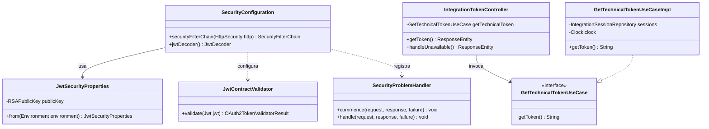
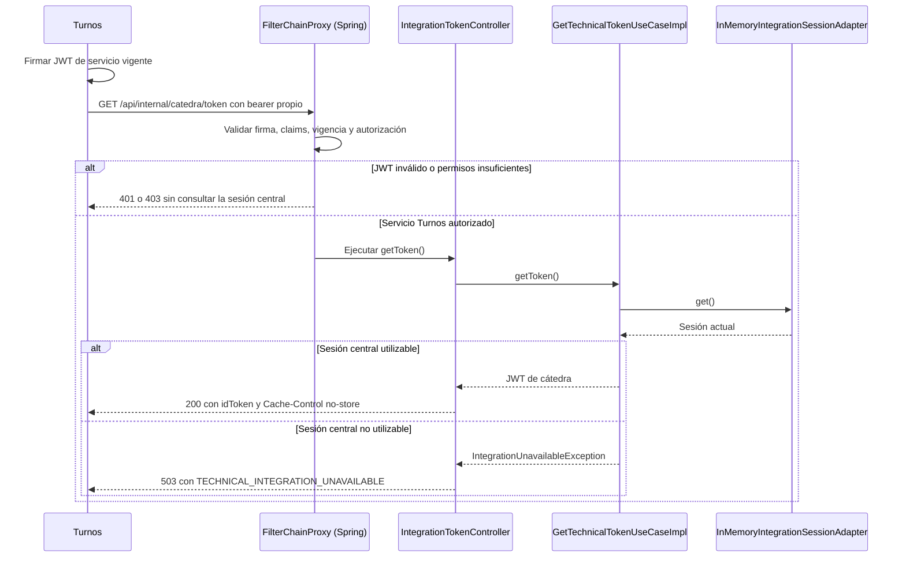

# PLAN: Protección JWT de las APIs de Catálogo

**SPEC de referencia:** [SPEC.md](SPEC.md).
**Versión de la spec revisada:** aprobada explícitamente por el usuario el 2026-10-13.
**Estado:** Aprobado <!-- Borrador | En revisión | Aprobado -->
**Aprobación:** confirmada por el usuario el 2026-10-14; tareas derivadas en [TASKS.md](TASKS.md). Implementación autorizada explícitamente el mismo día; seguimiento y evidencias en TASKS.
**Revisión técnica:** 2026-10-14, el usuario reemplazó HS512 con secreto compartido por RS256.

<!-- PARA LA PERSONA
Este documento define la solución técnica. Tras su aprobación se deriva TASKS.md.
La aprobación del PLAN no autoriza por sí sola a implementar.
-->

<!-- PARA EL AGENTE
- Leer la SPEC aprobada, instrucciones y contratos. Mobile Guidelines es exclusiva de KMP.
- Distinguir componentes existentes, propuestas y decisiones confirmadas.
- Consultar decisiones no resueltas y mantener diseño proporcional al alcance.
- Referenciar RF/CA sin repetir la SPEC. Si cambia comportamiento, revisar la SPEC.
- Conservar secciones y comentarios; no implementar durante la planificación.
- Solicitar aprobación antes de marcar Aprobado; no inferir autorización para implementar.
-->

## Contexto técnico verificado

<!-- Qué existe hoy y cómo participa en la funcionalidad. -->

| Componente | Ruta verificada | Uso |
| --- | --- | --- |
| Build | `pom.xml` | Java 25, Boot 4.1.1, MVC y WebFlux saliente. Starters de Resource Server y pruebas incorporados en #13, con Security 7.1.1 y Nimbus 10.9.1 gestionados por Boot. |
| Consulta de token | `integration/domain/ports/in/GetTechnicalTokenUseCase.java` | Contrato existente `getToken()`, sin HTTP ni Spring en el puerto. |
| Evaluación de sesión | `integration/application/usecases/GetTechnicalTokenUseCaseImpl.java` | Comprueba estado/vencimiento; lanza `IntegrationUnavailableException` sin hacer login. |
| Sesión en memoria | `integration/infrastructure/persistence/adapter/InMemoryIntegrationSessionAdapter.java` | Almacenamiento existente; no modificar su responsabilidad. |
| Health y despliegue | `src/main/resources/application.yaml`, `compose.yaml`, `.env.example` | Health mínimo, parámetros externos y ejecución local. |
| Configuración MySQL | `infrastructure/config/DatabaseConfiguration.java` | Corrección previa de S1118 aplicada; `clean verify` pasó con 63 pruebas el 2026-10-14. Confirmación Sonar remota pendiente. |
| Regresión | `src/test/java/com/prog2/catalog/` | Último `clean verify`: 63 pruebas pasando antes de esta implementación. |

Rutas Java relativas a `src/main/java/com/prog2/catalog/`. El BOM local de Boot 4.1.1 gestiona Spring Security **7.1.1** y Framework **7.0.9**; declara los starters de seguridad/resource server y pruebas citados abajo.

**Convenciones y patrón de referencia:** skill `hexagonal-arch` y ejemplo del profesor. El controlador y DTO pertenecen a `integration/infrastructure/web/` y consumen el puerto del mismo slice. Seguridad transversal en `infrastructure/security/`, según la aclaración de cátedra resumida en [SESSION_HANDOFF](../../../../SESSION_HANDOFF.md). Sin nuevo slice de negocio, dependencias entre dominios, fachada, entidades ni tablas.

## Solución propuesta

<!-- Enfoque, motivos, responsabilidades y recorrido; diagramas solo cuando aclaren. -->

**Decisiones confirmadas:** RS256, con clave privada exclusivamente en Turnos y pública de verificación en Catálogo; JWT de servicio generado localmente por Turnos en cada solicitud, duración de 5 minutos; tolerancia de reloj de 30 segundos para JWT propios; health público; contrato HTTP indicado abajo; HTTP solo en desarrollo local/red privada de Compose y HTTPS fuera de ese entorno, sin instalar proxy/certificados en este issue.

Usar el soporte JWT de **Spring Security Resource Server**, con `NimbusJwtDecoder.withPublicKey(...)`, algoritmo RS256 explícito y una `SecurityFilterChain` servlet. El nombre de la dependencia no implica desplegar un servidor OAuth: Catálogo verifica localmente con la pública configurada y no posee una clave de firma. No consulta a Turnos, no descubre claves remotas y no incorpora un filtro JWT manual. La sesión HTTP es stateless, sin login de formulario, HTTP Basic ni cookies de autenticación.

La firma verifica autenticidad; los validadores comprueban contrato y vigencia; la autorización decide qué operación permite esa identidad. Después, `IntegrationTokenController` llama al puerto existente. Su conversión a DTO es directa, sin mapper dedicado.

Referencia de clase: `toda_la_materia.md` menciona Spring Security (línea 4211) y muestra JWT en JHipster (línea 6943); no se verificó allí una implementación detallada de validadores o claims. La configuración concreta se fundamenta en la [documentación oficial de Spring Security](https://docs.spring.io/spring-security/reference/servlet/oauth2/resource-server/jwt.html).

### Diagrama de clases

Clases propias principales y puerto reutilizado. `SecurityConfiguration` crea componentes del framework y registra las políticas HTTP; no depende del controlador Java. DTO y helpers del framework se describen en las tablas para mantener legibilidad.

### Secuencia de entrega

`FilterChainProxy` es infraestructura de Spring, no una clase propia que deba implementarse. La secuencia muestra ejecución HTTP; el diagrama anterior muestra dependencias entre clases.

**Patrones y mecanismos:** el controlador es el adaptador HTTP de entrada del puerto existente; se conserva inversión de dependencias. La cadena de filtros, el decoder y los handlers son mecanismos de Spring Security que configuramos, sin recrearlos ni introducir patrones adicionales. Javadoc explicará responsabilidades y contratos relevantes, manteniendo secretos fuera de `toString`.

## Módulos y componentes afectados

<!-- Identificar responsabilidades y dirección de dependencias, sin modularización adicional. -->

No hay módulos Maven separados. La seguridad transversal queda en infraestructura y el adaptador HTTP en su slice.

| Componente o ruta propuesta | Acción | Responsabilidad | Requisito |
| --- | --- | --- | --- |
| `infrastructure/security/config/SecurityConfiguration.java` | Crear | Cadena HTTP, decoder, validadores, conversión de autoridades y CORS. | RF-01/02/03/07/08 |
| `infrastructure/security/config/JwtSecurityProperties.java` | Crear | Cargar/validar la pública RSA y orígenes permitidos; no recibe claves privadas. | RF-08 |
| `infrastructure/security/jwt/JwtContractValidator.java` | Crear | Validaciones específicas del contrato propio que no cubren los validadores estándar. | RF-01/03 |
| `infrastructure/security/web/SecurityProblemHandler.java` | Crear | Respuestas 401/403 mínimas en los handlers de seguridad. | RF-06 |
| `integration/infrastructure/web/controller/IntegrationTokenController.java` | Crear | Entrega HTTP y traducción local de indisponibilidad a 503. | RF-04/05/06 |
| `integration/infrastructure/web/dto/TechnicalTokenResponse.java` | Crear | Record con `idToken`, representación de texto redactada. | RF-04/06 |
| Puerto y caso de consulta existentes | Reutilizar | Misma sesión y comprobación de vigencia; sin nuevo login. | RF-04/05 |
| Build, Compose, ejemplo de entorno y README | Modificar | Dependencias, montaje de pública y contrato reproducible. | RF-08 |
| Tests de seguridad, controlador y arranque | Crear/adaptar | Validación criptográfica, autorización y regresión de #6/setup. | CA-01 a CA-08 |

## Datos y contratos

<!-- Completar lo aplicable y señalar datos, persistencia, transformaciones y compatibilidad. -->

### JWT propios, propuesta de contrato para coordinar con Turnos

Un único formato y mecanismo de firma para usuarios y servicio, con perfiles distintos. Los identificadores siguientes son propuestas concretas sujetas a la revisión de este PLAN; no son claves ni URLs de servidores.

| Campo | Usuario final | Servicio Turnos |
| --- | --- | --- |
| Cabecera `alg` | `RS256`, único algoritmo admitido | Igual |
| `iss` | `backend-turnos` | Igual |
| `aud` | Incluye `catalog`; puede incluir `turnos` | `catalog` |
| `sub` | Identificador estable del usuario acordado con Turnos | `backend-turnos` |
| `token_use` | `user` | `service` |
| `auth` | Cadena de autoridades separadas por espacios; usuario común `ROLE_USER` | `ROLE_CATALOG_INTEGRATION` |
| `iat`, `exp` | Emisión y vencimiento obligatorios; duración de usuario se define en Turnos | `exp = iat + 300 s` |

No inferir perfil por nombre de usuario ni por `groupId`. El claim `auth` sigue el [ejemplo oficial de JHipster](https://github.com/jhipster/jhipster-sample-app/blob/main/src/main/java/io/github/jhipster/sample/security/SecurityUtils.java); su [controlador de autenticación actual](https://github.com/jhipster/jhipster-sample-app/blob/main/src/main/java/io/github/jhipster/sample/web/rest/AuthenticateController.java) separa autoridades por espacios y utiliza el login como `sub`. Ese ejemplo usa HS512; elegimos RS256 para separar emisión y verificación. Aquí se propone un identificador de usuario estable en `sub`, a acordar con Turnos, y exigir `iss`, `aud` y `token_use`: son decisiones propias. `iss`, `aud`, `sub`, `iat` y `exp` son campos estándar de JWT; sus valores y obligatoriedad forman parte de nuestro contrato. Esto no cambia el modelo/HTTP de registro/login exigido por cátedra.

Configurar RS256 explícitamente y componer validadores de emisor, audiencia y tiempo con `JwtContractValidator`: `sub` no vacío, perfiles admitidos, formato de autoridades y `iat`/`exp` coherentes. Exigir `exp`; validar `nbf` si existe. Rechazar emisión futura más allá de la tolerancia y duración de servicio mayor a 300 s. El validador temporal usa un `Clock` inyectable; los propios JWT admiten 30 s de desfase al comprobar tiempos. No trasladar esa tolerancia al token de cátedra, cuya regla de #6 se conserva. [API temporal de Spring](https://docs.spring.io/spring-security/reference/api/java/org/springframework/security/oauth2/jwt/JwtTimestampValidator.html).

La conversión de `auth` usa `JwtGrantedAuthoritiesConverter`, configurando el claim y prefijo vacío para conservar `ROLE_*`; se mantiene su separador predeterminado de espacios. No tomar autoridades de cabeceras, query ni cuerpo. Un conjunto vacío no concede permisos; un formato de claim inválido rechaza autenticación. [API de conversión](https://docs.spring.io/spring-security/reference/api/java/org/springframework/security/oauth2/server/resource/authentication/JwtGrantedAuthoritiesConverter.html).

**Importante para el uso:** los 5 minutos no son un timeout de inactividad ni la sesión del usuario. Turnos firma localmente un JWT de servicio nuevo al solicitar el token central, incluso tras horas sin actividad; no requiere relogin ni otro endpoint. La vigencia del JWT central es independiente. Su readquisición se implementa en Turnos #4, no aquí.

### Entrega HTTP confirmada

`GET /api/internal/catedra/token`, sin cuerpo ni parámetros de usuario/integración. Requiere simultáneamente `token_use=service`, `sub=backend-turnos` y `ROLE_CATALOG_INTEGRATION`.

| Estado | Respuesta |
| --- | --- |
| 200 | `application/json`, objeto `{ "idToken": "<jwt-central-ficticio>" }`. Solo el token existente y utilizable. |
| 401 | JWT propio ausente o no válido; `WWW-Authenticate: Bearer`, problema con código `AUTHENTICATION_REQUIRED`. |
| 403 | JWT válido sin la identidad/permisos necesarios; problema con código `ACCESS_DENIED`. |
| 503 | Identidad autorizada, sesión central no utilizable; problema con código `TECHNICAL_INTEGRATION_UNAVAILABLE`. |

Usar `ProblemDetail` de Spring y `application/problem+json` para rechazos de autenticación/autorización (401/403) e indisponibilidad (503): `type=about:blank`, título, estado y extensión `code`, sin mensajes originales de excepciones ni tokens. No crear otra jerarquía de errores. Headers `Cache-Control: no-store` en entrega/errores y `Pragma: no-cache` como compatibilidad. Los handlers 401/403 operan en la cadena de seguridad; una excepción del filtro no llega normalmente al controlador. [ProblemDetail de Spring MVC](https://docs.spring.io/spring-framework/reference/web/webmvc/mvc-ann-rest-exceptions.html).

**Persistencia, convivencia y migraciones:** no nuevas tablas, migraciones, cuentas, repositorios ni caché de tokens. Par RSA propio por entorno; Catálogo conserva solo la pública y la sesión central permanece en memoria. La entrega no consulta a cátedra ni demuestra vigencia de catálogo. Catálogo y Turnos intercambian HTTP/JSON, sin dependencia compartida de código ni acceso cruzado a bases.

## Estado, operaciones y errores

<!-- Referenciar RF/CA y resolver ejecución, concurrencia, recuperación y casos del backend. -->

- **Autorización HTTP:** permitir `GET /actuator/health`; regla específica de entrega con la identidad/permisos anteriores; denegar el resto de `/api/internal/**`; para `/api/**`, exigir perfil `user` y `ROLE_USER`; denegar demás accesos. Los CU futuros deberán añadir sus reglas de operación antes de publicar endpoints. Ninguna ruta de negocio ficticia se despliega para completar este issue.
- **Estado:** `SessionCreationPolicy.STATELESS`; no persistir `SecurityContext` en sesión ni habilitar form login/Basic. El despacho interno de errores debe preservar las respuestas sin abrir `/error` a llamadas externas.
- **CSRF y CORS:** API autenticada solo mediante bearer en cabecera, sin credenciales automáticas en cookies; desactivar CSRF para este contrato y documentar la condición. Si se agregan cookies, revisar esa decisión. CORS se procesa antes de autenticación para preflight autorizado; no permite acceso al token central sin JWT de servicio. [Criterio CSRF de Spring](https://docs.spring.io/spring-security/reference/servlet/exploits/csrf.html).
- **Concurrencia:** cada petición obtiene su contexto de seguridad y consulta el almacenamiento atómico existente. No añadir executor, bloqueo ni estado de autenticación mutable compartido.
- **Errores y recuperación:** 401/403 antes de consultar el token; 503 saneado desde `IntegrationUnavailableException`. Sin reintentos ni renovación del acceso central desde este endpoint. Expiración/reinicio mantienen #6.
- **Interfaz y ciclo de vida mobile:** no aplican. Esta funcionalidad prepara una API backend; no modifica KMP ni la sesión de sus usuarios.

## Dependencias y configuración

<!-- Verificar compatibilidad y justificar dependencias; no incorporarlas por defecto. -->

- Proponer `spring-boot-starter-security-oauth2-resource-server`, gestionado por Boot 4.1.1; aporta soporte de seguridad/bearer/JWT. Añadir el starter de pruebas correspondiente `spring-boot-starter-security-oauth2-resource-server-test` en scope test, utilizando solo sus utilidades necesarias. Confirmar árbol transitivo al implementar; no fijar versiones adicionales de Spring/Nimbus ni añadir JJWT en paralelo.
- `JWT_PUBLIC_KEY_PATH` obligatorio: archivo PEM de pública RSA en formato X.509 (`PUBLIC KEY`), con módulo de al menos 2048 bits, mínimo definido por [RS256 en RFC 7518](https://www.rfc-editor.org/rfc/rfc7518.html#section-3.3). Cargar mediante los conversores RSA de Spring/JDK, sin implementar criptografía propia. Ausencia, archivo ilegible, PEM inválido, clave de otro tipo o RSA insuficiente detienen el arranque con diagnóstico saneado, sin volcar contenido. Catálogo no genera claves ni acepta una privada como configuración de verificación.
- Proveer la pública de Turnos explícitamente; no aceptar una clave o URL suministrada por el propio JWT. Sin servidor JWKS, descubrimiento ni descarga de claves. El par se genera fuera de Catálogo; su privada pertenece exclusivamente al entorno de Turnos. La carga directa de pública está [soportada por Spring Security](https://docs.spring.io/spring-security/reference/servlet/oauth2/resource-server/jwt.html#oauth2resourceserver-jwt-decoder-public-key).
- `CORS_ALLOWED_ORIGINS` opcional, lista explícita por entorno. Vacía por defecto: sin acceso cross origin de navegadores. Android nativo y comunicación backend no requieren habilitar un origen web. Sin comodines ni cookies; permitir los métodos necesarios y `Authorization`/`Content-Type` para orígenes configurados. Validar formato de orígenes y preflight; no exponer cabeceras con secretos.
- Emisor, audiencia, identidad, autoridad de servicio, duración y tolerancia se fijan al contrato anterior inicialmente; evitar múltiples parámetros que no necesita el proyecto.
- `.env.example` declara `JWT_PUBLIC_KEY_PATH` vacío. En ejecución local señala la pública del host; Compose monta ese archivo en `/run/keys/turnos-public.pem` como solo lectura y configura esa ruta dentro del contenedor. Usar un bind mount que falle si falta el archivo, sin crear un directorio por error. No montar la privada en Catálogo. Ignorar los archivos locales de claves; tests generan pares RSA ficticios independientes. README explicará generación del par, distribución de la pública y ejecución reproducible, sin publicar privadas.
- Rotación inicial manual: reemplazar el par en Turnos y la pública configurada en Catálogo de manera coordinada y reiniciar para cargarla. Los JWT propios firmados con la clave anterior dejan de aceptarse; los usuarios podrán requerir login y Turnos firma nuevos tokens de servicio. No cambia el JWT de cátedra ni se agrega rotación automática en este issue.
- HTTP se limita al entorno local/red privada de Compose acordado. Documentar HTTPS para exposición fuera de ese entorno; esta entrega no instala certificados/proxy ni presenta HTTP local como transporte seguro para redes no confiables.
- Sin nueva dependencia OpenAPI/Swagger: el contrato queda documentado aquí y en README. Su adopción puede evaluarse cuando aporte una necesidad concreta, sin bloquear la entrega.

## Estrategia de validación

<!-- Una fila por CA; probar comportamiento real y distinguir evidencia prevista de ejecutada. -->

| Criterio | Método y test propuesto/existente | Entorno y datos | Evidencia prevista |
| --- | --- | --- | --- |
| CA-01 | `SecurityHttpTests`: cadena y decoder reales; tokens firmados con RS256, otro par RSA, `alg=none`, intento HS512 con bytes de la pública, claims ausentes/inválidos, vencimiento y `nbf`. | MVC de prueba, pares RSA ficticios y reloj controlado. | 401; ningún acceso al puerto de entrega. |
| CA-02 | JWT de usuario con el contrato de Turnos y control de permisos. Controlador de prueba solo en `src/test`, protegido por las mismas reglas `/api/**`. | Firmante real de prueba; no reemplazar decoder ni usar `jwt()` para eludir validación. | Usuario autenticado; acceso permitido/403; sin cuenta local ni endpoint ficticio en producción. |
| CA-03 | JWT `user` con permiso de servicio, `service` con sujeto incorrecto, permiso ausente, JWT central con otra clave y servicio correcto. | Autenticación real; puerto real observado con spy cuando haga falta. | Solo la combinación completa entrega el secreto. |
| CA-04 | `SecurityHttpTests`: controlador, caso de uso y almacenamiento reales con sesión READY. | Token central ficticio, validación JWT propia real. | 200, JSON exacto, headers de no caché y sin credenciales adicionales. |
| CA-05 | Sesiones INITIALIZING/FAILED, sin token, vencidas y reinicio/contexto nuevo; reutilizar escenarios de #6 donde corresponda. | Reloj controlado; no cátedra real. | 503/código estable; no login disparado por entrega. |
| CA-06 | Solicitudes no autorizadas sobre sesiones disponibles/indisponibles. | Spy que conserva comportamiento del caso de uso. | 401/403; caso de consulta no invocado y ausencia de secretos en respuesta/logs. |
| CA-07 | Adaptar `CatalogApplicationTests`: health público mínimo; entrega antes inédita ahora 401 sin JWT. | Spring Boot/Testcontainers MySQL, fixture central existente. | Health 200; APIs no públicas protegidas; integración inicial conservada. |
| CA-08 | Propiedades: archivo público ausente/ilegible, PEM inválido, clave privada/otro tipo o RSA insuficiente y orígenes inválidos; CORS permitido/denegado; revisar README, Compose y salidas. | Pares RSA/archivos temporales exclusivamente de prueba. | Fallo local seguro, preflight correcto, privada ausente de Catálogo y ninguna credencial publicada. |

**Regresiones:** mantener arranque, MySQL/Flyway, health y políticas de #6. Actualizar fixtures de arranque con la pública de prueba para que las pruebas de MySQL sigan fallando por su causa prevista. Las comprobaciones de `/actuator` y `/actuator/env` sin autenticación pasarán de 404 a rechazo de seguridad; no habilitar esos endpoints. Cubrir límites temporales dentro/fuera de los 30 s, JWT sin `exp`, autoridades vacías/malformadas y tokens que intenten cruzar perfiles. Una firma correcta con `iss`/`aud` incorrectos también se rechaza.

**Comando verificado existente:** `./mvnw -B -ntp clean verify` genera JaCoCo. Tras implementar, revisar cobertura de caminos de error y feedback Sonar/Actions sin fabricar excepciones para sumar porcentaje. CLI local `sonar` no pudo analizar por Vortex 403; usar IDE o CI, sin presentar esa limitación como análisis exitoso ni repetir intentos rechazados.

**Dispositivos:** no aplican. **Limitación de integración:** Turnos aún no emite estos JWT ni consume la entrega implementada; las pruebas contractuales usan un firmante real ficticio. El ensayo entre ambos servicios quedará pendiente hasta implementar el consumidor, aunque la entrega HTTP de Catálogo se pruebe aquí.

### Correcciones previas y controles de entrega

- Resolver S1118 de `DatabaseConfiguration` en un cambio previo separado y comprobar con las pruebas existentes que Spring sigue construyendo la configuración sin proxies y que se conservan los fallos por parámetros/DB inválidos. Registrar evidencia en [TASKS del setup](../setup-backend/TASKS.md); no agregar una prueba que solo inspeccione la visibilidad del constructor.
- Mantener los tests adicionales de #6, ya en el commit `0b959fb`, separados del código JWT. Su efecto sobre Sonar de `main` solo se confirma tras integración por PR.
- Revisar responsabilidades y dirección de imports al incorporar seguridad: sin Spring/JWT/HTTP en dominio, sin infraestructura en casos de uso, sin duplicar el caso de consulta ni crear capas vacías.
- Probar el contrato HTTP exacto, errores ProblemDetail y autorización previa a leer la sesión; verificar firmas RSA reales, algoritmo fijo, claims y tiempos. Revisar líneas y ramas sin cobertura relevantes y corregir hallazgos justificados de Sonar; conservar el umbral actual, sin excluir código ni fabricar fallos solo para obtener porcentaje.
- Revisar las alertas de dependencias disponibles en GitHub/CI y registrar la fuente. Cero vulnerabilidades de código en Sonar no demuestra cero CVEs; si no hay evidencia de dependencias, dejar esa limitación explícita, sin afirmar un análisis ejecutado ni introducir un scanner adicional por defecto.
- Comprobar las dos formas de ejecución (Compose y Java local), montaje de pública sin privada, README y evidencia en TASKS; la decisión de firma y confianza se conserva en este PLAN. Publicación mediante PR a cargo del usuario. Revisar tanto Actions como el check informativo de Sonar después del push.

**Trabajo siguiente:** tras #13, continuar CU-01, CU-02/03 y consultas con sus propias SPEC/PLAN/TASKS, sin adelantar su código a este issue.

<!-- Durante la implementación, registrar en TASKS los resultados reales.
No declarar superados criterios, builds o integración entre repositorios desde este PLAN.
-->

## Orden de implementación

<!-- Etapas/dependencias; el desglose ejecutable se deriva en TASKS tras aprobación. -->

1. Preparación de calidad autorizada por el usuario: S1118 corregido localmente, regresión de 63 pruebas correcta y evidencia registrada en TASKS del setup. Pendiente publicación/revisión Sonar a cargo del usuario. Conservar separado el commit de tests de #6 ya realizado.
2. Tras aprobar este PLAN, derivar TASKS de #13; dependencias, pública RSA validada y contrato JWT. Verificar firma/claims/tiempos con pares de prueba.
3. Cadena de seguridad, autoridades, errores y CORS. Verificar rechazos antes de ejecutar operaciones y health público.
4. Controlador/DTO de entrega sobre el puerto existente. Verificar 200/401/403/503, ausencia de secretos y no caché.
5. Adaptar regresión, Compose y README; ejecutar `clean verify`, revisar JaCoCo y dejar el contrato disponible para la sesión de Turnos. No modificar ese repo.

## Riesgos y decisiones pendientes

<!-- Riesgos concretos y medidas, sin listas genéricas; resolver antes de aprobar. -->

- **Riesgos y medidas:** RS256 separa emisión y verificación: solo Turnos tiene la privada; la pública de Catálogo no permite fabricar JWT de Turnos. Proteger la privada y la integridad del archivo público/configuración; un reemplazo malicioso de la pública altera la confianza. Los 5 minutos acotan reutilización de un token filtrado, no el daño de filtrar la privada. Una intrusión en Catálogo aún podría exponer su sesión central: esta decisión no elimina ese riesgo.
- **Separación de perfiles:** permiso de servicio, sujeto y `token_use` se comprueban conjuntamente. Turnos controla las autoridades al registrar usuarios y nunca concede permisos de servicio por campos enviados por KMP.
- **Coordinación:** este PLAN documenta el contrato proveedor; la implementación consumidora se coordina con Turnos #4/#7. No declarar probada esa integración ni modificar su repo como parte de Catálogo #13.
- **Decisiones pendientes:** ninguna consulta técnica abierta. El usuario aprobó integralmente el PLAN, revisó las tareas derivadas y autorizó implementar el 2026-10-14. El avance y las verificaciones reales se registran en [TASKS.md](TASKS.md); la corrección previa de calidad fue autorizada por separado.

<!-- ANTES DE SOLICITAR APROBACIÓN
Comprobar RF/CA, exclusiones, límites de arquitectura y referencias.
Solicitar aprobación y luego derivar TASKS; implementar solo con autorización explícita.
-->
