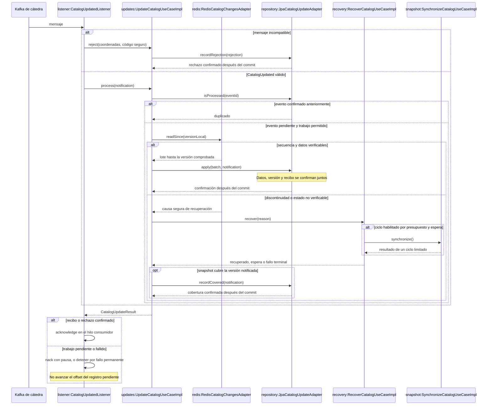

# PLAN: Incorporar incrementos y recuperar discontinuidades

**SPEC de referencia:** [SPEC.md](SPEC.md)
**Versión de la spec revisada:** aprobada por el usuario el 2026-10-19.
**Estado:** Aprobado <!-- Borrador | En revisión | Aprobado -->
**Aprobación del usuario:** «apruebo plan. dale con las tasks».

**Supuesto de integración:** cátedra publica un estado coherente de entidades,
cambios y versión. Su mecanismo interno no está verificado. El PLAN aprobado
permite derivar TASKS; la implementación requiere autorización explícita.

**Aclaración al aprobar:** GitHub Actions es retroalimentación posterior aportada
por el usuario. Consultar los resultados que comparta para atender defectos
demostrados; no crear una tarea de esperar/ejecutar CI ni condicionar el cierre
local a su recepción. La validación propia se realiza con las pruebas y controles
locales indicados aquí.

<!-- PARA LA PERSONA
Este documento define la solución técnica. Las propuestas pendientes se revisan
con el usuario; TASKS se deriva después de aprobar el PLAN.
-->

<!-- PARA EL AGENTE
- Lee la SPEC aprobada, las instrucciones y el código pertinente.
- Distingue rutas existentes, componentes propuestos y decisiones pendientes.
- Reutiliza lo existente y justifica dependencias o mecanismos adicionales.
- Consulta decisiones no resueltas; no conviertas supuestos externos en garantías.
- Referencia RF/CA, sin copiar la SPEC. Si cambia el alcance, vuelve a ella.
- Conserva secciones/comentarios; no implementes durante la planificación.
- No marques Aprobado sin confirmación ni deduzcas autorización de implementar.
-->

**Ajuste de implementación, 2026-10-23:** autorización explícita al aprobar TASKS.
El lector Redis usa un executor dedicado para imponer los 20 s globales; su tarea
solo lee y nunca escribe MySQL tras un timeout. Un timeout de red es temporal,
sin inferir una discontinuidad. Se comparte la configuración JSON estricta con
el mapper existente. Los diagramas reflejan `runId`, publicación y reanudación.
CU-02 registra IN_PROGRESS antes de preparar el lote, para no mostrar la última
comprobación como actualización terminada durante el trabajo. Las regresiones
de CU-01 aíslan el monitor nuevo; el seguimiento se verifica por
separado con Redis/Kafka/MySQL y en el arranque real de JAR/Compose. No cambia
alcance ni aceptación; evidencia y límites en TASKS (T-02/T-04/T-06/T-07).

**Ajuste posterior al feedback del PR, 2026-10-24:** se explicita la publicación
sincronizada de los clientes ya configurados y el cierre del scheduler como bean
administrado por Spring. Las consultas internas del escritor se separan de sus
entradas transaccionales públicas para participar en la misma unidad atómica.
CU-02 obtiene metadata desde `CatalogUpdateRepository`, conservando lectura fresca
y eliminando su dependencia de `CatalogSnapshotRepository`. No se agrupan
parámetros artificialmente ni se cambian RF/CA, presupuestos o contratos externos.
Se completan pruebas de interrupción, recuperación y cierre (CA-02/06/08/09/10,
T-01/T-03/T-04/T-05/T-06/T-07); resultados posteriores en TASKS.

## Contexto técnico verificado

**Corrección posterior, 2026-10-27:** autorizada por el usuario antes de continuar
las consultas de catálogo. Un timeout real al confirmar metadata se clasificó
como terminal y detuvo el seguimiento. Se ajustará la traducción compartida de
los adaptadores JPA de snapshot e incrementos para reconocer SQLState de conexión
`08`, tipos JDBC de conexión o un fallo transaccional Hibernate con SQLException
sin SQLState tras fallar el rollback, conservando resultado incierto. Validar el fallo
de commit antes/después de confirmar y el rollback con conexión cerrada en MySQL real,
reconciliación y reanudación posterior sin reiniciar; mantener terminales los
errores SQL permanentes. Afecta RF-06/RF-08/RF-09 y CA-03/CA-08/CA-09/CA-10,
sin nuevos requisitos, dependencias, timeouts ni cambios de políticas.

<!-- Componentes existentes y participación prevista. Rutas bajo src/main/java/com/prog2/catalog/. -->

| Componente o archivo existente | Ruta verificada | Responsabilidad y uso previsto |
| --- | --- | --- |
| Arranque | `infrastructure/startup/CatalogStartupRunner.java` | Adquiere acceso y llama al snapshot una vez; añadir después el seguimiento continuo sin alterar la política inicial. |
| Snapshot | `synchronization/application/usecases/SynchronizeCatalogUseCaseImpl.java` | Tres intentos por ciclo, candidato/runId estables y reconciliación; reutilizar para CU-03. Su bloqueo hoy es privado. |
| Composición | `synchronization/infrastructure/config/SynchronizationConfiguration.java` | Construye caso de uso y WebClient con límites 5/10/20 s y 8 MiB. |
| Escritor transaccional | `synchronization/infrastructure/persistence/service/TransactionalCatalogSnapshotWriter.java` | Bean separado con `@Transactional(REQUIRES_NEW)` y timeout de 20 s; patrón de frontera para incrementos. |
| Adaptador JPA | `synchronization/infrastructure/persistence/adapter/JpaCatalogSnapshotAdapter.java` | Traduce también fallos de commit; mantener esa garantía. |
| Estado y migración | `synchronization/domain/model/CatalogState.java`, `synchronization/infrastructure/persistence/entity/CatalogSyncStateEntity.java`, `src/main/resources/db/migration/V2__catalog_snapshot.sql` | Versión/runId confirmados y último intento; ampliar solo lo necesario para seguimiento y recuperación. |
| Configuración adquirida | `integration/domain/model/IntegrationConfiguration.java` | Ya contiene Redis, topic y consumer group. La sesión permanece en memoria y protege su representación de texto. |
| Colaboración entre slices | `synchronization/infrastructure/integration/adapter/IntegrationTechnicalAccessAdapter.java` | Consume puertos públicos de integration; ampliar por esa frontera conforme a D-03. |
| Build y pruebas | `pom.xml`, `src/test/java/com/prog2/catalog/synchronization/` | Java 25, Boot 4.1.1, JPA/MySQL, Mockito y Testcontainers. Todavía sin dependencias Kafka/Redis en el POM. |

**Convenciones y patrón de referencia:** skill `hexagonal-arch`, estructura del
profesor y dependencias hacia el dominio. Constructor DI y Javadoc en español.
Adapter aísla Kafka/Redis/JPA; Repository expresa persistencia; el proxy transaccional
es un mecanismo de Spring. No introducir una jerarquía de estados ni capas adicionales
solo para describir el flujo. Usar `infrastructure/messaging` y `infrastructure/redis`
según su contenido, conforme a las aclaraciones de cátedra.

## Solución propuesta

<!-- D-01 a D-06 acordadas el 2026-10-19. Solución aprobada al solicitar TASKS. -->

Ejemplo: la copia local está en `7` y Redis publica `10`. Leer la secuencia `8..10`
identifica los IDs afectados, pero sus entidades ya representan el estado actual.
La decisión D-02 reúne esos cambios y confirma una unidad `7 → 10`; no publica una
copia etiquetada `8` que contenga valores de `10`. Un hueco o lectura no verificable
activa CU-03, que reutiliza el snapshot. Las unidades confirmadas anteriormente se
conservan si falla esta nueva unidad (RF-03/04/07).

Kafka y la comprobación periódica entran en el mismo caso de uso. La notificación
se reconoce por `eventId`; el trabajo sigue la versión persistida y la metadata de
Redis. La recepción de eventos no reinicia presupuestos ni elude esperas. El proceso
continúa activo y conserva su copia ante indisponibilidad; disponibilidad de proceso,
copia y vigencia siguen siendo condiciones diferentes.

### Responsabilidades principales propuestas

```mermaid
classDiagram
class CatalogUpdatedListener {
  +onMessage(message, acknowledgment) void
}
class UpdateCatalogUseCase {
  <<interface>>
  +process(notification) CatalogUpdateResult
  +reject(rejection) CatalogUpdateResult
  +check() SynchronizationResult
}
class UpdateCatalogUseCaseImpl {
  -CatalogChangesGateway changes
  -CatalogUpdateRepository repository
  -RecoverCatalogUseCase recovery
  +process(notification) CatalogUpdateResult
  +reject(rejection) CatalogUpdateResult
  +check() SynchronizationResult
}
class CatalogChangesGateway {
  <<interface>>
  +readSince(baseVersion) CatalogChangesBatch
}
class RedisCatalogChangesAdapter {
  +readSince(baseVersion) CatalogChangesBatch
}
class CatalogUpdateRepository {
  <<interface>>
  +getState() CatalogState
  +isProcessed(eventId) boolean
  +apply(runId, batch, notification) CatalogState
  +recordCovered(notification) void
  +recordRejection(rejection) void
}
class JpaCatalogUpdateAdapter {
  -TransactionalCatalogUpdateWriter writer
  +getState() CatalogState
  +isProcessed(eventId) boolean
  +apply(runId, batch, notification) CatalogState
}
class TransactionalCatalogUpdateWriter {
  +apply(runId, batch, notification) CatalogState
}
class RecoverCatalogUseCase {
  <<interface>>
  +recover(reason) SynchronizationResult
  +resume() Optional~SynchronizationResult~
}
class RecoverCatalogUseCaseImpl {
  -SynchronizeCatalogUseCase snapshots
  +recover(reason) SynchronizationResult
  +resume() Optional~SynchronizationResult~
}
class SynchronizeCatalogUseCase {
  <<interface>>
  +synchronize() SynchronizationResult
}
class CatalogChangesBatch {
  +long baseVersion
  +CatalogPublication publication
  +List~ProfessionalCategory~ categories
  +List~Professional~ professionals
  +List~WeeklySchedule~ schedules
}
class CatalogUpdateResult {
  +SynchronizationPhase phase
  +boolean recorded
  +Instant retryAt
  +String safeDiagnostic
  +SnapshotFailureKind failureKind
}
CatalogUpdatedListener --> UpdateCatalogUseCase
UpdateCatalogUseCaseImpl ..|> UpdateCatalogUseCase
UpdateCatalogUseCaseImpl --> CatalogChangesGateway
UpdateCatalogUseCaseImpl --> CatalogUpdateRepository
UpdateCatalogUseCaseImpl --> RecoverCatalogUseCase
RedisCatalogChangesAdapter ..|> CatalogChangesGateway
JpaCatalogUpdateAdapter ..|> CatalogUpdateRepository
JpaCatalogUpdateAdapter --> TransactionalCatalogUpdateWriter : llamada mediante proxy
RecoverCatalogUseCaseImpl ..|> RecoverCatalogUseCase
RecoverCatalogUseCaseImpl --> SynchronizeCatalogUseCase : reutiliza CU-01
CatalogChangesGateway ..> CatalogChangesBatch : devuelve
CatalogUpdateRepository ..> CatalogChangesBatch : confirma
UpdateCatalogUseCase ..> CatalogUpdateResult : devuelve
```

El diagrama muestra fronteras y contratos, sin duplicar todos los modelos,
mappers o repositorios Spring Data. El seguimiento periódico invoca `check()`;
no requiere mensajes ficticios. `CatalogUpdateResult` indica si hay reconocimiento
durable suficiente para confirmar el mensaje o si debe esperar/detenerse. No es
el ACK del broker. `SynchronizationResult` conserva la clasificación del fallo
de snapshot para que CU-03 decida sin interpretar textos de diagnóstico.

### Recorrido de una notificación

## Módulos y componentes afectados

<!-- No se crean módulos Maven. Las rutas nuevas son propuestas, no código existente. -->

| Módulo | Existe / nuevo | Responsabilidad y cambios | Dependencias afectadas |
| --- | --- | --- | --- |
| `synchronization/` | Existe | Incrementos, notificaciones, comprobación y recuperación. | Su dominio; clientes y JPA solo en infraestructura. |
| `integration/` | Existe | Consulta de configuración adquirida mediante una interfaz Java interna, D-03. | Sus propios puertos/modelos; sin conocer synchronization. |
| `infrastructure/config` y `infrastructure/startup` | Existen | Composición, clientes con configuración dinámica y ciclo de vida. | Puertos públicos de ambos slices y frameworks. |

| Componente o ruta | Acción | Cambio y responsabilidad | Requisito relacionado |
| --- | --- | --- | --- |
| `synchronization/domain/model/`, `domain/enums/` | Ampliar | Notificación, lote y resultados/estado de recuperación necesarios. Conservar modelos de entidades. | RF-02/03/04/07/09 |
| `synchronization/domain/ports/in/UpdateCatalogUseCase`, `RecoverCatalogUseCase` | Crear | CU-02 y CU-03 permanecen diferenciados. | RF-01 a RF-09 |
| `synchronization/domain/ports/out/CatalogChangesGateway`, `CatalogUpdateRepository` | Crear | Lectura remota y persistencia de unidades/recibos, sin tipos Spring. | RF-03/04/05 |
| `synchronization/application/usecases/` | Crear | Un caso por CU, con pasos privados legibles y política acotada. | RF-01 a RF-09 |
| `SynchronizeCatalogUseCaseImpl` y configuración del slice | Modificar | Inyectar un mismo bloqueo reentrante en las escrituras y conservar la clasificación del fallo en su resultado. No decidir reintentos por textos de diagnóstico. | RF-04/06/07 |
| `synchronization/infrastructure/redis/adapter`, `redis/dto` | Crear | Redis síncrono, metadata/changes/hashes, límites y traducción de fallos. | RF-03/04/06 |
| `synchronization/infrastructure/messaging/` | Crear | Listener y contenedor Spring Kafka dinámico; validación externa y offsets, sin lógica de actualización en el listener. | RF-01/02/05 |
| `synchronization/infrastructure/persistence/` | Ampliar | Adaptador y escritor separado para incrementos/recibos; reutilizar repositorios y mapper actuales. | RF-04/05/08 |
| `integration/domain/ports/in/`, `integration/application/usecases/` | Crear | Consulta de configuración de una sesión utilizable mediante una interfaz Java interna, sin endpoint HTTP. | RF-01/06 |
| Configuración raíz y coordinador de arranque | Modificar | Crear/cerrar recursos tras adquirir configuración; activar seguimiento solamente con copia confirmada. | RF-01/08/09 |
| `src/main/resources/db/migration/V3__catalog_updates.sql` | Crear | Metadata de comprobación y registros durables de eventos procesados/rechazos; no editar V2 aplicada. | RF-04/05/08 |
| `pom.xml`, pruebas, README | Modificar | Dependencias concretas, validación aislada y ejecución reproducible. | CA-01 a CA-10 |

## Datos y contratos

<!-- Modelos, persistencia y compatibilidad; decisiones de consistencia explícitas. -->

- **Entrada:** deserializar mensajes Kafka como texto y mapear un DTO propio; validar esquema/tipos/campos contractuales e ignorar extras compatibles. Evitar confiar en cabeceras que designen clases Java externas. Dominio recibe valores propios, no `ConsumerRecord` ni `Acknowledgment`.
- **Lote acordado (D-02):** versión base, versión objetivo, instante publicado, secuencia comprobada e IDs/entidades afectados. Unir IDs repetidos entre versiones para obtener su estado actual. Arrays vacíos no significan que falte el incremento; un field ausente del hash no se interpreta como baja física.
- **Lectura Redis:** asumir una publicación central coherente de entidades, cambios y versión, conforme al uso previsto del contrato. Leer metadata, verificar ventana, recuperar todos los `changes` necesarios y entidades, y volver a comprobar la publicación. Si cambia, descartar el candidato sin escribir; reintentar de forma acotada o recuperar por snapshot. El supuesto permite interpretar metadata estable como una publicación estable; no constituye verificación de la implementación central. No agregar pipeline, MULTI o Lua como prueba de atomicidad del productor.
- **Escritura:** bloquear metadata, comprobar que la versión base sigue siendo la aplicada y guardar categorías, profesionales y agendas en orden de referencias. Confirmar lote, versión objetivo, runId y recibo del evento en una transacción MySQL nueva. Las filas no afectadas permanecen; no llamar al reemplazo completo para simular un incremento.
- **Frontera:** adaptador externo → bean escritor separado con `@Transactional(REQUIRES_NEW)`. Reutilizar traducción de errores y consulta fresca de metadata del enfoque actual. Un error al volver del proxy también puede ser un commit incierto; no repetir sin reconciliar.
- **Deduplicación:** tabla `catalog_processed_event` con `eventId` completo en LONGTEXT, huella SHA-256 en BINARY(32) con índice único, versión notificada e instante de reconocimiento. La huella permite indexar un identificador sin inventarle un máximo de 255 caracteres; comprobar también el valor completo, sin normalizarlo ni ignorar mayúsculas. El recibo se confirma junto al efecto. Si una comprobación o un snapshot ya cubre el evento, `recordCovered` bloquea metadata y verifica `appliedVersion >= newVersion` antes de registrarlo, sin reescribir entidades. No marcar anticipadamente eventos todavía no recibidos.
- **Rechazos:** tabla `catalog_rejected_record`, única por topic/partición/offset, con fecha y código seguro de causa. No guardar el cuerpo ni errores externos libres. La entrada de dominio contiene esas coordenadas y el código, sin tipos Kafka; un mensaje sin `eventId` también puede registrarse. Su transacción no modifica versión, catálogo ni recibos de aplicación. Si falla el guardado o su confirmación queda incierta, comprobar el registro antes de confirmar el offset.
- **Estado:** añadir `observed_version` y `last_checked_at` a la metadata y al modelo correspondiente. Distinguir el último snapshot (`generatedAt`), el último commit (`appliedAt`) y la última comprobación remota; no sustituir la fecha de generación por la de publicación. Añadir las fases `CURRENT` y `RECOVERY_WAITING` a las existentes, con su instante y diagnóstico; `CURRENT` describe la comprobación fechada, no una vigencia indefinida. Un fallo al registrar estado nunca permite devolver éxito al listener.
- **Presupuestos:** contador de ciclos, causa pendiente y próxima ejecución en memoria, protegidos por el bloqueo compartido y observables mediante diagnósticos estructurados. No necesitan otra tabla: reiniciar ejecuta CU-01 y una comprobación nueva; no retoma un contador antiguo ni considera vigente una marca histórica. Datos, versión, runId y recibos sí son durables. La espera de recuperación impide continuar incrementos inseguros, incluso si reaparece la dependencia.
- **Compatibilidad:** V3 aditiva; mismas tablas, FKs, IDs y semántica temporal. Sin APIs nuevas ni cambios de JWT. Los valores existentes `SNAPSHOT_APPLIED` y la ausencia de versión conservan su significado.

## Estado, operaciones y errores

<!-- Aplicación backend de los RF/CA; no hay navegación ni ciclo de vida mobile. -->

- **Arranque:** login/configuración → ciclo inicial de CU-01 → seguimiento si existe copia confirmada y acceso habilitado. Si no hay copia, conservar la política inicial: proceso activo y consultas indisponibles. No crear un consumidor con credenciales ficticias ni copiar topic/servidores a nuevas variables estáticas.
- **Acceso durante la ejecución:** antes de cada intento o reanudación, comprobar por el puerto interno que la sesión técnica sigue utilizable. Redis/Kafka usan su propia configuración de conexión, sin recibir el JWT como credencial. Si el acceso técnico vence o se invalida, detener trabajo y consumo; no seguir usando conexiones abiertas como prueba de autorización ni reloguear automáticamente.
- **Clientes dinámicos:** construir un `KafkaMessageListenerContainer` de Spring Kafka después de adquirir la configuración, con el listener inyectado, topic y grupo recibidos. Es la misma biblioteca acordada; registrar directamente el listener evita beans prototype y expresiones adicionales para adaptar `@KafkaListener` a datos conocidos después del login. Crear igualmente `LettuceConnectionFactory` y `StringRedisTemplate` con la configuración adquirida y cierre explícito. La composición crea colaboradores, el consumidor no construye casos de uso. [Contenedores dinámicos de Spring Kafka](https://docs.spring.io/spring-kafka/reference/kafka/dynamic-containers.html), [conexiones Redis](https://docs.spring.io/spring-data/redis/reference/redis/drivers.html).
- **Concurrencia:** un `CatalogSynchronizationGuard` compartido entre snapshot, incrementos y recuperación, inyectado desde configuración. La reentrada permite CU-03 → CU-01 dentro de la misma coordinación. Una entrada competidora devuelve ocupado y se reprograma, sin esperar indefinidamente. HTTP/Redis y pausas no mantienen una transacción MySQL abierta. Liberar el bloqueo entre ciclos y durante sus pausas largas, conservando la recuperación pendiente que impide otros incrementos.
- **Seguimiento (D-04):** scheduler dedicado de un hilo, primera comprobación al terminar CU-01 si existe copia/acceso y luego 30 segundos después de finalizar cada ejecución. No superponer tareas ni acumular ticks perdidos. Kafka puede adelantar la detección de cambios, pero no las esperas de recuperación; sin mensajes también se ejecuta `check()`. Después de snapshot, comprobar Redis antes de registrar `CURRENT`. El error de una ejecución se registra sin cancelar silenciosamente todas las futuras.
- **Offsets:** consumidor de un hilo, `max.poll.records=1`, `enable.auto.commit=false`, `AckMode.MANUAL_IMMEDIATE`, `syncCommits=true` y `asyncAcks=false`. Sin offset previo, comenzar en `earliest`; no crear topics. Ack en el hilo consumidor solo tras recibo o rechazo confirmado. Si el resultado es espera, usar `nack(Duration)` hasta la próxima oportunidad; ese mecanismo mantiene polls durante la pausa. No devolver simplemente sin ack y permitir que un mensaje posterior lo salte. Fallo permanente detiene ese consumo y conserva el diagnóstico. [Offsets y nack](https://docs.spring.io/spring-kafka/reference/kafka/receiving-messages/message-listener-container.html).
- **Recuperación (D-05):** cada llamada habilitada ejecuta como máximo un ciclo de CU-01, con sus 3 intentos, 5 segundos entre intentos y HTTP 5/10/20 s. Si agota un ciclo temporal, programar otro no antes de 30 segundos; un bloque admite 3 ciclos. Agotado el tercero, esperar 5 minutos desde su final antes de permitir otro bloque. Contar ciclos agotados y respetar el mismo presupuesto desde Kafka y scheduler. Las pausas se expresan con una próxima ejecución, sin dormir 5 minutos en un hilo de negocio. El éxito borra el pendiente y reinicia el presupuesto; un fallo permanente, acceso vencido o 401 detiene la recuperación automática. Esta política limita cada bloque y su frecuencia, no promete un número total finito durante toda la vida del proceso.
- **Fallos temporales de incrementos:** hasta 3 intentos por ejecución, separados al menos 5 segundos; si se agotan, próxima oportunidad no antes de 30 segundos. Es un único presupuesto, sin multiplicarlo entre adaptador, caso de uso y framework ni reiniciarlo por cada mensaje. Conservar candidato/runId validado al repetir un guardado temporal; ante resultado incierto, reconciliarlo primero. Sin candidato válido, volver a leer desde la versión confirmada. El scheduler sigue activo aunque no haya Kafka. Redis inaccesible por red no equivale a historial perdido ni provoca snapshots continuos; una discontinuidad comprobada activa CU-03.
- **Mensajes incompatibles (D-06):** persistir rechazo y después confirmar su offset para continuar; no marcar aplicación ni adelantar versión. Una reentrega del mismo registro reconoce el rechazo durable. No añadir un topic de descarte de cátedra. Un JSON válido con campos nuevos compatibles sigue procesándose; este rechazo corresponde a entradas incompatibles, no a errores temporales de red o base. La comprobación independiente permanece activa.
- **Cierre/reinicio:** detener comprobaciones, consumidor y conexiones propias; respetar interrupción sin iniciar otro trabajo. Un commit ya realizado se conserva. Reiniciar sigue iniciando un snapshot completo y luego reanuda con versión/recibos persistidos.

## Dependencias y configuración

<!-- Nuevas dependencias propuestas, no añadidas durante planificación. -->

- **D-01, acordada:** `spring-boot-starter-kafka` y `spring-boot-starter-data-redis` con Lettuce síncrono. El ejemplo Kafka de la materia usa el starter y `@KafkaListener`; RedisTemplate se menciona entre las abstracciones de acceso, sin ejemplo completo equivalente.
- BOM local de Boot 4.1.1 verificado: Spring Kafka 4.1.1, cliente Kafka 4.2.1, Lettuce 7.5.2.RELEASE y Testcontainers 2.0.5. No introducir pins redundantes ni cambiar Java/Boot/MySQL.
- Proponer `testcontainers-kafka` para broker real en pruebas y `GenericContainer` para Redis, reutilizando Testcontainers ya instalado. Imágenes propuestas: `apache/kafka-native:4.2.1` y `redis:8.4.0-alpine`; ambos manifests existen, verificados el 2026-10-19. Esto no demuestra todavía ejecución ni compatibilidad del ensayo. No desplegar infraestructura central en Compose de producción. [Módulo Kafka de Testcontainers](https://java.testcontainers.org/modules/kafka/).
- Configuración compartida en `infrastructure/config`, fuera de slices; estado dinámico de sesión permanece en integration. Recursos específicos de Kafka/Redis en la infraestructura que los utiliza. No abrir `.env` ni duplicar secretos en documentación/logs.
- Configurar explícitamente los recursos dinámicos y desactivar la creación automática de clientes Redis/Kafka predeterminados y repositorios Redis no utilizados. No instalar un health Redis que consulte localhost ni convertir una caída central en fallo de arranque local. El estado de integración es diagnóstico propio; MySQL y configuración obligatoria mantienen las condiciones actuales de arranque. Comprobar estas condiciones con un contexto sin servicio central.
- Límites técnicos iniciales: conexión/comando Redis de 5 s, presupuesto total de lectura de 20 s y candidato de hasta 8 MiB de JSON. Comprobar el presupuesto entre operaciones y limitar cada comando al tiempo restante, sin reintentos internos que lo reinicien. Si el volumen impide completar el incremento dentro del límite, conservar la base y solicitar snapshot. Un valor nulo o ausente del hash no se acepta como baja.
- Kafka: `pollTimeout` de 1 s, `max.poll.interval.ms` de 600000 y commit síncrono limitado a 10 s. Nunca ejecutar los 3 ciclos de recuperación dentro de una llamada del listener; sus esperas largas se delegan a próximas ejecuciones. Verificar con timeouts de HTTP/DB y prueba de un ciclo agotado que el trabajo cabe en el intervalo entre polls. Si no cabe, corregir el diseño antes de aumentar el intervalo por inercia. Reconexiones nativas del cliente usan backoff, sin bucles propios alrededor de `poll`; sus intentos de transporte no representan una nueva aplicación ni reinician el presupuesto de CU-03.

## Estrategia de validación

<!-- Test-design-first: escenarios basados en efectos observables y defectos plausibles. -->

| Criterio | Método y test existente o propuesto | Entorno y datos necesarios | Evidencia prevista |
| --- | --- | --- | --- |
| CA-01 | Nuevo `CatalogIncrementalSynchronizationTests`, seguimiento y arranque. | Redis/MySQL aislados, versiones cambiadas sin Kafka y durante inicialización. | Detectar atraso sin búsquedas ni notificación; ningún incremento sin copia/acceso. |
| CA-02 | Nuevo `CatalogNotificationConsumerTests` y prueba de persistencia. | Kafka y MySQL reales; caída tras commit antes de ack, reinicio y mismo ID con diferencias de mayúsculas/longitud. | Misma identidad no repite efectos; offset posterior a recibo/commit, sin colisión por truncado o collation. |
| CA-03 | Nuevo `CatalogUpdatePersistenceTests`. | MySQL real con lote válido, varias unidades previas y fallo forzado durante escritura. | Rollback completo de la unidad y preservación de las anteriores; sin versión anticipada. |
| CA-04 | Nuevo `CatalogRedisChangesTests`, consumidor y regresiones del mapper. | Deshabilitados, referencias, formatos de hora, JSON inválido/extendido y esquema incompatible seguido de evento válido. | Contrato conservado; rechazo durable antes del offset, sin versión adelantada, y continuidad del consumidor. |
| CA-05 | Nuevo `RecoverCatalogUseCaseTests`. | Cada causa contractual y snapshot ficticio con CU-01 real cuando corresponda. | Se abandona la secuencia insegura y se invoca recuperación; ejemplo 3/7/4 cubierto. |
| CA-06 | Recuperación y coordinación de ciclos con reloj controlado. | Ciclos agotados, límites 30 s/5 min, eventos intermedios, nuevo bloque y fallo permanente. | Hasta 3 ciclos por bloque; ningún inicio antes de la pausa ni reinicio de cuenta por mensaje; recuperación sin reinicio y parada ante fallo permanente. |
| CA-07 | Lecturas Redis y escritor concurrente sobre MySQL reales. | Publicación coherente conforme al supuesto, cambio entre lecturas y snapshot/incremento coordinados con latches. | Cambio de versión detectado, candidato descartado y ninguna escritura concurrente; el ensayo no verifica la implementación central. |
| CA-08 | Casos de uso con límites controlados y cortes de clientes reales cuando aporten evidencia. | Cortar/restablecer Redis, Kafka y guardado; resultado incierto, ciclo largo y contexto sin cátedra. | Retomar desde lo confirmado, sin duplicados, descarte por reintentos del framework ni clientes localhost; pausa no expulsa al consumidor del grupo. |
| CA-09 | Reiniciar contexto/consumidor sobre la misma DB. | Sin copia, copia vacía/versionada y unidad antes/después del commit. | Persistencia e idempotencia; estado histórico no equivale a vigencia actual. |
| CA-10 | Estado y captura de salidas en éxito/fallo. | Credenciales y mensajes ficticios; acceso técnico vencido/no disponible. | Diagnósticos seguros y políticas de consulta representables; sin renovación de credenciales. |

**Regresiones:** conservar `CatalogSnapshotPersistenceTests`,
`SynchronizeCatalogUseCaseTests`, `TechnicalSnapshotAccessTests`, seguridad y arranque.
Especial atención a runId/candidato, límite inicial de tres intentos y traducción
del commit. Mockito controla fronteras/tiempo; no simula una transacción que se
pretenda demostrar. Los retrasos se coordinan con reloj/latches, sin sleeps de adivinación.

**Comandos existentes:** `./mvnw -B -ntp clean verify`, JaCoCo y
`git diff --check`; análisis Sonar local según disponibilidad. Actions/SonarCloud
son retroalimentación posterior que aporta el usuario, sin tarea de espera ni
condición de cierre local. No se ejecutan builds por escribir este PLAN.

**Dispositivo/emulador:** no aplica. **Limitaciones:** los ensayos aislados no
demuestran permisos ACL ni publicación coherente del servicio central. No probar
conexión real ni leer secretos durante esta etapa; esa evidencia se coordinará al
implementar. Pruebas de API propias corresponden a CU-04/05/06.

**Revisión documental, 2026-10-19:** enlaces y estrategia para 10/10 CA comprobados,
seis decisiones registradas y dos diagramas aceptados por Mermaid 12.1.0. No se
inspeccionó su apariencia renderizada. Escaneo sin secretos y diff check correctos;
sin builds, TASKS ni código generado. Estas comprobaciones no constituyen evidencia
de implementación ni verifican el supuesto sobre el productor central.

## Orden de implementación

<!-- Etapas propuestas, no TASKS ni autorización de implementación. -->

1. Revisar la solución y el supuesto de integración documentado. Aprobar PLAN antes de derivar TASKS.
2. Preparar consulta pública de configuración, bloqueo compartido y resultado de fallo tipado; mantener regresiones de CU-01 y acceso técnico.
3. Añadir lectura Redis, lote, migración y escritor transaccional con reconciliación/deduplicación. Probar efectos y rollback antes de conectar el consumidor.
4. Conectar Kafka y comprobación independiente con configuración real adquirida, ack posterior al commit y ciclo de vida controlado.
5. Completar CU-03 y sus esperas/presupuesto; comprobar coexistencia, reinicios y mensajes pendientes. Mantener commits funcionales revisables dentro del PR conjunto.
6. Verificar suite, calidad, ejecución reproducible y evidencias. El usuario publica el PR que referencia ambos issues; el agente solo consulta Git.

## Riesgos y decisiones pendientes

<!-- Resolver antes de declarar este PLAN listo para aprobación. -->

- **D-01, acordada:** Spring Kafka y Spring Data Redis/Lettuce. Listener registrado mediante contenedor dinámico de Spring, según el fundamento indicado arriba.
- **D-02, acordada:** confirmar todas las versiones pendientes de un rango verificable como un lote; no inventar entidades históricas que Redis no publica.
- **D-03, acordada:** configuración adquirida mediante un puerto de integration y un adaptador de synchronization. «Público» significa accesible a otros componentes Java del mismo proceso, sin acceder al repositorio de integration. No crea un endpoint, un puerto de red ni acceso externo a las credenciales.
- **D-04, acordada:** comprobación periódica cada 30 segundos.
- **D-05, acordada:** hasta 3 ciclos de snapshot por bloque, con pausa de 30 segundos entre ciclos y 5 minutos entre bloques agotados. Los intentos internos de CU-01 no cambian. Nuevos bloques automáticos mientras el acceso técnico siga utilizable y el fallo sea temporal.
- **D-06, acordada:** registrar rechazo durable de mensajes incompatibles y confirmar su offset para continuar, sin declararlos aplicados.
- **Supuesto y riesgo:** se considera coherente el catálogo publicado por cátedra, sin afirmar que se conoce su mecanismo de escritura. La doble lectura detecta cambios de publicación bajo ese supuesto. Si la integración real muestra datos parciales con metadata estable, conservar la copia local, recuperar por snapshot ante inconsistencias detectadas y revisar el supuesto con cátedra. No se requiere una consulta previa para cerrar el PLAN.
- **Decisiones pendientes:** ninguna.

<!-- ANTES DE SOLICITAR APROBACIÓN
Cerrar decisiones y supuestos, comprobar RF/CA y las fuentes pertinentes, validar
diagramas y rutas. No marcar Aprobado ni derivar implementación por iniciativa propia.
-->

## Ajuste técnico del 2026-10-27 para consultas concurrentes

El PLAN aprobado de [agenda/estado](../consulta-agenda-estado/PLAN.md) amplía la
coordinación a lectura/escritura reentrante. CU-02 confirma la verificación en
memoria solo tras una publicación comprobada y persistida; fallos y recuperación
la invalidan aun si no puede guardarse su diagnóstico. Duplicados y rechazos no
simulan comprobaciones nuevas. Se conservan reintentos, pausas, transacciones,
recibos, offsets y reconciliación JDBC. Impacto: coordinación y regresiones de
CU-01/02/03 y consultas, sin modificar aceptación. Evidencia en TASKS de consultas.
