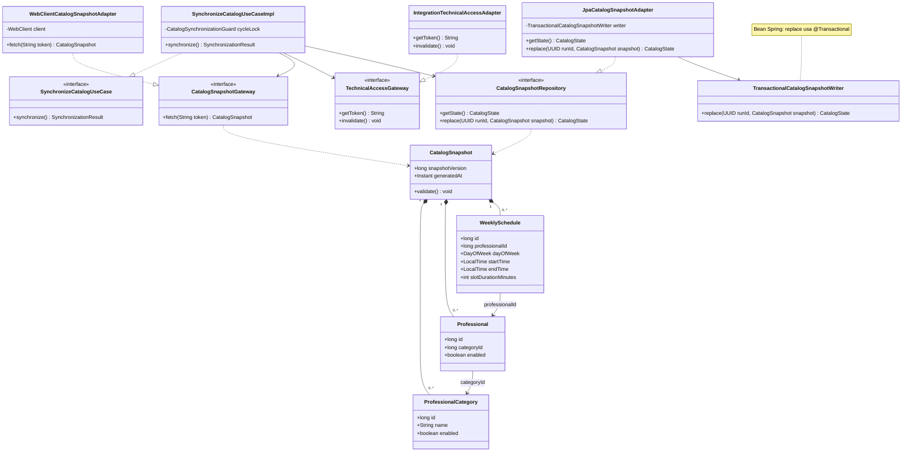
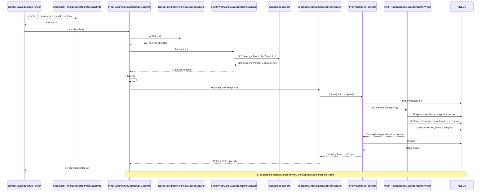

# PLAN: Inicializar o reconstruir el catálogo mediante snapshot

**SPEC de referencia:** [SPEC.md](SPEC.md)
**Versión de la spec revisada:** aprobada el 2026-10-17; decisión adicional de versiones menores confirmada durante este PLAN.
**Estado:** Aprobado <!-- Borrador | En revisión | Aprobado -->

**Aprobación del usuario:** 2026-10-17, con bean escritor `@Transactional` y refactorización compartida en commit previo separado.

<!-- PARA LA PERSONA
Este documento define la solución técnica. Una vez revisado, el agente puede
derivar TASKS.md con tareas, dependencias y comprobaciones.
-->

<!-- PARA EL AGENTE
- Lee la SPEC aprobada, las instrucciones y las fuentes del backend.
- Inspecciona el repositorio. Referencia rutas verificadas y distingue las nuevas propuestas.
- Propón una solución proporcional; reutiliza lo existente y justifica incorporaciones.
- Distingue hechos, decisiones confirmadas y propuestas. Consulta decisiones no resueltas.
- Referencia RF/CA sin copiar la SPEC. Un cambio funcional requiere confirmación.
- Conserva estos comentarios. No implementes durante la planificación.
- Solicita aprobación antes de marcar el plan como Aprobado. Implementar requiere
  autorización explícita, no se deduce del estado de los documentos.
-->

## Contexto técnico verificado

<!-- Qué existe hoy y cómo participa en la funcionalidad. Rutas relativas al repositorio. -->

| Componente existente | Ruta verificada | Uso previsto |
| --- | --- | --- |
| Stack y pruebas | `pom.xml` | Java 25, Boot 4.1.1, JPA/Hibernate, MySQL, Flyway, WebClient, JUnit/Mockito/AssertJ y Testcontainers ya disponibles. |
| Acceso técnico | `src/main/java/com/prog2/catalog/integration/domain/ports/in/` | Reutilizar `InitializeIntegrationUseCase` y `GetTechnicalTokenUseCase`. |
| Adquisición y sesión | `integration/application/usecases/`, `integration/domain/model/IntegrationSession.java` bajo el paquete base | Conservar estados, reintentos iniciales y JWT solo en memoria. |
| Arranque | `infrastructure/startup/CatalogStartupRunner.java` | Sustituye al runner técnico inicial; controla un executor y tres intentos técnicos antes del ciclo de snapshot. |
| Configuración | `infrastructure/config/CatalogConfiguration.java`, `IntegrationProperties.java`; `integration/infrastructure/config/IntegrationConfiguration.java` | T-01 separa propiedades/reloj compartidos del wiring del slice; el runner técnico se conserva hasta T-05. |
| Cliente central | `integration/infrastructure/client/adapter/WebClientCentralIntegrationAdapter.java` | Mantener login y consulta de integración; nuevo cliente específico para snapshot. |
| Persistencia | `src/main/resources/application.yaml` | Flyway activo, `ddl-auto: validate`, sin Open Session in View ni tablas productivas de catálogo. |
| Regresión | `src/test/java/com/prog2/catalog/`, `src/test/resources/db/migration/V1__setup_probe.sql` | Pruebas existentes de integración, seguridad y arranque. La versión 1 está usada por el fixture de setup. |

**Convenciones y patrón de referencia:** skill `hexagonal-arch`, estructura del profesor y aclaraciones de configuración/paquetes. Dominio sin Spring/JPA/Jackson; aplicación consume sus propios puertos; infraestructura adapta HTTP, JPA y la colaboración entre slices. Constructor explícito, sin `@Autowired` ni Lombok `@Data`. Javadoc en español sobre contratos, transacción, reintentos e incertidumbre del commit.

**Decisiones confirmadas con el usuario:** slice `synchronization` separado de `integration`, comunicación por puertos públicos, reemplazo en una sola transacción con bean escritor `@Transactional` y conservación del snapshot validado durante los reintentos locales. Tres intentos totales, pausa de 5 s; HTTP con conexión 5 s, lectura 10 s y límite global 20 s. Rechazar versiones menores. Refactorización compartida primero, en commit separado. La aprobación del PLAN no autoriza por sí sola la implementación.

## Solución propuesta

<!-- Explica enfoque, motivos y recorrido. Los diagramas muestran componentes de este PLAN. -->

1. Un coordinador de arranque ejecuta primero el ciclo técnico existente. Solo si termina disponible invoca `SynchronizeCatalogUseCase`; un fallo del snapshot no invalida el JWT salvo rechazo 401/vencimiento.
2. El caso de sincronización obtiene el token a través de un puerto propio y descarga el snapshot mediante WebClient síncrono. Convierte/valida antes de abrir la transacción de reemplazo.
3. El repositorio sustituye las tres colecciones y los metadatos en una transacción MySQL. Al confirmar, devuelve la versión aplicada. No se hace HTTP ni se espera entre reintentos dentro de una transacción.
4. Los fallos temporales se reintentan hasta el límite. Después de descargar una copia válida, los intentos restantes reutilizan esa copia. Un UUID de ejecución, confirmado con los datos, permite resolver un resultado de commit incierto.
5. Se conserva estado de copia y diagnóstico para las futuras consultas; no se añaden sus endpoints ni se presenta un snapshot aplicado como garantía de vigencia permanente.

### Clases y dependencias principales

Vista centrada en el caso de uso. Las entidades JPA, DTO y configuración se detallan en las tablas para no duplicar el mismo modelo en el diagrama. `<<interface>>` identifica contratos; la flecha discontinua con triángulo indica implementación, y la composición indica las colecciones del snapshot.

Los tres adaptadores aplican **Adapter**: implementan los contratos esperados por el caso de uso usando WebClient, los puertos públicos de `integration` y JPA. El puerto de persistencia cumple el papel de **Repository**. Depender de esas interfaces aplica DIP; constructor y transacciones son mecanismos de Java/Spring, no patrones añadidos al dominio. No se incorpora una fachada por mera delegación ni una jerarquía de reintentos.

### Secuencia de una carga correcta

Las instancias tienen los mismos nombres de clase que el diseño anterior, salvo el coordinador y el caso técnico existente, descritos en la tabla de cambios. El proxy es generado por Spring: permite mostrar que el commit ocurre después de terminar el cuerpo del escritor y antes de devolver el control al adaptador. Los caminos de fallo se precisan debajo.

## Módulos y componentes afectados

<!-- No introducir módulos de build por defecto. Distinguir cambios existentes y propuestas. -->

No hay módulos Maven adicionales. Los siguientes son paquetes del backend actual.

| Área | Existe / nueva | Responsabilidad | Dependencias |
| --- | --- | --- | --- |
| `synchronization` | Nueva | Snapshot, modelos del catálogo, consistencia y estado de aplicación. Reúne las tres colecciones. | Dominio propio; infraestructura utiliza puertos públicos de `integration`. |
| `integration` | Existente | Cuenta y sesión técnica; publicar una operación de invalidación sin exponer repositorios. | No importa modelos ni infraestructura de `synchronization`. |
| `infrastructure/config`, `infrastructure/startup` | Existente / nuevo | Configuración compartida y composición del arranque entre puertos públicos. | Cableado de ambos slices; sin reglas de catálogo. |

Rutas bajo `src/main/java/com/prog2/catalog/`, salvo indicación contraria:

| Componente o ruta propuesta | Acción | Responsabilidad | RF |
| --- | --- | --- | --- |
| `synchronization/domain/model/` | Crear | `CatalogSnapshot`, `ProfessionalCategory`, `Professional`, `WeeklySchedule`, `CatalogState`, `SynchronizationResult`. Valores inmutables; relaciones por ID. | RF-02/03/04/05 |
| `synchronization/domain/enums/`, `domain/exception/` | Crear | Fases y fallos clasificados del contrato, sin tipos externos ni causas con secretos. | RF-06/07/08 |
| `synchronization/domain/ports/in/SynchronizeCatalogUseCase.java` | Crear | Entrada de carga completa, reutilizable por la futura recuperación. | RF-01 |
| `synchronization/domain/ports/out/` | Crear | `CatalogSnapshotGateway`, `TechnicalAccessGateway`, `CatalogSnapshotRepository`. El repositorio también registra inicio/resultado del intento, sin borrar la versión confirmada. | RF-02/04/06/08 |
| `synchronization/application/usecases/SynchronizeCatalogUseCaseImpl.java` | Crear | Validación, coordinación del ciclo, reintentos e interpretación de incertidumbre; depende solo de sus puertos/modelos y JDK. | RF-01 a RF-08 |
| `synchronization/infrastructure/client/adapter/`, `client/dto/`, `client/mapper/` | Crear | `WebClientCatalogSnapshotAdapter`, DTO de las cuatro estructuras JSON y mapper manual. HTTP/JSON se convierte a dominio. | RF-02/03/08 |
| `synchronization/infrastructure/integration/adapter/IntegrationTechnicalAccessAdapter.java` | Crear | Traduce el puerto propio a `GetTechnicalTokenUseCase` y al nuevo puerto público de invalidación de `integration`. No accede a su repositorio ni a su estado interno. | RF-02/08 |
| `synchronization/infrastructure/persistence/entity/`, `repository/`, `mapper/`, `adapter/` | Crear | Cuatro entidades/tablas, repositorios Spring Data, mapper manual y `JpaCatalogSnapshotAdapter`, que adapta errores del puerto. | RF-04/05/06/07 |
| `synchronization/infrastructure/persistence/service/TransactionalCatalogSnapshotWriter.java` | Crear | Bean escritor separado, inyectado al adaptador; `replace` aplica y confirma la unidad completa con `@Transactional`. | RF-04/05/07 |
| `synchronization/infrastructure/config/SynchronizationConfiguration.java` | Crear | Cliente, tiempos y dependencias de persistencia del slice. | RF-02/07 |
| `integration/domain/ports/in/InvalidateTechnicalAccessUseCase.java`, `application/usecases/InvalidateTechnicalAccessUseCaseImpl.java` | Crear | Invalidar la sesión existente, sin login ni renovación. Reutiliza el repositorio propio de `integration`. | RF-08 |
| `infrastructure/config/CatalogConfiguration.java` | Crear / trasladar cableado | Proveer propiedades y reloj compartidos; construir el coordinador. Mover aquí la validación temprana sin duplicar beans. | RF-01/08 |
| `infrastructure/config/IntegrationProperties.java` | Trasladar | Mantener nombre, contrato `CATEDRA_*`, validación y redacción de valores del archivo hoy dentro de `integration`. | RF-01/02/08 |
| `infrastructure/startup/CatalogStartupRunner.java` | Sustituir coordinador actual | Mantener executor, interrupción, unicidad y política técnica; después de AVAILABLE llamar al nuevo caso. Consume los puertos de inicialización, invalidación y sincronización. | RF-01/07/08 |
| `integration/infrastructure/config/IntegrationConfiguration.java` | Modificar | Conservar únicamente wiring específico del cliente técnico; actualizar imports de propiedades y retirar reloj/coordinador trasladados. | RF-01/08 |
| `src/main/resources/db/migration/V2__catalog_snapshot.sql` | Crear | Primera migración productiva del catálogo; usa V2 para no colisionar con el fixture V1 de setup. No renumerar migraciones aplicadas. | RF-04/05 |
| `src/test/`, `README.md`, documentos de integración afectados | Modificar | Actualizar imports/arranque, añadir escenarios, explicar ejecución y mantener diagramas previos coherentes con los traslados. | CA-01 a CA-09 |

## Datos y contratos

<!-- Modelos, identificadores, persistencia y compatibilidad; sin APIs futuras especulativas. -->

- **Entrada/salida:** el HTTP externo conserva exactamente el contrato de la sección 7 del anexo. Los DTO usan valores que permitan distinguir campo ausente de `false`/`0`; no convertir una colección ausente en lista vacía. JSON extra compatible se ignora; no se aceptan tipos incompatibles por coerción. El caso devuelve `SynchronizationResult` con resultado/diagnóstico seguro, no JWT ni DTO HTTP. Sin endpoint público nuevo.
- **Validación:** tres listas presentes, elementos interpretables, IDs únicos dentro de cada colección, referencias existentes en el mismo snapshot y valores de día/hora/instante válidos. `CatalogSnapshot.validate()` comprueba consistencia del conjunto; el mapper comprueba la representación externa. Conservar estados deshabilitados. No exigir IDs consecutivos ni inventar una versión inicial, longitudes de nombre o reglas de agenda no especificadas. Validar versión menor nuevamente dentro de la transacción para comparar con la última confirmada; versión igual se admite.
- **Horas e instantes:** `DayOfWeek`, `LocalTime` para ambos formatos contractuales e `Instant` para UTC. Instantes con precisión MySQL de microsegundos y conversión JDBC/Hibernate en UTC. Usar `hibernate.type.java_time_use_direct_jdbc=true` para que `LocalTime` no pase por la conversión de zona de `java.sql.Time`; una prueba real verifica `09:00:00` en SQL con JVM local fuera de UTC. No convertir horarios semanales a instantes con una zona inventada.
- **Tablas InnoDB:** `professional_category`, `professional`, `weekly_schedule` y `catalog_sync_state`. IDs externos `BIGINT` asignados, sin `@GeneratedValue`. FKs categoría/profesional con índices, `enabled` obligatorio y sin borrado en cascada. Textos con capacidad compatible con el payload admitido, sin añadir límites funcionales de longitud. No heredar una clase de auditoría inexistente: los tiempos externos se conservan como campos explícitos.
- **Metadata:** una fila de control creada por migración, con versión aplicada nullable, `applied_run_id`, `generated_at`, `applied_at` y último intento/resultado seguro. Versión nula indica ausencia de copia confirmada; tres listas vacías con versión no nula son un catálogo aplicado. Un UUID identifica la aplicación de ese snapshot y se guarda junto con sus datos; no reemplaza `snapshotVersion`.
- **Reemplazo:** `JpaCatalogSnapshotAdapter` invoca al bean inyectado `TransactionalCatalogSnapshotWriter`. Su método público `replace`, anotado `@Transactional(propagation = REQUIRES_NEW, timeout = 20)`, abre una transacción nueva para cada intento. Bloquea la fila de metadata, comprueba la versión, borra horarios/profesionales/categorías, limpia el contexto JPA tras borrados masivos e inserta categorías/profesionales/horarios en ese orden, con flush entre dependencias. Finalmente actualiza metadata; Spring confirma antes de regresar al adaptador. Usar DELETE transaccional, nunca TRUNCATE, DDL, desactivar FKs o commits por colección.
- **Elección transaccional confirmada:** usar `@Transactional` en el bean escritor separado. El adaptador permanece fuera de la transacción de escritura y rodea la llamada al escritor con `try/catch`; así traduce también los errores del commit que realiza el proxy. El escritor es otro bean: llamarlo mediante `this`, crearlo con `new` desde el adaptador o llamar un método privado eludiría ese límite transaccional. Las lecturas de metadata del adaptador usan repositorios Spring Data en una transacción nueva de lectura, sin un contexto exterior que conserve datos antiguos durante la reconciliación. No se incorpora TransactionTemplate. [Spring, transacciones declarativas y proxies](https://docs.spring.io/spring-framework/reference/data-access/transaction/declarative/tx-decl-explained.html).
- **Lecturas concurrentes:** SELECT ordinarios de InnoDB pueden leer la copia confirmada anterior durante la escritura. Una consulta que combine varias tablas y versión debe hacerlo en una sola transacción de lectura `REPEATABLE_READ`, no en consultas autocommit independientes; probarlo ahora y conservar el requisito al implementar CU-04/05/06. [Aislamiento MySQL 8.4](https://dev.mysql.com/doc/refman/8.4/en/innodb-transaction-isolation-levels.html).
- **JPA y volumen:** mantener el stack elegido. `saveAll` con IDs externos puede usar merge y no es una carga masiva optimizada; controlar el orden/flush y comprobar SQL en pruebas. No añadir Spring Batch, JDBC masivo ni parámetros de rendimiento sin evidencia de necesidad. [Persistencia Spring Data JPA](https://docs.spring.io/spring-data/jpa/reference/jpa/entity-persistence.html).
- **Compatibilidad:** conservar tablas, health y seguridad existentes. No tocar `.env`, claves o datos de Turnos. La primera migración productiva puede comenzar en V2; el fixture de setup sigue solo en test. Probar arranque limpio y actualización de una base existente sin borrar volúmenes.

## Estado, operaciones y errores

<!-- Referencia RF/CA. No hay estado de UI ni consideraciones mobile en este backend. -->

- **Estado:** distinguir ausencia de copia, ejecución en curso, snapshot aplicado, fallo y resultado no verificable. `SNAPSHOT_APPLIED` significa consistencia en esa versión, no `CURRENT`. La metadata describe la última aplicación confirmada y el último intento; el caso conserva el estado de su ejecución actual en memoria para no informar éxito si no pudo guardar un diagnóstico. CU-06 definirá su exposición, sin confundir un intento histórico interrumpido con una tarea activa después de reiniciar.
- **Arranque y ejecución:** `CatalogStartupRunner` sustituye al runner técnico porque ahora coordina dos casos de uso, fuera de ambos slices. Conserva `ApplicationReadyEvent`, un solo executor y el ciclo técnico actual. El caso de snapshot controla su propio ciclo de hasta tres intentos; ambos presupuestos son independientes. No usar dos listeners concurrentes esperando que el login termine primero, polling ni eventos de negocio nuevos. Error de snapshot no revierte un login READY; excepción del arranque técnico sí conserva su tratamiento anterior.
- **Concurrencia:** `CatalogSynchronizationGuard.trySynchronize()` protege el ciclo completo de snapshot; otra invocación devuelve ocupado sin duplicar descarga ni reemplazo. El bloqueo de metadata coordina la escritura DB y evita publicar una versión menor. El despliegue actual tiene una instancia; no se añade elección de líder para múltiples réplicas. CU-02/03 respetan la misma exclusión de escritura.
- **Reintentos:** tres intentos totales por ciclo de snapshot, incluidos descarga/guardado; no tres por cada fase ni reintentos ocultos del cliente. Pausa fija de 5 s solo si queda otro intento. Cachear únicamente el candidato validado durante ese ciclo. Cada reintento de DB utiliza una transacción nueva, sin reutilizar una transacción marcada rollback-only. Descartar candidato al terminar el ciclo.
- **Organización interna del ciclo:** separar preparación del candidato, aplicación, clasificación del fallo, pausa y reconciliación en métodos privados. `SnapshotCycle` agrupa exclusivamente el estado de una llamada y se descarta al finalizar; no es un bean, un puerto ni una sesión compartida. El bucle conserva un único presupuesto y las mismas transacciones. El mapper de persistencia construye `WeeklyScheduleEntity` con el horario completo, evitando nueve argumentos posicionales; la dependencia permanece desde infraestructura hacia dominio.
- **Resultado incierto:** reutilizar un único `runId` para el candidato. Si el commit pudo completarse antes del error de conexión, leer metadata en una transacción nueva: `applied_run_id == runId` significa aplicado y evita otra escritura; si no coincide, bloquear la fila al reintentar y volver a comprobar antes de sustituir. Si no se puede verificar, conservar estado no verificable y reintentar solo dentro del límite, comenzando por esa comprobación. El registro final devuelve la metadata bajo el mismo bloqueo y conserva un éxito confirmado mientras esperaba, evitando sobrescribirlo con un fallo. No informar rollback demostrado ni catálogo vigente sin evidencia.
- **Reinicio/cierre:** interrumpir el executor y respetar la interrupción antes del siguiente intento. Un cierre interrumpe la descarga/espera y evita trabajo nuevo; si un commit ya ocurrió, verificar/preservar el resultado y no intentar deshacerlo. MySQL confirma o revierte la unidad completa al perder conexión. El siguiente arranque vuelve a descargar snapshot según RF-01, sin persistir candidatos HTTP ni JWT.
- **Diagnóstico:** códigos internos acotados y seguros; no conservar causas que impriman HTTP/JWT/credenciales ni cuerpos centrales. Si MySQL cae, conservar la copia no garantiza poder consultarla mientras la base esté inaccesible; no agregar otra caché para simular disponibilidad. La política de búsquedas previas aplica cuando esos datos siguen accesibles.

| Condición | Clasificación y resultado |
| --- | --- |
| Red, timeout HTTP, HTTP 500/503 | Temporal; repetir dentro del límite. |
| HTTP 401 o token vencido antes de la descarga | Invalidar mediante puerto público de `integration`; terminar sin login ni renovación. |
| Otros rechazos HTTP, JSON/tipos/referencias inválidos o versión menor | Terminal; conservar la copia y diagnóstico. Leer `code` si existe, sin decidir por `detail`. |
| Bloqueo temporal/deadlock o caída transitoria de conexión DB | Adaptador clasifica como recuperable; nueva transacción y candidato conservado. |
| Commit con confirmación perdida | Resultado incierto; verificar runId antes de repetir o informar resultado. |
| Restricción de integridad, esquema incompatible o fallo no recuperable DB | Terminal; no ocultar el defecto con reintentos. |

Las clases de Spring/SQL que permiten esa clasificación se quedan en el adaptador; la aplicación recibe un fallo propio del puerto con categoría y diagnóstico seguro. No usar un `catch` genérico que reintente cualquier error.

## Dependencias y configuración

<!-- Reutilizar herramientas existentes y justificar cambios. -->

- Sin librerías nuevas ni cambio de versiones: WebClient síncrono, JPA/Hibernate, Flyway SQL, MySQL 8.4.8 y herramientas de pruebas actuales.
- Mover `IntegrationProperties` y el reloj UTC a configuración raíz. Mantener las variables y validación actuales; `IntegrationSession` y configuración dinámica recibida de cátedra siguen en su slice, no se convierten en propiedades estáticas.
- El cliente de snapshot recibe solo URL base, mapper y tiempos por constructor; las credenciales de login permanecen en el cliente técnico. Propuesta de límite de respuesta en memoria: 8 MiB, fijo y explícito, para no depender del valor predeterminado del cliente; un exceso termina con diagnóstico seguro. Verificarlo con el volumen real antes de la entrega.
- Conexión 5 s, lectura 10 s y límite global HTTP 20 s. La lectura limita esperas de red; el límite global impide prolongar indefinidamente una descarga que gotea datos. No introducir variables adicionales para los valores fijos acordados. Conservar timeouts de conexión/socket DB existentes y definir límite transaccional inicial de 20 s; no afirmar que eso limita por sí solo cada fase de conexión/commit.
- Mantener Compose/red compartida, montaje de pública y transporte local ya documentados; este issue no cambia JWT, CORS, CSRF ni el endpoint de entrega a Turnos.

## Estrategia de validación

<!-- Una fila por CA, escenarios observables y defectos plausibles. Resultados reales en TASKS. -->

| Criterio | Método y test propuesto/existente | Entorno/datos | Evidencia prevista |
| --- | --- | --- | --- |
| CA-01 | Ampliar `CatalogApplicationTests` y prueba del coordinador: login, snapshot y reinicio con copia previa; sin acceso no hay snapshot. | HttpServer ficticio, JWT ficticio y MySQL Testcontainers. | Orden login→snapshot, cada arranque carga y no aparece login extra por la carga. |
| CA-02 | `CatalogSnapshotPersistenceTests`: dos copias distintas, IDs retirados/deshabilitados y aplicación repetida. | Repositorios, mapper y transacciones reales sobre MySQL. | Filas y versión exactas, sin residuos, duplicados ni ID regenerado. |
| CA-03 | `CatalogSnapshotValidationTests` y `CatalogSnapshotClientTests`: colecciones ausentes, duplicados, tipos/referencias inválidos y versión menor. | Dominio real y HTTP ficticio; DB para verificar rechazo de retroceso dentro del bloqueo. | Rechazo completo; no omitir entradas ni avanzar metadata. |
| CA-04 | `CatalogSnapshotPersistenceTests`: pausar un escritor antes de commit y leer desde otra conexión en una transacción RR. | Latches/futures, MySQL real; sin mock de transacción. | Copia anterior durante reemplazo y nueva tras commit; lectura de varias tablas no mezcla versiones. |
| CA-05 | Confirmar una copia, fallar tras borrar/insertar parcialmente y reiniciar contexto/conexión; prueba controlada de corte antes del commit. | Mismo contenedor/DB entre contextos, fallos deterministas en SQL o frontera de commit. | Rollback verificable, metadata anterior intacta y descarga nueva al reiniciar. |
| CA-06 | Primera copia vacía frente a metadata sin versión. | Snapshot de tres listas vacías y DB inicial. | Copia vacía aplicada diferenciada de ausencia de inicialización. |
| CA-07 | `SynchronizeCatalogUseCaseTests` para límites/pausas/candidato; DB real para rollback y reconciliación. Provocar commit confirmado cuya respuesta del puerto se pierda y otra variante sin commit; verificar que el adaptador traduce un error al volver del proxy escritor. | Clock fijo, duraciones de test reducidas, escritor inyectado como bean Spring y puertos externos controlados. | Tres intentos totales, sin otra descarga tras candidato válido, sin escritura duplicada ni declarar fallo de un commit comprobado. |
| CA-08 | 401, vencimiento y errores sin `code`; probar invalidación con casos de uso reales de `integration`; capturar logs. | HttpServer, sesión ficticia, cliente real; sin mockear la validación que se comprueba. | Sesión invalidada sin nuevo login, diagnóstico seguro y sin efectos sobre JWT de usuarios/servicio. |
| CA-09 | JSON con `HH:mm`, `HH:mm:ss`, días de semana y UTC; round trip de entidades. | Mapper real, HTTP ficticio y MySQL. | Habilitación, IDs, referencias y semántica temporal conservados. |

**Diseño de pruebas:** aplicar `test-design-first`. Preferir dominio real para validación y MySQL real para consistencia/FKs/commit; Mockito sirve para simular límites externos y observar ausencia de efectos, no para reemplazar el caso de uso bajo prueba. Los fallos de commit se simulan en la frontera después de una transacción real para comprobar reconciliación; el corte de conexión previo verifica rollback real. No afirmar que una simulación reproduce todos los fallos físicos del servidor. No usar `sleep` para adivinar cuándo terminó otro hilo.

**Regresiones:** adaptar las pruebas del runner y sus imports al nuevo coordinador conservando escenarios de PENDING, límite, fallos inesperados e interrupción. El HTTP ficticio deberá contestar también snapshot; `CatalogApplicationTests` ya no puede asumir una sola solicitud total, pero sí un único login y ninguna renovación causada por snapshot. Mantener las pruebas JWT, ausencia de sesiones, health y validación temprana. Probar 401 con sesión real para que el endpoint interno deje de entregar token utilizable.

**Comandos existentes:** `./mvnw -B -ntp clean verify` para suite y JaCoCo; `git diff --check`. Durante la implementación, verificaciones enfocadas por escenario y luego suite completa. Sonar CLI/IDE y Cloud/Actions según acceso disponible, sin exclusiones para ocultar fallos. No se ejecutó build por preparar este PLAN.

**Ejecución manual prevista:** JAR local y Compose con MySQL aislado, cuenta/servidor ficticios y pública de prueba. Observar carga al arrancar, copia tras reinicio y conservación ante fallo de descarga. No desplegar cátedra ni tocar los volúmenes o secretos de desarrollo. La conexión real y el volumen del snapshot central se comprobarán cuando corresponda, sin sustituir los tests aislados por esa dependencia.

**Dispositivo/emulador:** no aplica, sin cambios KMP. **Límites:** consultas de usuarios/Turnos y recuperación incremental se prueban al incorporar sus CU; aquí se prueban las garantías del almacenamiento y el contrato de carga.

**Revisión documental del 2026-10-17:** enlaces locales y cobertura de los nueve CA comprobados; ambos diagramas pasan el parser Mermaid 12.1.0. La apariencia renderizada no fue revisada. Escaneo de secretos sin hallazgos. Estas comprobaciones no equivalen a pruebas de implementación, todavía inexistente.

## Orden de implementación

<!-- Secuencia principal; TASKS se deriva después de revisar y aprobar este PLAN. -->

1. Separar únicamente propiedades/reloj/configuración compartidos, actualizar imports, pruebas y documentación relacionadas, y verificar regresión técnica sin cambiar su política. El runner técnico mantiene su comportamiento; todavía no se agrega dependencia de snapshot. Entregar este ajuste para un commit independiente del usuario antes de implementar sincronización.
2. Incorporar modelos, validación y cliente HTTP de snapshot. Verificar contrato, errores, tiempos y no exposición de secretos.
3. Crear migración/entidades/repositorios/mapper y adaptador transaccional. Verificar reemplazo, rollback, FK, lector concurrente y reconciliación.
4. Incorporar el puerto público de invalidación y conectar caso de uso, adaptador de acceso técnico y nuevo coordinador de arranque; comprobar reintentos, reutilización del candidato e interrupción. Mantener los dos estados, acceso técnico y sincronización, separados.
5. Actualizar documentación afectada, ejecución reproducible y evidencias en TASKS. Ejecutar verify/JaCoCo, revisión de calidad y después checks remotos tras publicación del usuario.

Por decisión explícita del usuario, la refactorización compartida se entrega primero, verificada y en un commit separado. La implementación concreta de snapshot va después, en su propia unidad funcional. El usuario realiza las operaciones Git; el agente no prepara staging ni commits.

## Riesgos y decisiones pendientes

<!-- Riesgos concretos, sin listas genéricas ni decisiones funcionales inventadas. -->

- **Riesgos y medidas:** JPA puede resultar costoso para un catálogo grande; comprobar tamaño real/SQL antes de optimizar. Descarga y mapeo no mantienen una transacción abierta. Commit incierto exige runId confirmado, no suponer rollback. Lecturas multitabla deben ser RR; los futuros endpoints no pueden dividir esa unidad. Si se reinician versiones en cátedra, el rechazo de versiones menores requerirá una decisión explícita, no borrado automático de datos. El estado de sincronización nunca sustituye la validación del JWT ni viceversa.
- **Decisiones pendientes:** ninguna. El usuario aprobó el diseño con `@Transactional` y bean escritor separado. La refactorización compartida sigue como entrega previa en commit separado. Las tareas se derivaron en [TASKS.md](TASKS.md); la ejecución requiere autorización explícita.

<!-- ANTES DE SOLICITAR APROBACIÓN
Comprueba requisitos, exclusiones, dependencias y criterios. Si cambia la SPEC,
revisa su impacto. Tras aprobar el PLAN deriva TASKS con IDs, dependencias,
referencias y comprobaciones; implementar requiere autorización explícita.
-->

## Ajuste técnico del 2026-10-27

El PLAN aprobado de [consultas de agenda/estado](../consulta-agenda-estado/PLAN.md)
sustituye el bloqueo suelto por `CatalogSynchronizationGuard`, con acceso exclusivo
reentrante para CU-01/02/03 y compartido para lecturas. Un snapshot invalida la
verificación de esta ejecución; solo una comprobación o incremento confirmado
vuelve a habilitarla. Se conservan los presupuestos, transacciones, runId y
reconciliación de CU-01. Impacto: coordinación y regresiones concurrentes, sin
cambio de alcance ni aceptación de esta SPEC. Evidencia en TASKS de consultas.
